# Does Physical Layout Matter on a Weight-Stationary CIM System?

*A progress report. Every number below has a committed, re-runnable source
(named in each table); figures are generated by the same scripts. The reader
is assumed to start from zero: each section relies only on what came before.*

---

## 1. The system and the question

### 1.1 What the system is

A ReRAM compute-in-memory (CIM) inference machine is a nesting of grids:

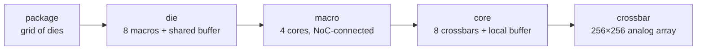

The defining property: **weights are written into the crossbar cells once and
never move again**. Multiplication happens where the weights sit. What moves
at runtime is only (a) input activations and (b) partial sums:

| level boundary | going down (inputs) | going up (outputs) |
|---|---|---|
| buffer → macros | each input slice **multicast** to the macros that share it | partial sums **merge** at the buffer |
| macro → cores | same, one level down | same, one level down |
| core → crossbars | same | analog columns already sum inside the array |
| die → die | the finished **layer output** (hidden state) crosses to the die holding the next layer | — |

So there are two very different traffic classes: a heavy multicast/reduction
flood **inside** the die, and a thin stream of finished layer outputs
**between** dies. Section 6 shows this asymmetry is load-bearing.

### 1.2 What the layout decisions are

Going down the hierarchy, someone (today: nobody — these are implicit
defaults) decides:

1. **Which die holds which layer** (the package-level assignment);
2. **Which macro/core/crossbar holds which weight block** inside a die;
3. **Where the shared buffer attaches** on the die's grid;
4. **How the wires are organised** — a private link per unit, a routed grid,
   a tree, or one shared bus.

### 1.3 The question

Do these decisions change **energy**, **single-request latency**, or
**throughput**? By how much, and through what mechanism? (This section
deliberately gives no answer.)

---

## 2. The instrument, and how to read its numbers

We extended the CiMLoop simulator (Timeloop + Accelergy with CIM device
models) so that the questions above become measurable:

- **Real traffic structure**: multicast counted once, idle units carry zero,
  volumes reconciled against the simulator's own access counters (a
  divisibility guard raises on any disagreement).
- **Per-level link pricing**: every wire's energy/latency parameters are
  explicit inputs; anything not yet priced is an explicit zero, never a
  hidden guess.
- **Bandwidth occupancy**: each wire moves a finite number of words per
  device cycle; traffic beyond that serializes. Every flow is routed onto the
  physical wires its interconnect scheme dictates, so shared wires accumulate
  load.
- **Cross-die topology**: dies sit on a package grid with the same routed
  model, one level up.

**Workload and configuration.** GPT-2 medium (24 identical transformer
blocks, d=1024), sequence length 512 — both inference phases: *prefill*
(the whole 512-token prompt processed at once) and *decode* (one generated
token at a time) — on a 24-die package example configuration; each operator is mapped by Timeloop onto one die (8 macros ×
4 cores × 8 crossbars = 256 arrays). The model is deliberately small enough
that every single operator fits inside one die — Section 6 examines what
changes when that stops being true.

**Basis note (O12).** All 355M numbers below are on the **co-residency
basis**: each operator is mapped inside its own array share of the 48-die
seating, which forbids the weight replication an exclusive die allows (the
mapper otherwise duplicates small operators' weights into idle arrays, up
to 8 copies). Without replication every prefill operator computes in
5.19 ms; the stall-free stack is 813.1 ms (92% compute, 8% K/V write);
decode is unchanged. The earlier exclusive-die basis remains frozen as the
v1 fixture.

**Accounting note (O22/O23).** Since 2026-08-21 the wires are accounted
physically: inputs travelling down and partial sums travelling up are
routed separately, point-to-point schemes are full-duplex (one wire set
per direction — the convention every published anchor uses; a bus stays
one shared medium), and partial sums are counted at 16 bits (platform
input; W4×A8 sums over K rows are 12+log₂K bits) against 8-bit
activations. Compute, write and energy are unchanged; every contention
multiplier and threshold moved — up, because the partial-sum width
outweighs the relief of separate wires (the earlier numbers understated
contention). The previous accounting is reproducible on request and kept
as the v2 fixture; the four-way comparison is in §5.2.

**Digital unit note (O24).** Since 2026-08-21 the block's non-matmul
operators — softmax, GELU, LayerNorm ×2, residual adds ×2 — are in every
total. They run on a modeled digital vector unit next to the glb
(`fabric.digital`, platform input DR-8; shipped generic: 64 lanes @ 1 GHz,
Horowitz per-op energies), closed-form: energy = glb passes × the
calibrated 15.47 pJ/word + arithmetic; latency = arithmetic / (lanes ×
clock), serial with the matmuls. At the generic configuration they add
+8.9 mJ (+3.1%) and +13.4 ms (+1.1%) to 355M prefill; decode is
unaffected in practice. softmax leaves with the attention under offload.
The embedding read (priced, not timed) and the LM head (a 7-die matmul,
last token only) complete the model. The v3 fixture keeps the
matmul-only stack; v4 adds the four elementwise rows.

**Two reading rules**, used everywhere below:

1. **A ratio is not a result until multiplied by its level's share.** "The
   network cost doubled" means nothing until you know the network is 0.65% of
   the total. Every table carries the share.
2. **Wire bandwidths are not calibrated to a real chip yet** — they are
   platform inputs with example defaults. The valid form of any
   bandwidth-dependent result is therefore a **threshold** ("below X the
   effect appears") and an **ordering**, never an absolute milliseconds
   claim. Where absolute units appear they are conversions of the example
   inputs, marked as such.

---

## 3. Conclusion 1 — Layout barely changes energy, at any level

### 3.1 The measurements, side by side

| level | what was varied | ratio at that level | that level's share | system effect | source |
|---|---|---|---|---|---|
| macro network (priced) | grid vs line arrangement; full setting sweep | 1.5× – 3.0× | router = 0.65% of a block | **≤ 0.34%** | `analyze_position_aware.py` |
| crossbar map (unpriced level) | corner vs centre position | 1.50× (2×4 die layout; 3.62× on the 3×3 variant) | level carries no energy price | ranking only (honest note: not in totals) | `crossbar_comm.py` |
| core regions (unpriced level) | which cores six matmuls occupy | 17.8% | same | ranking only | `analyze_region_locality.py` |
| die-to-die (priced) | worst vs best unit→die ordering (feasible 48-die config, 2 dies/layer) | +1.37 mJ per pass | vs 287.5 mJ total | **+0.48%** | `analyze_d2d.py` |

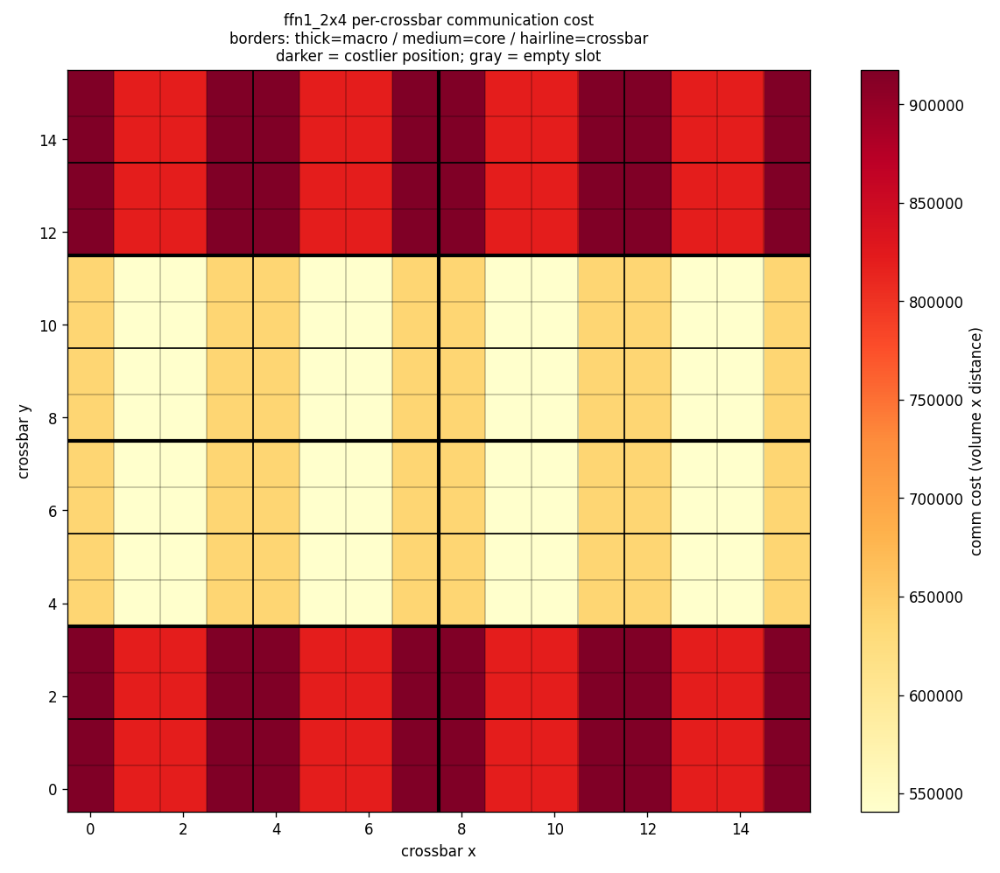

*The per-crossbar map: identical traffic per crossbar, cost varying only with
position — a ranking a placement search can consume, honestly labelled as not
yet priced in joules.*

### 3.2 Why energy is nearly layout-blind

Energy **sums** over all traffic, and the bulk of every word's cost is fixed
regardless of where it travels: buffer entry/exit, digital↔analog conversion,
and array driving are paid identically whether the destination is one hop or
five hops away. Layout only changes the *extra hops* increment, and the base
that increment multiplies (the on-die network) is ~1% of the system. Between
dies, the volume itself is structurally pinned: only finished layer outputs
cross (12.1M words per pass, against 13,100M words on the on-die network —
three orders of magnitude), so no reordering of dies can move much energy.

### 3.3 Robustness of the conclusion

- Multiply the on-die network's unit price **10×**: the worst layout effect
  grows 0.34% → 3.4% of a block — still single digits.
- Charge cross-die transfers for **every** hop (instead of only hops beyond
  the first, which the flat port already bills): the worst ordering costs
  1.61 mJ = **0.56%** of a pass.

The conclusion survives both.

---

## 4. Conclusion 2 — Layout does affect *time*, through exactly one mechanism

### 4.1 Time is a maximum, not a sum

Latency is set by the slowest term on the critical path, so a term with tiny
energy can own the time entirely. A layout-independent example pins this
down: the ReRAM write of the attention K/V values is **0.9% of decode
energy** but — being a serial microsecond-scale programming operation —
**90% of decode latency**. On this system, small-energy terms ruling the
clock is the steady state, not a curiosity.

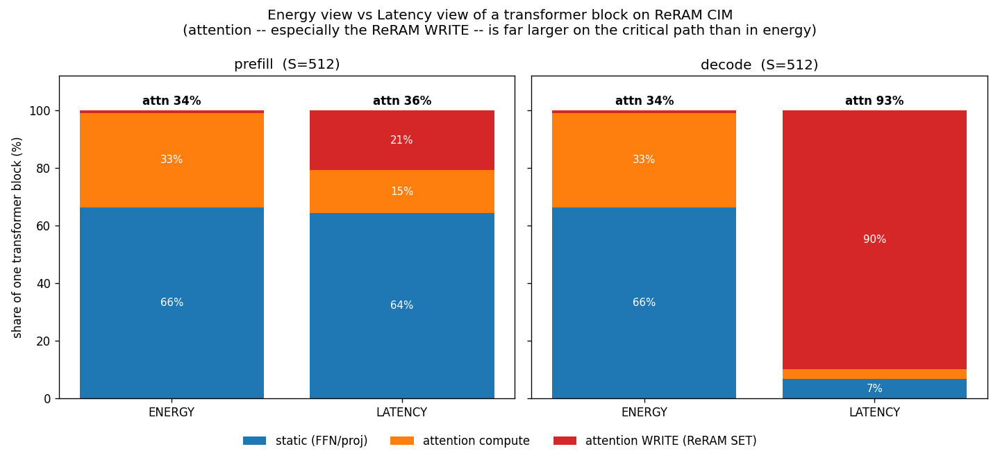

### 4.2 Candidate mechanism 1: distance (propagation delay) — ruled out

Signal propagation over the measured worst-case paths adds 0.006% (prefill)
to 0.13% (decode) of a block's latency. Real, wired into the model, and
irrelevant at these scales.

### 4.3 Candidate mechanism 2: bandwidth congestion — this is the one

A wire moves a finite number of words per beat; loads beyond that wait in
line. The behaviour is **threshold-like**: above some bandwidth the effect is
exactly zero, below it the effect *multiplies* latency. Three independent
groups of evidence (each number is one point of a full bandwidth sweep —
reading rule 2):

1. **Wiring scheme.** Identical traffic and floorplan, only the interconnect
   organisation differing: whole-stack prefill spans **1.00× (private links)
   to 4.08× (one shared bus)** at the example operating point.
2. **Buffer position.** Moving the die's shared buffer from centre to corner
   funnels 3→5 operators' traffic onto one wire: **1.49×** on the whole
   stack — mapping unchanged, energy account unchanged.
3. **Removing a masking term exposes it.** With attention (and its serial
   write) offloaded, decode's total drops from ~15 ms to ~1 ms per token,
   and the interconnect schemes — indistinguishable behind the write —
   separate by up to **3.3×** at the low anchor for the first time.

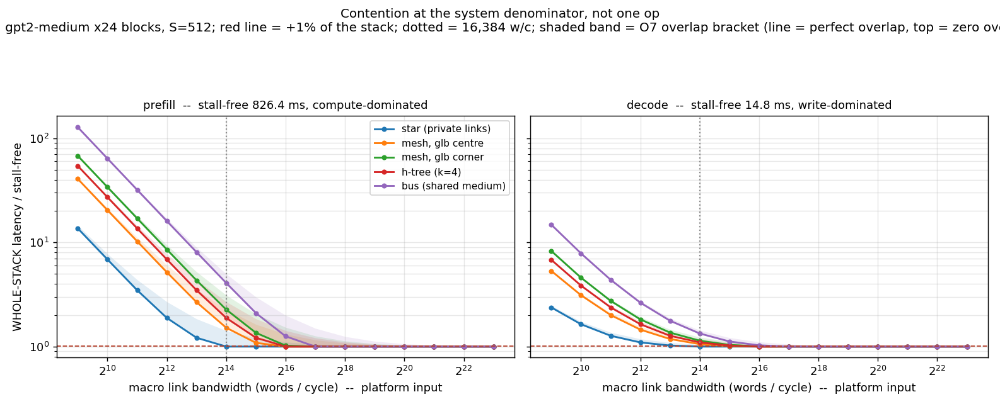
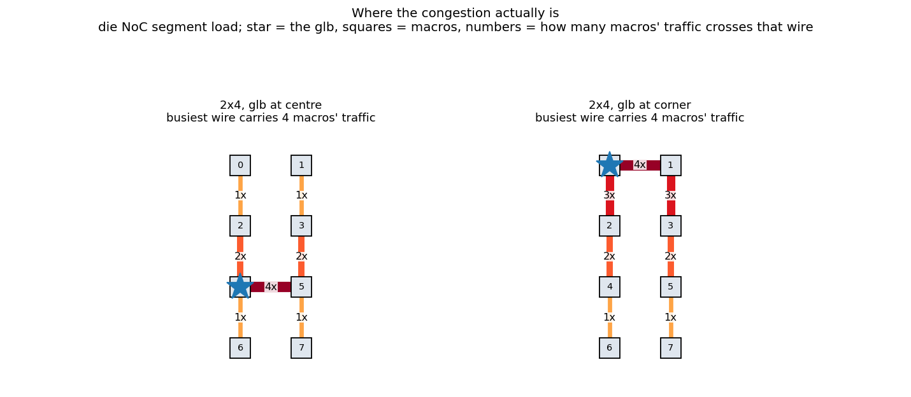
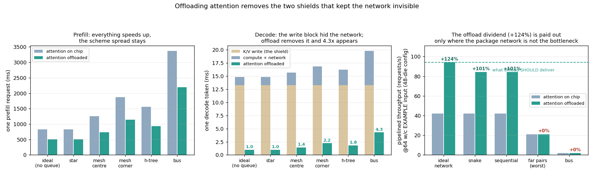

---

## 5. Conclusion 3 — Thresholds beside real hardware: on-die pressured, die-to-die safe

### 5.1 Converting the axis

Bandwidths are modelled in words per device cycle (1 word = 8 bits, device
cycle = 1.449 µs from the calibrated array model). One word/cycle ≈ 0.69
MB/s; 16,384 words/cycle ≈ 11.3 GB/s.

### 5.2 On-die: the threshold sits exactly where real chips live

On the co-residency basis, per-scheme readouts (whole-stack prefill). Each
threshold now carries both ends of the O7 overlap bracket: the first
number assumes compute and communication overlap perfectly (double
buffering — the headline end so far), the second assumes zero overlap.

| wiring scheme | stack moves 1% below | stack doubles below |
|---|---|---|
| private links (star) | 5.7 / 362 GB/s | 1.4 / 2.8 GB/s |
| routed grid, buffer centred | 22.6 / 1,448 GB/s | 5.7 / 11.3 GB/s |
| routed grid, buffer at corner | 45.2 / 1,448 GB/s | 11.3 / 22.6 GB/s |
| shared bus | 45.2 / 2,896 GB/s | 22.6 / 45.2 GB/s |

(Wire accounting since O22/O23: full-duplex direction-split links, bus
shared; partial sums at 16 bits up the tree. Against the previous
shared-direction, 8-bit accounting every threshold moved UP ~2×: the
width of the partial sums outweighs the relief of separate wires.)

The bracket separates two different questions. "Does the network hurt
badly" (the doubling threshold) moves at most 2× with the overlap
assumption — published links sit at or above both ends, so that verdict is
robust and settled by the real chip's parameters. "Is the network
perfectly invisible" (the 1% threshold) moves ~64×: with zero overlap even
a FlooNoC-class link leaves more than 1% on the table. Invisibility is a
property of the double-buffering microarchitecture, not of bandwidth
alone.

**Anchored readout.** Three published per-link bandwidths (sources and
conversions in [ANCHORS.md](ANCHORS.md)) were substituted for the example
input — a silicon-measured inference chiplet at the low end (Simba, 70 Gb/s
per on-die link, JSSC 2020), a fabricated open-source SoC in the middle
(ESP, 256 Gb/s), and a state-of-the-art wide-link NoC at the top (FlooNoC,
645 Gb/s). Each anchor substitutes exactly one number — the per-link
bandwidth; the workload, chip architecture, device cycle, and traffic all
remain ours (this is a sensitivity substitution, not a simulation of those
chips). Whole-stack latency relative to an unqueued network
(`analyze_anchored_sweep.py`):

Each cell shows the O7 bracket: perfect-overlap end .. zero-overlap end
(the truth lies between; the lower end is what previous sections quoted).

*Prefill, attention on chip (no-queue stack 826.4 ms, co-residency basis,
digital-unit terms in):*

| scheme / buffer position | Simba 8.75 GB/s | ESP 32 GB/s | FlooNoC 80.6 GB/s |
|---|---|---|---|
| private links (star) | 1.03–1.55× | 1.00–1.15× | 1.00–1.06× |
| routed grid, buffer centred | 1.84–2.64× | 1.00–1.45× | 1.00–1.18× |
| routed grid, buffer at corner | 2.86–3.73× | 1.16–1.75× | 1.00–1.30× |
| tree (k=4) | 2.33–3.19× | 1.06–1.60× | 1.00–1.24× |
| shared bus | 5.24–6.15× | 1.59–2.41× | 1.00–1.56× |

*Decode with attention offloaded (no-queue stack 0.99 ms/token):*

| scheme / buffer position | Simba 8.75 GB/s | ESP 32 GB/s | FlooNoC 80.6 GB/s |
|---|---|---|---|
| private links (star) | 1.03–1.58× | 1.00–1.16× | 1.00–1.06× |
| routed grid, buffer centred | 1.80–2.74× | 1.00–1.48× | 1.00–1.19× |
| routed grid, buffer at corner | 2.92–3.90× | 1.13–1.79× | 1.00–1.32× |
| tree (k=4) | 2.34–3.32× | 1.05–1.63× | 1.00–1.25× |
| shared bus | 5.61–6.60× | 1.60–2.53× | 1.01–1.61× |

*Wire accounting (O22/O23) — the same prefill table under the four
accountings, Simba anchor, perfect-overlap end, to show what moved and why:*

| scheme / buffer position | shared wires, 8-bit partial sums (before) | separate wires only | 16-bit partial sums only | separate wires + 16-bit (now) |
|---|---|---|---|---|
| private links (star) | 1.00× | 1.00× | 1.05× | 1.03× |
| routed grid, buffer centred | 1.31× | 1.20× | 2.06× | 1.84× |
| routed grid, buffer at corner | 1.97× | 1.61× | 3.35× | 2.86× |
| tree (k=4) | 1.62× | 1.39× | 2.70× | 2.33× |
| shared bus | 3.11× | 3.11× | 5.31× | 5.24× |

(The first three columns are read on the matmul-only stack; the current
column includes the digital-unit terms of O24 in the denominator, which is
why it sits a percent or two under the "16-bit only" column.)

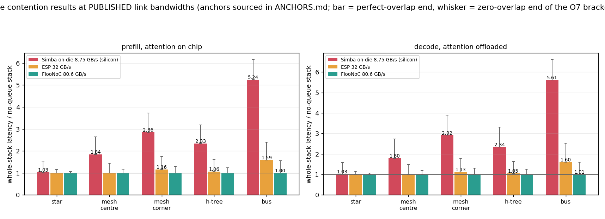
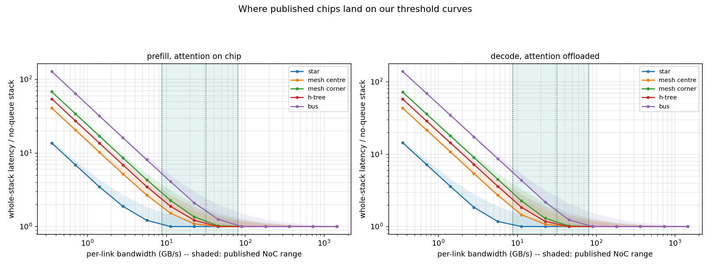

A coherence check worth stating: on the exclusive-die basis (v1) that
preceded the co-residency accounting, the sweep produced no new physics —
it placed real chips on the x-axis of curves whose thresholds were already
published, and all three anchors landed exactly where those lines
predicted (below the doubling line → 3.32×; between → 1.28×; above the
1%-line → 1.00×). The threshold instrument hit under a blind test; that
coherence is pinned as a regression test on the v1 fixture, and the same
instrument re-read on the v2 basis produced the tables above.

Three things the anchors settle that the example input could not:

1. **At the silicon-measured low anchor, on-die contention is a
   first-order effect** — 1.03–5.24× on prefill, the buffer position alone
   worth 1.55× (1.84→2.86); even private links no longer hide the
   network completely (1.03×) — at a bandwidth a fabricated inference
   chiplet actually shipped with.
2. **By the mid anchor the perfect-overlap end has collapsed for private
   links and the centred grid** (1.00×) but not for the corner grid, the
   tree or the bus (1.06–1.59×); at the high anchor it is gone for all.
   The transition therefore sits INSIDE the published range — between the
   mid and high anchors for hub-heavy layouts — the precise sense in which
   "the real chip's parameter decides". The zero-overlap end does NOT
   collapse (bus still 1.56× at FlooNoC): full invisibility additionally
   requires the double-buffered overlap the lower end assumes. Both ends
   rank the schemes identically at every anchor, so every placement
   RANKING survives the bracket untouched (pinned as a test).
3. **The accounting matters as much as the anchor**: the exclusive-die
   numbers (1.42–8.60×, hub lever 1.65×) shrank to 1.00–3.11× when
   co-residency replaced whole-die mapping (the "mid-anchor condition
   divergence" finding did not survive that and is retired), then grew to
   the above when the wires were accounted physically (O22/O23): 16-bit
   partial sums up the tree outweigh the relief of separate per-direction
   wires, so the earlier numbers UNDERSTATED contention. The register's
   "net direction undetermined" is thereby settled: understated.

Caveat: the core-level region allocation (the 17.8% ranking of §3) cannot
join this sweep — those links carry no bandwidth or price yet — so the
anchored grid covers scheme × buffer position, not region assignment.

### 5.3 Die-to-die: safe by a wide margin (at this model's granularity)

Every hand-off is 0.52M words (feasible 48-die configuration: two dies per
layer — attention half + FFN half — so 47 hand-offs per pass). Even in the
most demanding operating mode (pipelined serving, every boundary
transferring each beat, stage 23.5 ms on the co-residency basis),
throughput degrades only below **0.011–0.044 GB/s** for routed-mesh
orderings — **283× to 1,132×** under the one silicon-measured die-to-die
anchor we have (Simba's package mesh: 100 Gb/s = 12.5 GB/s per link
direction, at 0.82–1.75 pJ/bit; see [ANCHORS.md](ANCHORS.md)). One
exception at this granularity: a single shared-interposer **bus** degrades
below **0.71 GB/s**, 18× under the anchor — the thinnest margin on the
package. These are the perfect-overlap end (O7): with zero overlap the
mesh margins shrink to 2.2×–8.8× and the bus's guard bandwidth (90 GB/s)
crosses the anchor — a non-double-buffered interposer bus pays ~8% of the
beat there. (Full-duplex wires, O22: the busiest-wire integers of the
6×8 chain are 1/1/4/47 — sequential rows equal snake once the row wrap
rides the opposite-direction wires, and the adversarial order halves.
The knee integers are power-of-two grid readings: with the digital-unit
terms the beat is 1.3% longer, which tips the 32 w/c point of the mesh
orderings just under the 1% line — 32/32/128 → 16/16/64 w/c, not a
mechanism change.) Its
measured pJ/bit band (6.6–14 pJ/word) is now also the source of our default
per-word energy (10 pJ, the band midpoint) — the earlier 5 pJ example it
replaced was optimistic by 1.3–2.8×. In single-request operation the hand-off (2.97 ms at the
example link) hides entirely behind the stack's 747.6 ms of compute.

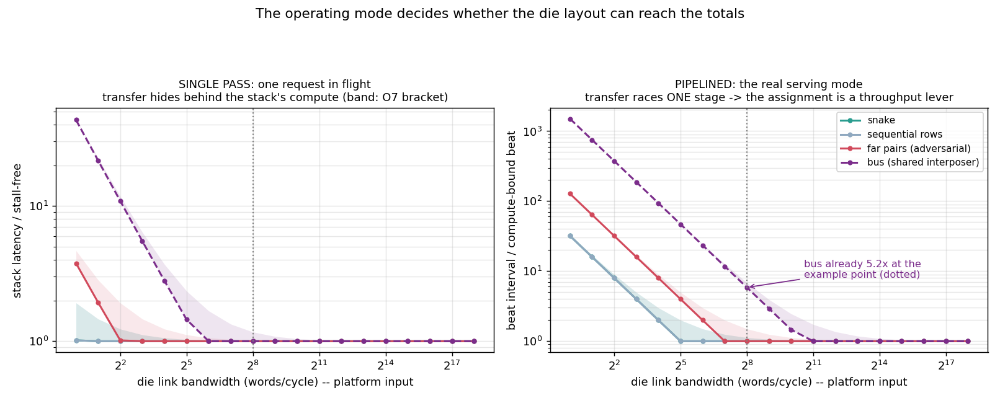

### 5.4 Corollary: at the current configuration, die ordering is free

All four tested layer→die orderings tie: energy within +0.08%, single-pass
latency identical to the microsecond. **This is the model measuring "does
not bite" — not a failure to model it.** The machinery that would show a
difference is the same machinery that shows none here.

---

## 6. Conclusion 4 — *Why* die-to-die is safe: two ratios, and what flips them

### 6.1 Ratio one: per-unit volume ÷ per-die capacity

As long as a compute unit's weights fit inside one die, the multicast/
reduction flood stays internal and only layer outputs cross (12.1M vs
13,100M words). Once weights exceed one die, part of the flood itself is
forced across the package — and cross-die volumes jump a hundredfold.

Measured on this configuration (honest capacity: one weight occupies **two**
cells under the device's differential encoding, so a die holds 8.39M
weights):

| granularity | volume ÷ capacity | status |
|---|---|---|
| largest single operator (ffn1) | **0.50** | safe — this is what today's runs use |
| one whole layer (6 operators) | **1.50** | already past the flip at layer granularity: the feasible configuration places TWO dies per layer (attention half + FFN half, the latter filling its die exactly) — now the configuration all 355M die-level results use (valid to ~2.5k tokens of K/V growth on the attention die) |

**The flip, measured.** A probe operator sized at 4 dies of weights (a
2.7B-class FFN shape) was run with the new multi-die spatial split (weights
stay resident, the operator spans 4 dies):

| where the 4 dies sit on the package | busiest package wire | avg hops | extra energy | op latency @0.18 GB/s | @2.8 GB/s | @45 GB/s |
|---|---|---|---|---|---|---|
| clustered at the attach point | 1.0× | 0.75 | 0 mJ | 81.6 ms | 5.1 ms | 0.65 ms |
| one row | 2.0× | 3.00 | 1.15 mJ | 163.2 ms | 10.2 ms | 0.65 ms |
| one column | 4.0× | 3.00 | 1.15 mJ | 326.3 ms | 20.4 ms | 1.27 ms |
| four corners | 2.0× | 4.00 | 1.73 mJ | 163.2 ms | 10.2 ms | 0.65 ms |

Past the flip, everything changes character (`analyze_multidie_placement.py`):

- each intra-operator die edge carries 14.4M words — **28× a layer
  hand-off**; one operator's cross-die traffic (57.7M words) exceeds the
  whole model's boundary total (12.1M);
- die placement now moves the **single operator's** latency by 4× — no
  pipelining framing needed;
- the extra energy (up to 1.73 mJ against the operator's 2.24 mJ of compute,
  at the measured 10 pJ/word) makes die placement an **energy** variable for
  the first time (+77%);
- the bandwidth needed to stay compute-bound rises to ~45 GB/s — on-die
  class, no longer trivially satisfied by real D2D links.

**The flip, completed: a full model past the boundary.** The whole
2.7B-class model (d=2560, ff=10240, 32 layers) was then simulated end to end
— the first full model on this platform whose operators span dies (4/2/5/5
dies for the static operators, by the residency tiler; the power-of-two
fanout grid needs more dies than raw capacity says, a utilisation loss the
run charges honestly). At the measured D2D anchor (Simba GRS, 12.5 GB/s):

| die placement of each op's die-set | prefill stack (NoC @ ESP 32 GB/s) | extra D2D energy per pass |
|---|---|---|
| clustered at the attach point (per-op lower bound — jointly, not every op can have this seat) | 1128 ms (1.22×) | **0 mJ** |
| row-fill (naive sequential) | 1971 ms (**2.14×**) | **792 mJ = +34% of the model's 2297 mJ** |
| spread | 1815 ms (1.97×) | 829 mJ (+36%) |

(Physical wire accounting, O22/O23: 16-bit partial sums double the
intra-operator die flows too, so even the clustered row now pays 1.23×
at the D2D anchor — before: 1.07× / 1.82× / 1.71×. The placement lever,
row-fill over clustered, is 1.75× (digital-unit terms in the denominator;
no-network stack 921 ms).)

Die placement is now a first-order variable on BOTH axes — the +34% energy
figure is the same decision that was worth +0.15% at tier S. Accounting
note: the temporal-rewrite mechanism fires zero times in these runs (every
operator's weights stay resident, verified per mapping); the only write
charged is the attention K/V programming in the on-chip condition. In the
**offloaded-decode** condition (attention and its write off chip, on-chip
side counted) the write shield is gone and die placement moves each token
**1.27× → 2.50×** (1.71 → 3.36 ms) at the GRS anchor — insensitive to the
on-die NoC tier, i.e. a pure die-to-die effect. (Caveat: the v1 anchor model
routes all intra-op flows through the package attach point; an owner-die
refinement would reduce, not remove, these numbers.)

Value distributions: the tier-L runs use REAL operand histograms extracted
from facebook/opt-2.7b itself (192 per-layer histograms,
`extract_opt2p7b_hists.py` — the model whose shapes these runs use), not
borrowed GPT-2 ones; the substitution moved every energy by ≤1.4% (whole
stack −1.2%), which also bounds how much the earlier borrowed-distribution
approximation mattered. The per-crossbar distribution machinery was
regression-checked after all the recent plumbing: spreads reproduce at
1.000× / 1.002× / 1.010× / 1.199× (the last vs 1.204× — drift from
unseeded random CNN sample inputs, not from code).

Scale-study figures: `anchored_sweep.png` (tier S), `scale_tier_probe.png`
(tier M), `scale_tier_2p7b.png` (tier L), `scale_combined.png` (all three).

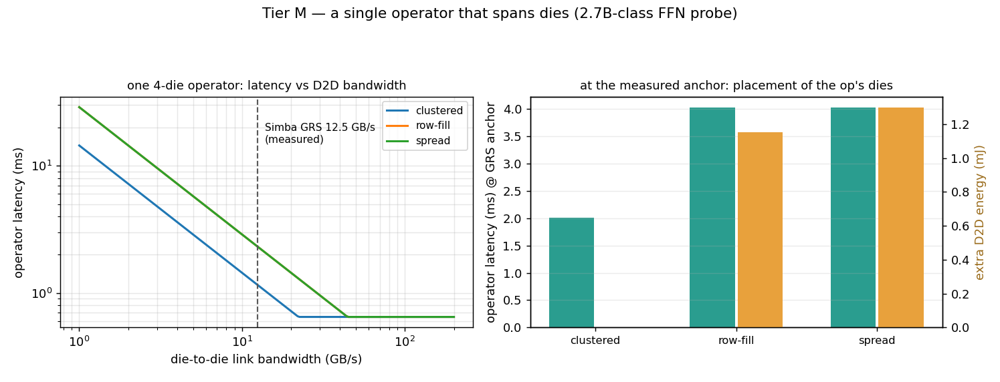
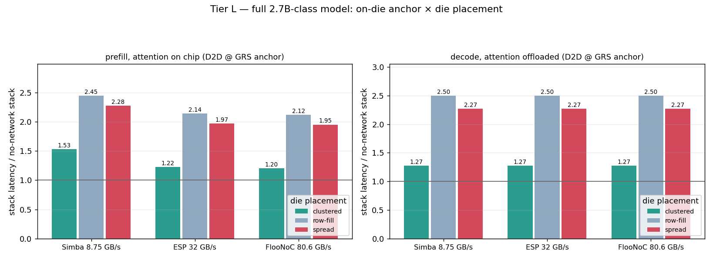
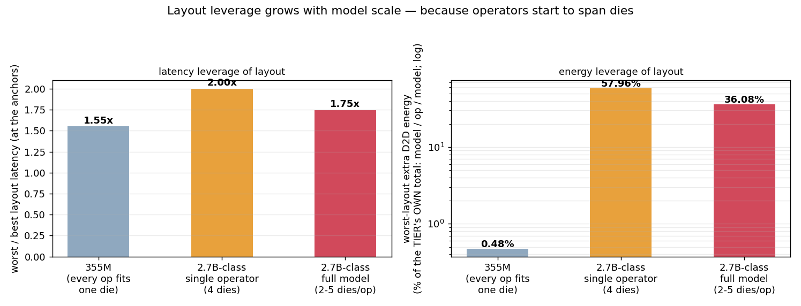

### 6.2 Ratio two: per-die compute time ÷ hand-off time

The microsecond-scale analog array makes one layer's compute ≈ 34 ms
(co-residency basis, digital terms in), while a layer hand-off at a real
link speed is tens of µs — two to three orders of headroom. The ratio
shrinks with faster devices, smaller dies, or offloading (measured:
offloading attention cuts the pipeline beat 23.8 → 10.6 ms and moves every
network threshold up one octave, 2×).

### 6.3 Cross-check against a published system

Simba (a 36-chiplet digital inference machine, Shao et al., MICRO 2019) has
*both* ratios on the other side: fast digital arithmetic, small dies, layers
spanning many chiplets. Its published measurements show strong cross-die
placement sensitivity (up to ≈2.5× latency, double-digit-% energy effects).
One mechanism — the two ratios — explains both systems' opposite behaviour,
which is the closest thing to external validation this model currently has.

### 6.4 Flip conditions

Any of the following re-opens the die-to-die question, and each is
quantifiable by this tool before hardware exists:

1. **Bigger models** — a Llama-70B-class layer is ~1.7G cells ≈ 100 dies at
   this density; every operator spans dies.
2. **Smaller dies** — ratio one rises directly.
3. **Faster readout** — ratio two falls directly.
4. **Offloading** — measured 2× threshold shift (v2 basis, halved stage), plus decode losing its
   masking term (§4.3).

---

## 7. Conclusion 5 — On-die layout cannot be solved by intuition

Three measured reasons an automatic search is warranted:

1. **Distance-optimal and congestion-optimal disagree.** The 3×3 die layout
   spreads distance worse (3.62× vs 1.50×) but congests less (3 vs 4
   operators on the busiest wire) than the 2×4 layout — the two metrics rank
   the same pair of layouts in opposite orders. Likewise, the layout ranked
   best by energy (routed grid, buffer centred) and the one ranked best by
   latency (private links) are different designs:

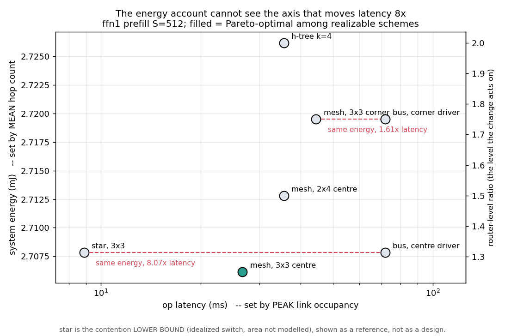

2. **A measured counter-intuitive case — with its survival check.** In
   decode with attention on chip, the corner buffer position slightly
   *beats* the centre (15.62 vs 15.70 ms/token): decode only occupies part
   of the array, and which slots are active couples to where the buffer
   sits. A dedicated sweep (`analyze_corner_flip.py`) checked whether this
   reversal flips along the bandwidth axis inside the published range: **it
   never does** — the sign difference is between *operating conditions*
   (prefill prefers centre by up to 1.50×; on-chip decode prefers corner by
   ~0.5%, at every in-band bandwidth), and its magnitudes are so asymmetric
   that centre wins any joint objective. "Corner is always worse" is false,
   but the search argument rests on the metric disagreement and the 1.50×
   lever, not on this reversal.

3. **The synthesis.** Multiplicative effects (§4) landing exactly in the
   plausible-bandwidth zone (§5), with intuition demonstrably failing (this
   section) — that is the definition of a legitimate automatic search
   problem. Formally: search over (slot permutations at each level) ×
   (interconnect scheme and its parameters) × (operator→die-set assignment,
   §6.1), minimising the tuple (energy, single-request latency, pipelined
   interval), all three evaluable by this tool.

---

### 7.x The per-operator ledger (deliverable, 2026-08-21)

`scripts/op_breakdown.py` is the single entry point for the company's
per-operator request: one mapper run per operator, then a whole-model
operator-type share table (six matmul types × layers, under attention-on-chip
and attention-offloaded conditions; since O24 the non-matmul operator
types — softmax, GELU, LayerNorm, residual adds — are numbers on the
digital unit, the embedding read is priced (timed only with an off-chip
bandwidth set) and the LM head is a real 8-die matmul, last token only),
per-operator totals, and every cost item on its own row (24 CiMLoop
components, placement re-pricing, K/V write, rewrite, D2D, an explicit
residual row; latency composed at both O7 ends).
Categories are deliberately not merged. Conservation is pinned (group 19)
and the whole-model totals reproduce the system script's numbers exactly.
Outputs under `analysis/op_breakdown/` (the figures and the table file are
tracked; the JSON/CSV are regenerable). A companion settings document
(`analysis/settings_and_assumptions.tex`, local) states every setting,
assumption, formula and replaceable input of the v4 baseline for the
company's review.

## 8. Summary table and validity boundary

### 8.1 All results in one table

| # | level | variable | metric | effect | holds when | source |
|---|---|---|---|---|---|---|
| 1 | macro | arrangement | energy | ≤0.34% of block (≤3.4% at 10× price) | always (priced) | `analyze_position_aware.py` |
| 2 | crossbar/region | position | energy | 1.50×/3.62×, 17.8% — rankings | level unpriced | `crossbar_comm.py`, `analyze_region_locality.py` |
| 3 | die | wiring scheme | stack latency | 1.00–4.08× (ref. input); 1.03–5.24× at Simba anchor (overlap end; zero-overlap 1.55–6.15×) | below per-scheme threshold (§5.2) | `analyze_contention_system.py` |
| 4 | die | buffer position | stack latency | 1.49× (ref. input); 1.55× at Simba anchor | same | same |
| 5 | die | scheme (decode, attention offloaded) | token latency | 1.03–5.61× at the anchors (overlap end) | write no longer masks | `analyze_offload_contention.py` |
| 6 | package | layer ordering | energy | ≤+0.15% | operator fits one die | `analyze_d2d.py` |
| 7 | package | unit ordering (48-die config) | pipelined throughput | up to 2× (mesh orderings; bus 23×) at 64 w/c | mesh orderings below 0.011–0.044 GB/s; bus below 0.71 GB/s (overlap end) | same |
| 8 | package | die-set placement of a spanning operator | op latency / energy | 4× / +77% | operator exceeds one die | `analyze_multidie_placement.py` |

### 8.2 Assumptions, and which conclusion flips if one fails

| assumption | if it fails |
|---|---|
| weights resident, written once | §3.2 and §6.1 collapse — weight movement becomes the dominant traffic and layout becomes an energy variable everywhere |
| no cross-layer pipelining in the latency account | §5.3's single-pass safety overstates; the pipelined columns already show the alternative |
| one cross-die traffic class (layer outputs only) | §5.3 margins shrink (e.g. KV-offload streams sharing the die links) |
| capacity grid (8.39M weights/die, 2 cells/weight) | §6.1's flip points move linearly with it |
| contention = busiest wire, no queueing | all latency multipliers are lower bounds of the max/sum bracket |

### 8.3 What depends on placeholder parameters, and what does not

| depends on example inputs | does **not** depend on them |
|---|---|
| absolute ms / mJ / GB/s values | every ordering (which layout is worse) |
| where a threshold falls in GB/s | that behaviour **is** threshold-like |
| the +0.08% / 0.34% magnitudes | the flip mechanisms and both ratios of §6 |

---

## 9. Implications and next steps

**Design implication.** At this configuration, bandwidth budget belongs
**inside the die**; package-level layout is currently free — and §6.4 lists
exactly the four triggers under which that stops being true, each computable
in advance with this tool.

**Next steps.**

1. **Die-capacity sweep** — make §6.1's flip point an actual curve (shrink
   the die, watch cross-die traffic and placement sensitivity rise); the
   4-die probe is the first point of that curve.
2. **A minimal real layer-spanning case** — one full transformer layer at 2
   dies (GPT-2 medium's own honest requirement), with the operator→die-set
   assignment done properly.
3. ~~Source the §5 comparison points~~ — **done**: [ANCHORS.md](ANCHORS.md)
   (Simba silicon, ESP, FlooNoC; Simba GRS for die-to-die), read out in
   §5.2/§5.3 via `analyze_anchored_sweep.py`. Remaining: a D2D anchor beyond
   Simba (UCIe-class) once a citable per-link figure is chosen.
4. **Parameter request map** — for each real-chip parameter received, which
   conclusion upgrades from "ordering" to "absolute value".
