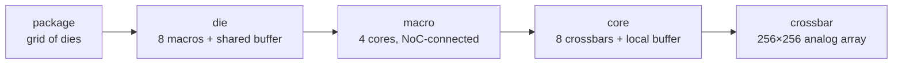

# Does Physical Layout Matter on a Weight-Stationary CIM System?

*A progress report. Every number below has a committed, re-runnable source
(named in each table); figures are generated by the same scripts. The reader
is assumed to start from zero: each section relies only on what came before.*

---

## 1. The system and the question

### 1.1 What the system is

A ReRAM compute-in-memory (CIM) inference machine is a nesting of grids:

The defining property: **weights are written into the crossbar cells once and
never move again**. Multiplication happens where the weights sit. What moves
at runtime is only (a) input activations and (b) partial sums:

| level boundary | going down (inputs) | going up (outputs) |
|---|---|---|
| buffer → macros | each input slice **multicast** to the macros that share it | partial sums **merge** at the buffer |
| macro → cores | same, one level down | same, one level down |
| core → crossbars | same | analog columns already sum inside the array |
| die → die | the finished **layer output** (hidden state) crosses to the die holding the next layer | — |

So there are two very different traffic classes: a heavy multicast/reduction
flood **inside** the die, and a thin stream of finished layer outputs
**between** dies. Section 6 shows this asymmetry is load-bearing.

### 1.2 What the layout decisions are

Going down the hierarchy, someone (today: nobody — these are implicit
defaults) decides:

1. **Which die holds which layer** (the package-level assignment);
2. **Which macro/core/crossbar holds which weight block** inside a die;
3. **Where the shared buffer attaches** on the die's grid;
4. **How the wires are organised** — a private link per unit, a routed grid,
   a tree, or one shared bus.

### 1.3 The question

Do these decisions change **energy**, **single-request latency**, or
**throughput**? By how much, and through what mechanism? (This section
deliberately gives no answer.)

---

## 2. The instrument, and how to read its numbers

We extended the CiMLoop simulator (Timeloop + Accelergy with CIM device
models) so that the questions above become measurable:

- **Real traffic structure**: multicast counted once, idle units carry zero,
  volumes reconciled against the simulator's own access counters (a
  divisibility guard raises on any disagreement).
- **Per-level link pricing**: every wire's energy/latency parameters are
  explicit inputs; anything not yet priced is an explicit zero, never a
  hidden guess.
- **Bandwidth occupancy**: each wire moves a finite number of words per
  device cycle; traffic beyond that serializes. Every flow is routed onto the
  physical wires its interconnect scheme dictates, so shared wires accumulate
  load.
- **Cross-die topology**: dies sit on a package grid with the same routed
  model, one level up.

**Workload and configuration.** GPT-2 medium (24 identical transformer
blocks, d=1024), sequence length 512 — both inference phases: *prefill*
(the whole 512-token prompt processed at once) and *decode* (one generated
token at a time) — on a 24-die package example configuration; each operator is mapped by Timeloop onto one die (8 macros ×
4 cores × 8 crossbars = 256 arrays). The model is deliberately small enough
that every single operator fits inside one die — Section 6 examines what
changes when that stops being true.

**Two reading rules**, used everywhere below:

1. **A ratio is not a result until multiplied by its level's share.** "The
   network cost doubled" means nothing until you know the network is 0.65% of
   the total. Every table carries the share.
2. **Wire bandwidths are not calibrated to a real chip yet** — they are
   platform inputs with example defaults. The valid form of any
   bandwidth-dependent result is therefore a **threshold** ("below X the
   effect appears") and an **ordering**, never an absolute milliseconds
   claim. Where absolute units appear they are conversions of the example
   inputs, marked as such.

---

## 3. Conclusion 1 — Layout barely changes energy, at any level

### 3.1 The measurements, side by side

| level | what was varied | ratio at that level | that level's share | system effect | source |
|---|---|---|---|---|---|
| macro network (priced) | grid vs line arrangement; full setting sweep | 1.5× – 3.0× | router = 0.65% of a block | **≤ 0.34%** | `analyze_position_aware.py` |
| crossbar map (unpriced level) | corner vs centre position | 1.50× (2×4 die layout; 3.62× on the 3×3 variant) | level carries no energy price | ranking only (honest note: not in totals) | `crossbar_comm.py` |
| core regions (unpriced level) | which cores six matmuls occupy | 17.8% | same | ranking only | `analyze_region_locality.py` |
| die-to-die (priced) | worst vs best layer→die ordering | +217.6 µJ per pass | vs 287.5 mJ total | **+0.08%** | `analyze_d2d.py` |

*The per-crossbar map: identical traffic per crossbar, cost varying only with
position — a ranking a placement search can consume, honestly labelled as not
yet priced in joules.*

### 3.2 Why energy is nearly layout-blind

Energy **sums** over all traffic, and the bulk of every word's cost is fixed
regardless of where it travels: buffer entry/exit, digital↔analog conversion,
and array driving are paid identically whether the destination is one hop or
five hops away. Layout only changes the *extra hops* increment, and the base
that increment multiplies (the on-die network) is ~1% of the system. Between
dies, the volume itself is structurally pinned: only finished layer outputs
cross (12.1M words per pass, against 13,100M words on the on-die network —
three orders of magnitude), so no reordering of dies can move much energy.

### 3.3 Robustness of the conclusion

- Multiply the on-die network's unit price **10×**: the worst layout effect
  grows 0.34% → 3.4% of a block — still single digits.
- Charge cross-die transfers for **every** hop (instead of only hops beyond
  the first, which the flat port already bills): the worst ordering costs
  0.28 mJ = **0.097%** of a pass.

The conclusion survives both.

---

## 4. Conclusion 2 — Layout does affect *time*, through exactly one mechanism

### 4.1 Time is a maximum, not a sum

Latency is set by the slowest term on the critical path, so a term with tiny
energy can own the time entirely. A layout-independent example pins this
down: the ReRAM write of the attention K/V values is **0.9% of decode
energy** but — being a serial microsecond-scale programming operation —
**90% of decode latency**. On this system, small-energy terms ruling the
clock is the steady state, not a curiosity.

### 4.2 Candidate mechanism 1: distance (propagation delay) — ruled out

Signal propagation over the measured worst-case paths adds 0.006% (prefill)
to 0.13% (decode) of a block's latency. Real, wired into the model, and
irrelevant at these scales.

### 4.3 Candidate mechanism 2: bandwidth congestion — this is the one

A wire moves a finite number of words per beat; loads beyond that wait in
line. The behaviour is **threshold-like**: above some bandwidth the effect is
exactly zero, below it the effect *multiplies* latency. Three independent
groups of evidence (each number is one point of a full bandwidth sweep —
reading rule 2):

1. **Wiring scheme.** Identical traffic and floorplan, only the interconnect
   organisation differing: whole-stack prefill spans **1.25× (private links)
   to 6.70× (one shared bus)** at the example operating point.
2. **Buffer position.** Moving the die's shared buffer from centre to corner
   funnels 3→5 operators' traffic onto one wire: **1.64×** on the whole
   stack — mapping unchanged, energy account unchanged.
3. **Removing a masking term exposes it.** With attention (and its serial
   write) offloaded, decode's total drops from ~15 ms to ~1 ms per token,
   and the interconnect schemes — indistinguishable behind the write —
   separate by **1.2×–3.0×** for the first time.

---

## 5. Conclusion 3 — Thresholds beside real hardware: on-die pressured, die-to-die safe

### 5.1 Converting the axis

Bandwidths are modelled in words per device cycle (1 word = 8 bits, device
cycle = 1.449 µs from the calibrated array model). One word/cycle ≈ 0.69
MB/s; 16,384 words/cycle ≈ 11.3 GB/s.

### 5.2 On-die: the threshold sits exactly where real chips live

The busiest on-die link becomes the bottleneck below ≈ 2.9×10⁴ words/cycle ≈
**20 GB/s** — and published on-die network links sit precisely in the
tens-of-GB/s decade. The verdict is genuinely undecided and will be settled
by the real chip's parameters. Per-scheme readouts (whole-stack prefill):

| wiring scheme | stack moves 1% below | stack doubles below |
|---|---|---|
| private links (star) | 11.3 GB/s | 2.8 GB/s |
| routed grid, buffer centred | 45 GB/s | 11.3 GB/s |
| routed grid, buffer at corner | 90 GB/s | 22.6 GB/s |
| shared bus | 90 GB/s | 22.6 GB/s |

**Anchored readout.** Three published per-link bandwidths (sources and
conversions in [ANCHORS.md](ANCHORS.md)) were substituted for the example
input — a silicon-measured inference chiplet at the low end (Simba, 70 Gb/s
per on-die link, JSSC 2020), a fabricated open-source SoC in the middle
(ESP, 256 Gb/s), and a state-of-the-art wide-link NoC at the top (FlooNoC,
645 Gb/s). Each anchor substitutes exactly one number — the per-link
bandwidth; the workload, chip architecture, device cycle, and traffic all
remain ours (this is a sensitivity substitution, not a simulation of those
chips). Whole-stack latency relative to an unqueued network
(`analyze_anchored_sweep.py`):

*Prefill, attention on chip (no-queue stack 314.6 ms):*

| scheme / buffer position | Simba 8.75 GB/s | ESP 32 GB/s | FlooNoC 80.6 GB/s |
|---|---|---|---|
| private links (star) | 1.42× | 1.00× | 1.00× |
| routed grid, buffer centred | 3.32× | 1.28× | 1.00× |
| routed grid, buffer at corner | 5.49× | 1.70× | 1.07× |
| tree (k=4) | 4.55× | 1.49× | 1.00× |
| shared bus | 8.60× | 2.50× | 1.32× |

*Decode with attention offloaded (no-queue stack 0.97 ms/token):*

| scheme / buffer position | Simba 8.75 GB/s | ESP 32 GB/s | FlooNoC 80.6 GB/s |
|---|---|---|---|
| private links (star) | 1.31× | 1.00× | 1.00× |
| routed grid, buffer centred | 1.99× | 1.06× | 1.00× |
| routed grid, buffer at corner | 2.09× | 1.06× | 1.00× |
| tree (k=4) | 3.76× | 1.37× | 1.00× |
| shared bus | 3.76× | 1.37× | 1.00× |

A coherence check worth stating: the sweep produced no new physics — it
placed real chips on the x-axis of curves whose thresholds were **already
published above**. Mesh-centre's lines were 16,384 w/c (doubling) and
65,536 w/c (1%), i.e. 11.3 and 45.2 GB/s — and the three anchors land
exactly where those lines predict: Simba (8.75) below the doubling line →
3.32×; ESP (32) between the lines → 1.28×; FlooNoC (80.6) above the 1%
line → 1.00×. The threshold instrument hit under a blind test; this
coherence is itself pinned as a regression test.

Three things the anchors settle that the example input could not:

1. **At the silicon-measured low anchor, on-die contention is a first-order
   effect** — 1.4–8.6× on prefill, and the buffer position alone is worth
   1.65× (3.32→5.49) at a bandwidth a fabricated inference chiplet actually
   shipped with.
2. **At the high anchor it nearly vanishes** (≤1.32×, and only for the bus).
   The published range brackets the transition almost exactly — the shaded
   band in the curve figure sits on the bend of every curve, which is the
   precise sense in which "the real chip's parameter decides".
3. **The two conditions rank schemes differently at the mid anchor**:
   prefill still separates grid layouts (1.28 vs 1.70) while offloaded
   decode has almost collapsed (1.06 both) — because decode's flows are
   smaller. A single-number "NoC is fast enough" claim would miss this.

Caveat: the core-level region allocation (the 17.8% ranking of §3) cannot
join this sweep — those links carry no bandwidth or price yet — so the
anchored grid covers scheme × buffer position, not region assignment.

### 5.3 Die-to-die: safe by a wide margin (at this model's granularity)

The layer hand-off is 0.52M words. Even in the most demanding operating mode
(pipelined serving, every boundary transferring each beat), throughput
degrades only below **0.02–0.7 GB/s** depending on the layer ordering —
while the one silicon-measured die-to-die anchor we have (Simba's package
mesh: 100 Gb/s = 12.5 GB/s per link direction, at 0.82–1.75 pJ/bit; see
[ANCHORS.md](ANCHORS.md)) sits at **18× to 570×** those thresholds. Its
measured pJ/bit also brackets our 5 pJ/word example as optimistic by
~1.3–2.8×, which strengthens rather than weakens the margin conclusion. In single-request operation the hand-off (2.97 ms at the
example link) hides entirely behind the stack's 249 ms of compute.

### 5.4 Corollary: at the current configuration, die ordering is free

All four tested layer→die orderings tie: energy within +0.08%, single-pass
latency identical to the microsecond. **This is the model measuring "does
not bite" — not a failure to model it.** The machinery that would show a
difference is the same machinery that shows none here.

---

## 6. Conclusion 4 — *Why* die-to-die is safe: two ratios, and what flips them

### 6.1 Ratio one: per-unit volume ÷ per-die capacity

As long as a compute unit's weights fit inside one die, the multicast/
reduction flood stays internal and only layer outputs cross (12.1M vs
13,100M words). Once weights exceed one die, part of the flood itself is
forced across the package — and cross-die volumes jump a hundredfold.

Measured on this configuration (honest capacity: one weight occupies **two**
cells under the device's differential encoding, so a die holds 8.39M
weights):

| granularity | volume ÷ capacity | status |
|---|---|---|
| largest single operator (ffn1) | **0.50** | safe — this is what today's runs use |
| one whole layer (6 operators) | **1.50** | already past the flip: a layer needs 2 dies, so the "one layer per die" example is a capacity idealisation (registered as an open fix) |

**The flip, measured.** A probe operator sized at 4 dies of weights (a
2.7B-class FFN shape) was run with the new multi-die spatial split (weights
stay resident, the operator spans 4 dies):

| where the 4 dies sit on the package | busiest package wire | avg hops | extra energy | op latency @0.18 GB/s | @2.8 GB/s | @45 GB/s |
|---|---|---|---|---|---|---|
| clustered at the attach point | 1.0× | 0.75 | 0 mJ | 81.6 ms | 5.1 ms | 0.65 ms |
| one row | 2.0× | 3.00 | 0.58 mJ | 163.2 ms | 10.2 ms | 0.65 ms |
| one column | 4.0× | 3.00 | 0.58 mJ | 326.3 ms | 20.4 ms | 1.27 ms |
| four corners | 2.0× | 4.00 | 0.87 mJ | 163.2 ms | 10.2 ms | 0.65 ms |

Past the flip, everything changes character (`analyze_multidie_placement.py`):

- each intra-operator die edge carries 14.4M words — **28× a layer
  hand-off**; one operator's cross-die traffic (57.7M words) exceeds the
  whole model's boundary total (12.1M);
- die placement now moves the **single operator's** latency by 4× — no
  pipelining framing needed;
- the extra energy (up to 0.87 mJ against the operator's 2.24 mJ of compute)
  makes die placement an **energy** variable for the first time (+39%);
- the bandwidth needed to stay compute-bound rises to ~45 GB/s — on-die
  class, no longer trivially satisfied by real D2D links.

### 6.2 Ratio two: per-die compute time ÷ hand-off time

The microsecond-scale analog array makes one layer's compute ≈ 13 ms, while
a layer hand-off at a real link speed is tens of µs — two to three orders of
headroom. The ratio shrinks with faster devices, smaller dies, or offloading
(measured: offloading attention cuts per-die compute 13.1 → 8.4 ms and moves
every network threshold up 1.55×).

### 6.3 Cross-check against a published system

Simba (a 36-chiplet digital inference machine, Shao et al., MICRO 2019) has
*both* ratios on the other side: fast digital arithmetic, small dies, layers
spanning many chiplets. Its published measurements show strong cross-die
placement sensitivity (up to ≈2.5× latency, double-digit-% energy effects).
One mechanism — the two ratios — explains both systems' opposite behaviour,
which is the closest thing to external validation this model currently has.

### 6.4 Flip conditions

Any of the following re-opens the die-to-die question, and each is
quantifiable by this tool before hardware exists:

1. **Bigger models** — a Llama-70B-class layer is ~1.7G cells ≈ 100 dies at
   this density; every operator spans dies.
2. **Smaller dies** — ratio one rises directly.
3. **Faster readout** — ratio two falls directly.
4. **Offloading** — measured 1.55× threshold shift, plus decode losing its
   masking term (§4.3).

---

## 7. Conclusion 5 — On-die layout cannot be solved by intuition

Three measured reasons an automatic search is warranted:

1. **Distance-optimal and congestion-optimal disagree.** The 3×3 die layout
   spreads distance worse (3.62× vs 1.50×) but congests less (3 vs 4
   operators on the busiest wire) than the 2×4 layout — the two metrics rank
   the same pair of layouts in opposite orders. Likewise, the layout ranked
   best by energy (routed grid, buffer centred) and the one ranked best by
   latency (private links) are different designs:

2. **A measured counter-intuitive case.** In decode, the corner buffer
   position slightly *beats* the centre (15.62 vs 15.70 ms/token): decode
   only occupies part of the array, and which slots are active couples to
   where the buffer sits. "Corner is always worse" is false.

3. **The synthesis.** Multiplicative effects (§4) landing exactly in the
   plausible-bandwidth zone (§5), with intuition demonstrably failing (this
   section) — that is the definition of a legitimate automatic search
   problem. Formally: search over (slot permutations at each level) ×
   (interconnect scheme and its parameters) × (operator→die-set assignment,
   §6.1), minimising the tuple (energy, single-request latency, pipelined
   interval), all three evaluable by this tool.

---

## 8. Summary table and validity boundary

### 8.1 All results in one table

| # | level | variable | metric | effect | holds when | source |
|---|---|---|---|---|---|---|
| 1 | macro | arrangement | energy | ≤0.34% of block (≤3.4% at 10× price) | always (priced) | `analyze_position_aware.py` |
| 2 | crossbar/region | position | energy | 1.50×/3.62×, 17.8% — rankings | level unpriced | `crossbar_comm.py`, `analyze_region_locality.py` |
| 3 | die | wiring scheme | stack latency | 1.25–6.70× | below per-scheme threshold (§5.2) | `analyze_contention_system.py` |
| 4 | die | buffer position | stack latency | 1.64× | same | same |
| 5 | die | scheme (decode, attention offloaded) | token latency | 1.2–3.0× | write no longer masks | `analyze_offload_contention.py` |
| 6 | package | layer ordering | energy | ≤+0.08% | operator fits one die | `analyze_d2d.py` |
| 7 | package | layer ordering | pipelined throughput | 1.8–5.4× | link below 0.02–0.7 GB/s | same |
| 8 | package | die-set placement of a spanning operator | op latency / energy | 4× / +39% | operator exceeds one die | `analyze_multidie_placement.py` |

### 8.2 Assumptions, and which conclusion flips if one fails

| assumption | if it fails |
|---|---|
| weights resident, written once | §3.2 and §6.1 collapse — weight movement becomes the dominant traffic and layout becomes an energy variable everywhere |
| no cross-layer pipelining in the latency account | §5.3's single-pass safety overstates; the pipelined columns already show the alternative |
| one cross-die traffic class (layer outputs only) | §5.3 margins shrink (e.g. KV-offload streams sharing the die links) |
| capacity grid (8.39M weights/die, 2 cells/weight) | §6.1's flip points move linearly with it |
| contention = busiest wire, no queueing | all latency multipliers are lower bounds of the max/sum bracket |

### 8.3 What depends on placeholder parameters, and what does not

| depends on example inputs | does **not** depend on them |
|---|---|
| absolute ms / mJ / GB/s values | every ordering (which layout is worse) |
| where a threshold falls in GB/s | that behaviour **is** threshold-like |
| the +0.08% / 0.34% magnitudes | the flip mechanisms and both ratios of §6 |

---

## 9. Implications and next steps

**Design implication.** At this configuration, bandwidth budget belongs
**inside the die**; package-level layout is currently free — and §6.4 lists
exactly the four triggers under which that stops being true, each computable
in advance with this tool.

**Next steps.**

1. **Die-capacity sweep** — make §6.1's flip point an actual curve (shrink
   the die, watch cross-die traffic and placement sensitivity rise); the
   4-die probe is the first point of that curve.
2. **A minimal real layer-spanning case** — one full transformer layer at 2
   dies (GPT-2 medium's own honest requirement), with the operator→die-set
   assignment done properly.
3. ~~Source the §5 comparison points~~ — **done**: [ANCHORS.md](ANCHORS.md)
   (Simba silicon, ESP, FlooNoC; Simba GRS for die-to-die), read out in
   §5.2/§5.3 via `analyze_anchored_sweep.py`. Remaining: a D2D anchor beyond
   Simba (UCIe-class) once a citable per-link figure is chosen.
4. **Parameter request map** — for each real-chip parameter received, which
   conclusion upgrades from "ordering" to "absolute value".
