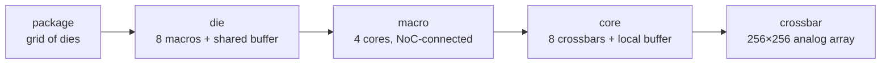

# Does Physical Layout Matter on a Weight-Stationary CIM System?

*A progress report. Every number below has a committed, re-runnable source
(named in each table); figures are generated by the same scripts. The reader
is assumed to start from zero: each section relies only on what came before.*

---

## 1. The system and the question

### 1.1 What the system is

A ReRAM compute-in-memory (CIM) inference machine is a nesting of grids:

The defining property: **weights are written into the crossbar cells once and
never move again**. Multiplication happens where the weights sit. What moves
at runtime is only (a) input activations and (b) partial sums:

| level boundary | going down (inputs) | going up (outputs) |
|---|---|---|
| buffer → macros | each input slice **multicast** to the macros that share it | partial sums **merge** at the buffer |
| macro → cores | same, one level down | same, one level down |
| core → crossbars | same | analog columns already sum inside the array |
| die → die | the finished **layer output** (hidden state) crosses to the die holding the next layer | — |

So there are two very different traffic classes: a heavy multicast/reduction
flood **inside** the die, and a thin stream of finished layer outputs
**between** dies. Section 6 shows this asymmetry is load-bearing.

### 1.2 What the layout decisions are

Going down the hierarchy, someone (today: nobody — these are implicit
defaults) decides:

1. **Which die holds which layer** (the package-level assignment);
2. **Which macro/core/crossbar holds which weight block** inside a die;
3. **Where the shared buffer attaches** on the die's grid;
4. **How the wires are organised** — a private link per unit, a routed grid,
   a tree, or one shared bus.

### 1.3 The question

Do these decisions change **energy**, **single-request latency**, or
**throughput**? By how much, and through what mechanism? (This section
deliberately gives no answer.)

---

## 2. The instrument, and how to read its numbers

We extended the CiMLoop simulator (Timeloop + Accelergy with CIM device
models) so that the questions above become measurable:

- **Real traffic structure**: multicast counted once, idle units carry zero,
  volumes reconciled against the simulator's own access counters (a
  divisibility guard raises on any disagreement).
- **Per-level link pricing**: every wire's energy/latency parameters are
  explicit inputs; anything not yet priced is an explicit zero, never a
  hidden guess.
- **Bandwidth occupancy**: each wire moves a finite number of words per
  device cycle; traffic beyond that serializes. Every flow is routed onto the
  physical wires its interconnect scheme dictates, so shared wires accumulate
  load.
- **Cross-die topology**: dies sit on a package grid with the same routed
  model, one level up.

**Workload and configuration.** GPT-2 medium (24 identical transformer
blocks, d=1024), sequence length 512 — both inference phases: *prefill*
(the whole 512-token prompt processed at once) and *decode* (one generated
token at a time) — on a 24-die package example configuration; each operator is mapped by Timeloop onto one die (8 macros ×
4 cores × 8 crossbars = 256 arrays). The model is deliberately small enough
that every single operator fits inside one die — Section 6 examines what
changes when that stops being true.

**Basis note (O12).** All 355M numbers below are on the **co-residency
basis**: each operator is mapped inside its own array share of the 48-die
seating, which forbids the weight replication an exclusive die allows (the
mapper otherwise duplicates small operators' weights into idle arrays, up
to 8 copies). Without replication every prefill operator computes in
5.19 ms; the stall-free stack is 813.1 ms (92% compute, 8% K/V write);
decode is unchanged. The earlier exclusive-die basis remains frozen as the
v1 fixture.

**Accounting note (O22/O23).** Since 2026-08-21 the wires are accounted
physically: inputs travelling down and partial sums travelling up are
routed separately, point-to-point schemes are full-duplex (one wire set
per direction — the convention every published anchor uses; a bus stays
one shared medium), and partial sums are counted at 16 bits (platform
input; W4×A8 sums over K rows are 12+log₂K bits) against 8-bit
activations. Compute, write and energy are unchanged; every contention
multiplier and threshold moved — up, because the partial-sum width
outweighs the relief of separate wires (the earlier numbers understated
contention). The previous accounting is reproducible on request and kept
as the v2 fixture; the four-way comparison is in §5.2.

**Digital unit note (O24).** Since 2026-08-21 the block's non-matmul
operators — softmax, GELU, LayerNorm ×2, residual adds ×2 — are in every
total. They run on a modeled digital vector unit next to the glb
(`fabric.digital`, platform input DR-8; shipped generic: 64 lanes @ 1 GHz,
Horowitz per-op energies), closed-form: energy = glb passes × the
calibrated 15.47 pJ/word + arithmetic; latency = arithmetic / (lanes ×
clock), serial with the matmuls. At the generic configuration they add
+8.9 mJ (+3.1%) and +13.4 ms (+1.1%) to 355M prefill; decode is
unaffected in practice. softmax leaves with the attention under offload.
The embedding read (priced, not timed) and the LM head (a 7-die matmul,
last token only) complete the model. The v3 fixture keeps the
matmul-only stack; v4 adds the four elementwise rows.

**Two reading rules**, used everywhere below:

1. **A ratio is not a result until multiplied by its level's share.** "The
   network cost doubled" means nothing until you know the network is 0.65% of
   the total. Every table carries the share.
2. **Wire bandwidths are not calibrated to a real chip yet** — they are
   platform inputs with example defaults. The valid form of any
   bandwidth-dependent result is therefore a **threshold** ("below X the
   effect appears") and an **ordering**, never an absolute milliseconds
   claim. Where absolute units appear they are conversions of the example
   inputs, marked as such.

---

## 3. Conclusion 1 — Layout barely changes energy, at any level

### 3.1 The measurements, side by side

| level | what was varied | ratio at that level | that level's share | system effect | source |
|---|---|---|---|---|---|
| macro network (priced) | grid vs line arrangement; full setting sweep | 1.33× – 3.0× | router = 0.65% of a block | **≤ 0.34%** | `analyze_position_aware.py` |
| crossbar map (unpriced level) | corner vs centre position | 1.70× (2×4 die layout; 3.69× on the 3×3 variant; value units C25) | level carries no energy price | ranking only (honest note: not in totals) | `crossbar_comm.py` |
| core regions (unpriced level) | which cores six matmuls occupy | 17.8% | same | ranking only | `analyze_region_locality.py` |
| die-to-die (priced) | worst vs best unit→die ordering (feasible 48-die config, 2 dies/layer) | +1.37 mJ per pass | vs 287.5 mJ total | **+0.48%** | `analyze_d2d.py` |

*The per-crossbar map: identical traffic per crossbar, cost varying only with
position — a ranking a placement search can consume, honestly labelled as not
yet priced in joules.*

### 3.2 Why energy is nearly layout-blind

Energy **sums** over all traffic, and the bulk of every word's cost is fixed
regardless of where it travels: buffer entry/exit, digital↔analog conversion,
and array driving are paid identically whether the destination is one hop or
five hops away. Layout only changes the *extra hops* increment, and the base
that increment multiplies (the on-die network) is ~1% of the system. Between
dies, the volume itself is structurally pinned: only finished layer outputs
cross (12.1M words per pass, against 13,100M words on the on-die network —
three orders of magnitude), so no reordering of dies can move much energy.

### 3.3 Robustness of the conclusion

- Multiply the on-die network's unit price **10×**: the worst layout effect
  grows 0.25% → 2.5% of a block — still single digits.
- Charge cross-die transfers for **every** hop (instead of only hops beyond
  the first, which the flat port already bills): the worst ordering costs
  1.61 mJ = **0.56%** of a pass.

The conclusion survives both.

---

## 4. Conclusion 2 — Layout does affect *time*, through exactly one mechanism

### 4.1 Time is a maximum, not a sum

Latency is set by the slowest term on the critical path, so a term with tiny
energy can own the time entirely. A layout-independent example pins this
down: the ReRAM write of the attention K/V values is **0.9% of decode
energy** but — being a serial microsecond-scale programming operation —
**90% of decode latency**. On this system, small-energy terms ruling the
clock is the steady state, not a curiosity.

### 4.2 Candidate mechanism 1: distance (propagation delay) — ruled out

Signal propagation over the measured worst-case paths adds 0.006% (prefill)
to 0.13% (decode) of a block's latency. Real, wired into the model, and
irrelevant at these scales.

### 4.3 Candidate mechanism 2: bandwidth congestion — this is the one

A wire moves a finite number of words per beat; loads beyond that wait in
line. The behaviour is **threshold-like**: above some bandwidth the effect is
exactly zero, below it the effect *multiplies* latency. With the wires
carrying values (C25) the threshold sits far below the example operating
point and every published (digital-ecosystem) bandwidth (each number is one point of a full
bandwidth sweep — reading rule 2):

1. **Wiring scheme.** Identical traffic and floorplan, only the interconnect
   organisation differing: the busiest wire of a prefill operator is
   occupied 0.19 ms (private links) to 1.53 ms (one shared bus) against
   2.60 ms of compute at the example operating point — the whole stack
   reads **1.00× for every scheme** (zero-overlap end 1.01–1.11×). The
   stack first moves 1% below 1,024 w/c (the routed grids and the tree) to
   2,048 w/c (bus) on the 2^k grid -- 0.8–1.9 GB/s per link as exact crossings; only a bus doubles it, below
   512 w/c.
2. **Buffer position.** On the fill-exact 2×4 die (the default since C27)
   moving the shared buffer from centre to corner does NOT move the busiest
   wire: the elongated grid funnels 4 operators' traffic onto one wire
   either way, so the routed grid ties the tree (1.05× at the zero-overlap
   end, 1.00× on the stack). The 3×3 comparison grid (one empty slot,
   `mlx300_3x3.yaml`) funnels 3→5 (1.67×). What gates the lever (C28,
   `analyze_grid_gating.py`, same traffic and mapping on 3×3 / 2×4 / 4×4 /
   2×8): under xy routing the corner hub's exit wire carries every macro not
   in its own column (busiest = N − column), and a 2-wide grid keeps half
   the macros there — so 2×4 and 2×8 read 1.00× in any filling while 3×3
   and 4×4 (both fillings) read 1.50–1.67×. The gate is the width along the
   routing's first axis, neither squareness nor the empty slot; the
   soft-placement lever (heaviest talker moved) survives on every grid,
   1.75× on the 2×4. Mapping and energy account are unchanged either way.
3. **Removing the masking terms does not expose it.** With attention (and
   its serial write) offloaded, decode's total drops from ~15 ms to ~1 ms
   per token on the die, and the on-die schemes still tie at 1.00×
   (zero-overlap 1.01–1.13×); what offloading exposes is the die-to-die
   network (§5.3). Before C25 this item read "separate by up to 3.3×" —
   the unit error.

---

### 4.4 Offload end to end: the external attention unit as an interface (O9)

Until O9 every offload number counted the die side only. The receiving
unit is now a black-box interface (`fabric.attention_unit`, platform input
DR-9): compute rate, average cost per MAC, per-call overhead, K/V memory
bandwidth/energy/capacity, die↔unit link bandwidth/energy/reference hops,
and the number of units. Shipped generic public figures: 2 T MAC/s and
1 pJ per MAC (edge-NPU class, 4 TOPS INT8 at 2 W), LPDDR4-class K/V memory
(25.6 GB/s, 50 pJ per word, 2 GB), a GRS-class link (12.5 GB/s per
direction, 10 pJ per word), one unit for all 24 layers. The unit sits at the
package attach point; per layer three streams cross the die grid to it (Q
0.52 M words, K/V 1.05 M, attention output 0.52 M back); inside the unit
QKᵀ + softmax + AV run at the rate and the whole stored K/V is read once
per layer, serial with the compute.

| quantity | die side (before O9) | end to end (generic unit) |
|---|---|---|
| prefill stack, no contention | 505.5 ms | 518.1 ms (+12.6 ms: unit 0.359 + link 0.168 ms per layer) |
| prefill energy | 195.9 mJ | 213.5 mJ (+17.6: compute 13.3, K/V 2.5, link 1.8 at the placement's mean 3.5 hops -- the one hop count every script uses, `unit_link_hops`) |
| pipelined beat / dividend | 10.63 ms / +124% | max(10.63, unit stage 8.61) = 10.63 ms / +124% |
| decode per token | 0.99 ms | 1.99 ms (K/V read of 25 MB at 25.6 GB/s = 0.98 ms) |
| decode energy per token | 0.47 mJ | 1.76 mJ (K/V reads 1.26 mJ) — on chip 0.67 mJ |
| busiest die wire, snake / sequential / adversarial / bus | 1 / 1 / 4 / 47 hand-offs | 36 / 25 / 38 / 143 hand-off equivalents (the streams converge on the attach point) |
| pipelined beat with the streams, 256 w/c → 12.5 GB/s anchor | — | 10.05× → 1.00× the die stage (snake) |
| decode at Simba, scheme spread | 1.03–5.61× | 1.01–3.28× |
| ledger, whole model, prefill / decode (v6) | 196.18 mJ, 505.50 ms / 466 µJ, 1.01 ms | 213.75 mJ, 518.14 ms (unit row 8.2% / 2.4%) / 1,756 µJ, 2.02 ms (unit row 73.5% / 49.8%) |

Three readings. (1) Prefill offload survives the generic unit: the unit's
stage (8.61 ms) is under the die stage, so the +124% holds — but only
above ~1.2 T MAC/s for one unit (−57% at 0.25 T; the sensitivity sweep
`offload_unit_sensitivity.png` gives the curve per unit count). (2) Decode
offload trades energy for time: the per-token K/V read grows linearly with
context (1.99 → 4.98 → 16.9 ms at 512 / 2k / 8k tokens at 25.6 GB/s,
overtaking the on-chip 14.8 ms near 7k tokens) and its energy exceeds the
whole on-chip token. (3) The attach point is a new hot spot: three streams
from 24 dies converge there, and at the example bandwidth they, not the
hand-offs, set the beat; at the measured link bandwidth they hide. The die side
always carries the die placement: the streams' link energy is priced at
the seating's mean hop count in every script (the scenario totals, the
ledger, the anchored and sensitivity sweeps and the offload script share
`unit_link_hops`); only the unit's internals are average costs. Still
unmodeled: the unit's internal structure and compute/memory overlap
(stated), pinned in group 21.

## 5. Conclusion 3 — Thresholds beside published hardware: hidden on both sides in the digital-link column

### 5.1 Converting the axis

Bandwidths are modelled in words per device cycle (1 word = 8 bits, device
cycle = 1.4486 µs: the fabric's `device` block since C30, checked against the
calibrated array model on every run). One word/cycle ≈ 0.69 MB/s; 16,384
words/cycle ≈ 11.3 GB/s; a bandwidth is declared in GB/s in the configuration
and converted at load. The unit carries the device: a threshold in
words/cycle is fixed by the traffic, and its GB/s value scales as 1/t_MVM
(7 slices × 1.4486 µs = 10.14 µs per MVM row here; O17).

### 5.2 On-die: hidden behind compute at every published (digital-ecosystem) bandwidth

**Units (C25, 2026-08-27).** Every on-die number before this date took
Timeloop's "Total scalar accesses" as 8-bit words. CiMLoop counts the
Inputs dataspace in input bit slices (7 per signed 8-bit word), the Outputs
dataspace in output bits (8 per word), every physical cell column of a
weight (2, differential encoding) converts on its own ADC, and the total
adds fills and updates to the reads — 14× the input tensor and 48× the
output piece. The wires carry values: the tensor once per multicast group
(`traffic.py` takes row-driver / ADC READS and divides the units out, and a
guard checks that the leaves' distinct slices reassemble P×C and P×M
exactly once). Compute, write and every energy are untouched (v5 fixture:
compute/write rows bit-identical to v4, 60 serialization rows moved).

On the co-residency basis, per-scheme readouts (whole-stack prefill), both
ends of the O7 overlap bracket (perfect overlap / zero overlap):

| wiring scheme | stack moves 1% below | stack doubles below |
|---|---|---|
| private links (star) | 0.195 / 11.4 GB/s | 0.061 / 0.114 GB/s |
| routed grid, buffer centred | 0.782 / 45.7 GB/s | 0.243 / 0.457 GB/s |
| routed grid, buffer at corner | 0.782 / 45.7 GB/s | 0.243 / 0.457 GB/s |
| tree (k=4) | 0.782 / 45.7 GB/s | 0.243 / 0.457 GB/s |
| shared bus | 1.89 / 129 GB/s | 0.68 / 1.29 GB/s |

(Exact crossings by bisection on the closed form, `sweep_axes.py` axis A;
2×4 default grid, C27: the three routed schemes tie because the elongated
grid funnels 4 macros' traffic onto the busiest wire whichever slot the
buffer takes. The 2^k-grid readings pinned in group 17 -- 256 / 1,024 /
1,024 / 1,024 / 2,048 w/c for the 1% line, 64 / 256 / 256 / 256 / 512 w/c
for doubling -- bracket them; on the 3×3 comparison grid the centred /
corner rows read 0.586 / 0.977 GB/s (1%) and 0.182 / 0.304 GB/s (doubling). Before C25 the same
table read 5.7–45 GB/s for the 1% line and 1.4–22.6 GB/s for the doubling
line.)

**Anchored readout** (`analyze_anchored_sweep.py`; anchors and conversions
in [ANCHORS.md](ANCHORS.md): Simba 8.75, ESP 32, FlooNoC 80.6 GB/s per
on-die link). Whole-stack latency relative to an unqueued network, each
cell the O7 bracket perfect-overlap .. zero-overlap:

*Prefill, attention on chip (no-queue stack 826.4 ms):*

| scheme / buffer position | Simba 8.75 GB/s | ESP 32 GB/s | FlooNoC 80.6 GB/s |
|---|---|---|---|
| private links (star) | 1.00–1.01× | 1.00–1.00× | 1.00–1.00× |
| routed grid, buffer centred | 1.00–1.05× | 1.00–1.01× | 1.00–1.01× |
| routed grid, buffer at corner | 1.00–1.05× | 1.00–1.01× | 1.00–1.01× |
| tree (k=4) | 1.00–1.05× | 1.00–1.01× | 1.00–1.01× |
| shared bus | 1.00–1.15× | 1.00–1.04× | 1.00–1.02× |

*Decode with attention offloaded (no-queue stack 0.99 ms/token, die side):*

| scheme / buffer position | Simba 8.75 GB/s | ESP 32 GB/s | FlooNoC 80.6 GB/s |
|---|---|---|---|
| private links (star) | 1.00–1.01× | 1.00–1.00× | 1.00–1.00× |
| routed grid, buffer centred | 1.00–1.05× | 1.00–1.01× | 1.00–1.01× |
| routed grid, buffer at corner | 1.00–1.05× | 1.00–1.01× | 1.00–1.01× |
| tree (k=4) | 1.00–1.05× | 1.00–1.01× | 1.00–1.01× |
| shared bus | 1.00–1.17× | 1.00–1.05× | 1.00–1.02× |

*Where the old numbers went (prefill, Simba anchor, perfect-overlap end):*

| scheme / buffer position | v3 (O22/O23, counter units) | v5 (value units) |
|---|---|---|
| private links (star) | 1.03× | 1.00× |
| routed grid, buffer centred | 1.84× | 1.00× |
| routed grid, buffer at corner | 2.86× | 1.00× |
| tree (k=4) | 2.33× | 1.00× |
| shared bus | 5.24× | 1.00× |

The single-operator readout tells the same story at its own denominator
(ffn1 prefill, 2.60 ms of compute, 16,384 w/c): the busiest wire is
occupied 0.19 ms (private links) to 1.53 ms (bus) — 1.00× at the
perfect-overlap end for every scheme, 1.07–1.59× at the zero-overlap end;
the ratios between schemes are what they were (bus / star 8.27× in
occupancy; corner / centre 1.00× on the 2×4 default, 1.67× on the 3×3
comparison grid), only the level moved. The per-crossbar
distance maps (3×3: 3.69×, 2×4: 1.70×) and the region metric (17.8%) are
ratios and barely moved.

Three things the anchors now settle:

1. **At every published on-die bandwidth (all of them digital NoCs, §5.5), the network is hidden behind
   the analog crossbar's compute** — 1.00× at the perfect-overlap end for
   every scheme and buffer position, both conditions. The old "first-order
   at the Simba anchor" reading (1.03–5.24×, buffer lever 1.55×) was the
   unit error, not a property of the chip.
2. **What remains is the zero-overlap end**: without double buffering the
   bus leaves 15% on the table at the Simba anchor and 2% at FlooNoC, the
   routed grids and the tree 5%; whether the network is *perfectly* invisible is still
   decided by the double-buffering microarchitecture, but the stakes are
   percent, not multiples. Both ends still rank the schemes identically
   (star < the three routed schemes, which tie on the 2×4 grid, < bus; pinned).
3. **The thresholds sit an order of magnitude below the anchors**: the
   stack first moves 1% at 0.2–1.9 GB/s per link (exact crossings,
   scheme-dependent) and doubles only on a shared bus below 0.68 GB/s. On
   this device (1.4486 µs cycle, 10.14 µs per MVM row) the on-die network
   would have to be 5–45× slower than the slowest published NoC to matter
   — which is where the analog CIM systems that describe their fabrics
   actually sit (DMA + shared SRAM, board-level hubs, compile-time
   scheduled links; none with a published link bandwidth, §5.5). Read at
   the analog-reality band's low end (0.4 GB/s, estimated) the bus is
   3.33×, the routed grids and the tree 1.31× (they tie on the 2×4 grid)
   and private links 1.00× (perfect-overlap end); at its high end
   (8 GB/s) every scheme is 1.00× (`sweep_axis_ondie.png`, C26). The
   busiest-operator boundary scales exactly as 1/t_MVM (the plane, C31):
   at the ISAAC design point (1.6 µs, 6.3×) the routed boundary is 5.1
   GB/s, at HERMES (~133 ns, 76.3× [derived]) 61.6 GB/s — above Simba and
   ESP, below FlooNoC only (`device_plane.png`, §5.5).

The accounting history is kept because it is a lesson, not a result:
exclusive-die basis 1.42–8.60× → co-residency 1.00–3.11× → physical wires
1.03–5.24× → value units 1.00×. The first three moves changed the
denominator or the wire model; the last removed a factor of 14–48 in the
numerator that had been present since the structured traffic model (v1)
took Timeloop's counters as words.

Caveat: the core-level region allocation (the 17.8% ranking of §3) cannot
join this sweep — those links carry no bandwidth or price yet — so the
anchored grid covers scheme × buffer position, not region assignment.

### 5.3 Die-to-die: safe by a wide margin (at this model's granularity)

Every hand-off is 0.52M words (feasible 48-die configuration: two dies per
layer — attention half + FFN half — so 47 hand-offs per pass). Even in the
most demanding operating mode (pipelined serving, every boundary
transferring each beat, stage 23.5 ms on the co-residency basis),
throughput degrades only below **0.011–0.044 GB/s** for routed-mesh
orderings — **283× to 1,132×** under the one silicon-measured die-to-die
anchor we have (Simba's package mesh: 100 Gb/s = 12.5 GB/s per link
direction, at 0.82–1.75 pJ/bit; see [ANCHORS.md](ANCHORS.md)). One
exception at this granularity: a single shared-interposer **bus** degrades
below **0.71 GB/s**, 18× under the anchor — the thinnest margin on the
package. These are the perfect-overlap end (O7): with zero overlap the
mesh margins shrink to 2.2×–8.8× and the bus's guard bandwidth (90 GB/s)
crosses the anchor — a non-double-buffered interposer bus pays ~8% of the
beat there. (Full-duplex wires, O22: the busiest-wire integers of the
6×8 chain are 1/1/4/47 — sequential rows equal snake once the row wrap
rides the opposite-direction wires, and the adversarial order halves.
The knee integers are power-of-two grid readings: with the digital-unit
terms the beat is 1.3% longer, which tips the 32 w/c point of the mesh
orderings just under the 1% line — 32/32/128 → 16/16/64 w/c, not a
mechanism change.) Its
measured pJ/bit band (6.6–14 pJ/word) is now also the source of our default
per-word energy (10 pJ, the band midpoint) — the earlier 5 pJ example it
replaced was optimistic by 1.3–2.8×. In single-request operation the hand-off (2.97 ms at the
example link) hides entirely behind the stack's 747.6 ms of compute.

**Read in the analog-reality D2D band** (0.1–2 GB/s, estimated; C26,
`sweep_axis_d2d_355m.png`): with the attention on chip the mesh orderings
stay 1.00× down to 0.1 GB/s (their pipelined 1% crossings are 0.022 GB/s
snake / sequential and 0.087 GB/s adversarial) while the interposer bus
reads 10.4× at 0.1 GB/s (1% crossing 1.02 GB/s, doubling 0.52 GB/s). With
the attention offloaded the streams to the attach point raise every
busiest-wire integer (36 / 25 / 38 / 143 boundaries) and the pipeline reads
12–19× (mesh) and 70.5× (bus) at 0.1 GB/s, 1.00× (mesh) and 3.5× (bus) at
2 GB/s: the +124% offload dividend needs 1.2–1.9 GB/s per direction (the
mesh orderings' 1% crossings), which GRS clears 7–10×. Single-pass
multipliers stay within 1.00–1.48× across the band.

### 5.4 Corollary: at the current configuration, die ordering is free

All four tested layer→die orderings tie: energy within +0.08%, single-pass
latency identical to the microsecond. **This is the model measuring "does
not bite" — not a failure to model it.** The machinery that would show a
difference is the same machinery that shows none here.

---

### 5.5 The reading position: what the anchors are, and are not (O25 / O17 / O26)

Every "at every published bandwidth" sentence above is the reading of ONE
cell of a phase diagram whose axes are model scale × device speed ×
transfer paradigm × link tier; the v5 numbers sit in the (NeuRRAM-class
device × digital-ecosystem link) cell. The thresholds themselves (0.2–1.9 GB/s on die; the 2.7B chain's 1–1.8 ms per layer of die-link occupancy at
GRS against 28.8 ms of compute) come from our traffic and our device cycle
— no anchor enters them; what the anchors decide is only where they are
read.

**What the anchors are.** Simba, ESP, FlooNoC and GRS are digital
accelerators' links: upper bounds of what fabricated interconnects deliver,
not operating points of analog CIM chips. No fabricated analog CIM system
publishes an on-die link bandwidth; the ones that describe their fabric are
DMA + shared SRAM (TetraMem MX100: 10 NPUs + RISC-V + 512 KB + 1 MB SRAM,
65 nm), board-level FPGA hubs (NeuRRAM's inter-core buffers and partial-sum
accumulation sit on the board; the Tsinghua multi-chip system routes all 8
chips through an FPGA), or compile-time scheduled point-to-point networks
(HERMES: per-core link controllers, no bandwidth in the main text; Mythic
AMP: per-tile 64 KB SRAM + router, product material only). In this model
those map to: DMA / shared SRAM → a shared medium whose bandwidth is the T1
hub bandwidth; compile-time scheduled → the star scheme; NoC → the mesh
scheme (registry mapping in ANCHORS.md).

**The analog-reality tier, measured (O25 closed, C26).** The registry
(`scripts/anchors.py`) carries the digital anchors with a status each, the
analog-reality tier as an estimated band (on die 0.4–8 GB/s, die to die
0.1–2 GB/s) and the chip points of the phase diagram (NeuRRAM 10.14 µs
measured, HERMES 0.133 µs derived, ISAAC 1.6 µs design point; MX100 and
Mythic pending). The per-axis sweeps (`sweep_axes.py`, 8 points per decade,
both overlap ends, `sweep_axis_*.png`, `phase_sweep.json`, group 23) read
the band: on the die, bus 3.33× / the three routed schemes 1.31× / private links
1.00× at 0.4 GB/s and 1.00× throughout at 8 GB/s;
the 2.7B chain (O13) crosses 1% at 1.02–1.72 GB/s and doubles at 0.26–0.40
GB/s (4.9–7.0× at 0.1 GB/s, 1.00× at 2 GB/s and at GRS; ffn2's entry sets
the busiest die link; the on-die link at 0.4 GB/s stacks a further 1.19×);
the 4-die probe doubles at 0.20–0.40 GB/s; the die↔unit link costs 1% at
GRS (prefill 518.1 ms end to end, the ledger's number) and doubles the
end-to-end latency at 0.098 GB/s. This is a CURRENT conclusion at NeuRRAM
speed, no device extrapolation: shared media cross the line in the
analog-reality tier, point-to-point links cross it at the 0.1 GB/s
die-to-die tier, every digital anchor reads 1.00×. The knee operator is
reported per condition: qk^T in prefill on chip (ffn2 on the bus), ffn2
everywhere once the attention is offloaded — "S cancels" holds for the
projections only, so the phase diagram's on-die panel uses "prefill,
attention offloaded" (O29).

**The device axis (O17; the input C30, the plane C31).** The device is a
fabric input since C30 (`device: {cycle_seconds, input_slices_per_mvm}`;
every latency and every GB/s ↔ words/cycle conversion reads it, bandwidths
are declared in GB/s, every run checks the CiMLoop macro's cycle). C31
measures the axis: the (t_MVM × bandwidth) plane (device grid 0.05–100 µs
crossed with the bandwidth axes; closed-form, no mapper rerun — at a fixed
GB/s the seconds on a link carry no device, the group 26 identity). The
plane's metric is the busiest operator's network / compute ratio r(g, t)
— not the whole-stack multiplier, because t_MVM scales the MVM read path
only (K/V write, digital unit, attention unit, link GB/s fixed). The r = 1
boundary is the closed form g = 11.310 × (ser/comp) × (10.14 µs / t): the
swept thresholds land on it to 1e-9 (group 27). Measured (prefill,
attention offloaded; knee ffn2 everywhere): star 0.202 / routed 0.808 /
bus 2.02 GB/s at NeuRRAM → 15.4 / 61.6 / 154 GB/s at HERMES (76.3×,
derived) — Simba and ESP fall below the routed line, FlooNoC alone stays
above; the 2.7B chain's boundary moves 1.01 → 77 GB/s, 6.2× past GRS —
both stories flip inside the analog family, as measured plane readings.
The whole stack does not scale with the device: 76.3× faster speeds
prefill 9.33× and decode 1.11× (the K/V write dominates decode; the
fixed-term decomposition `device_fixed_terms.png`); the matrix part
collapses exactly in g × t_MVM, the whole stack does not
(`device_plane_collapse.png`). The silicon marks (four since C36: NeuRRAM measured, Mythic derived,
ISAAC design point, HERMES derived) come from the registry
(`anchors.device_marks()`); the surface between them is closed-form, not
measurement. Since C33 the plane also draws the d-family boundary lines
(one per width tier, d = 1024 the production base; die level from the
tiler closed form, the d = 2560 line through the measured B2 mark) with
the routed ×4 multiplier verified d-independent on the re-scored probe
flows. The T1 (die-buffer) axis is audited and measured since C34: Timeloop
throttles the glb in counter units (×7 / ×8×2 — the old "160× at 64 w/c"
reproduced exactly in closed form); the readable axis is analytic in value
units, hub = T2 bus + the input's in-fill (ffn1 +6.25%), 1% at 2.27–2.33
GB/s, MX100-class chips 3.9–5.0× at the estimated band's low end
(`sweep_axis_t1_hub.png`, group 29). The phase diagram itself is drawn
since C35 (`phase_diagram.png` + grayscale copy + the grid → ratio table,
group 30) — with the die-level semantics corrected in review: the black
d = 1024 line is the pure hand-off stream; the d ≥ 2560 lines are block
chains INCLUDING their spanning operators (each receiving die takes the
full input), hence above the single 4-die operator probe. The scaling law in d is measured (O17c, C32; 48 mapper runs,
column split only): above the flip the busiest wire is the INPUT TRUNK and
serial / compute = d / 114,688 exactly ("knee ∝ d", slope 1 — the O29
boundary family's closed form); the flip is measured at d* = 1,220–1,350,
not the predicted 5,793 (falsified 4.3×: the prediction ignored the macro
fanout and exact die fill); ffn2 steps with the tiler's macro C split; and
every probed ratio is S-independent, attention included (qk^t: volume ∝ S²,
compute ∝ S², ratio 1/14). Below d* the dies are underfull and the mapper
replicates weights — the left branch is mapper-shaped. Figure
`scaling_law_vds.png`, pins in group 28; the earlier 7B / 70B
extrapolation had been withdrawn, the up-traffic story is now replaced by
the measurement.

**What the busiest wire means (O26).** For a given routing, any schedule —
a compile-time one included — needs at least volume ÷ bandwidth on each
wire, so the max end is the exact ideal of the scheduled paradigms and the
optimistic bound of the NoC paradigm; the sum end is the fully serialised
bound. "No queueing" is a gap of the NoC column only; for scheduled fabrics
the open question is feasibility, expressed as a `schedule_slack` platform
input (default 1.0).

---

## 6. Conclusion 4 — *Why* die-to-die is safe: two ratios, and what flips them

### 6.1 Ratio one: per-unit volume ÷ per-die capacity

As long as a compute unit's weights fit inside one die, the multicast/
reduction flood stays internal and only layer outputs cross (12.1M vs
13,100M words). Once weights exceed one die, an operator's input has to
reach several dies and its output pieces have to leave them — the tensor
once per die (O13): cross-die volume per layer grows from one hidden state
(1.3 M words at d=2560) to the sum of every operator's inputs over its dies
(26 M words), twenty-fold, not a hundredfold; the crossbars' re-reads stay
on the die.

Measured on this configuration (honest capacity: one weight occupies **two**
cells under the device's differential encoding, so a die holds 8.39M
weights):

| granularity | volume ÷ capacity | status |
|---|---|---|
| largest single operator (ffn1) | **0.50** | safe — this is what today's runs use |
| one whole layer (6 operators) | **1.50** | already past the flip at layer granularity: the feasible configuration places TWO dies per layer (attention half + FFN half, the latter filling its die exactly) — now the configuration all 355M die-level results use (valid to 2,048 tokens of K/V growth on the attention die — computed ceiling, guarded; O21/C38) |

**The flip, measured.** A probe operator sized at 4 dies of weights (a
2.7B-class FFN shape, 64 rows) was run with the multi-die spatial split
(weights stay resident, the operator spans 4 dies). What crosses a
die-to-die wire is the tensor ONCE (O13): the whole input from the attach
point to every die, each die's complete output piece back — 0.13 M words
in and 0.26 M out per die, at activation width. At the measured D2D anchor
(GRS 12.5 GB/s):

| where the 4 dies sit on the package | op latency (perfect-overlap end) | zero-overlap end | extra energy |
|---|---|---|---|
| clustered at the attach point | 0.65 ms (1.00× compute) | 1.03× | 0 |
| one row | 0.65 ms (1.00×) | 1.06× | 31 µJ (1.4% of the op's 2.24 mJ) |
| spread | 0.65 ms (1.00×) | 1.06× | 35 µJ (1.6%) |

The operator stays compute-bound above ~0.8 GB/s, two orders below the
anchor. Before O13 the same probe read 3.10–6.20× and up to 1.30 mJ
(`analyze_multidie_placement.py`, kept in `scale_tiers.json` as `tierM_v1`):
that accounting took Timeloop's row-driver / ADC counters as die-edge
words — 14× the input tensor (the bit-slice passes the crossbar rows see)
and 48× the output piece, the latter at partial-sum width although a
column-split output is complete — and routed everything through the attach
point. The re-reads are on-die traffic (the die's buffer holds the tensor);
the die-to-die wire carries the tensor once, the same convention as the
layer hand-offs. So a spanning operator's cross-die traffic is 0.4 M words
(probe) to 26 M words per layer (the 2.7B block at 512 rows), not 57.7 M
per operator.

**The flip, completed: a full model past the boundary.** The whole
2.7B-class model (d=2560, ff=10240, 32 layers) was then simulated end to end
— the first full model on this platform whose operators span dies (4/2/5/5
dies for the static operators, by the residency tiler; the power-of-two
fanout grid needs more dies than raw capacity says, a utilisation loss the
run charges honestly). At the measured D2D anchor (Simba GRS, 12.5 GB/s):

The block's five die-sets (Q/K/V projection 4 dies, the attention die,
output projection 2, feed-forward 5 + 5 = 17 dies) are seated DISJOINTLY on
the 24-die package in data-flow order, and every operator's input is routed
from the dies that own the previous operator's output over the die mesh
(O13, `llm_workload.block_chain / seat_block / block_die_flows`); the last
die-set feeds the next layer's first (layers as identical copies — the
joint seating of all 32 layers is O16).

| seating of the block's die-sets | prefill stack (NoC @ ESP 32 GB/s, D2D @ GRS) | zero-overlap end | die transfers per layer | extra D2D energy per pass |
|---|---|---|---|---|
| clustered (nearest free seats to the attach point, in chain order) | 938.7 ms (1.02×) | 1.26× | 1.08 ms (of 28.8 ms compute) | 30.5 mJ (+1.3% of the model's 2297 mJ) |
| row-fill (consecutive seats) | 938.7 ms (1.02×) | 1.28× | 1.56 ms | 27.1 mJ (+1.2%) |
| spread (farthest-point) | 938.7 ms (1.02×) | 1.26× | 1.10 ms | 30.1 mJ (+1.3%) |

The 1.02× is the on-die network's; the die transfers hide behind compute at
every seating (they would surface below ~0.7 GB/s of link bandwidth) and
show only at the zero-overlap end (+13–15 points). At the Simba NoC anchor
the stack is 1.33× — again the on-die network, identical across seatings.
Row-fill has the shortest hand-offs (consecutive die-sets sit next to each
other), clustered the shortest distance to the attach point; neither
matters at the anchor. Where the old numbers went (same runs, same
anchors, ESP 32 × GRS, `scale_tiers.json`):

| accounting | clustered | row-fill | spread |
|---|---|---|---|
| v1: Timeloop counters as die-edge words, hub-routed, 16-bit up, every op alone on its best seats | 1.22× / 0 mJ | 2.14× / 792 mJ | 1.97× / 829 mJ |
| the tensor once, still hub-routed, every op alone | 1.02× / 0 mJ | 1.02× / 37 mJ | 1.02× / 38 mJ |
| **O13: the tensor once, routed producer → consumer, die-sets seated together** | **1.02× / 30 mJ** | **1.02× / 27 mJ** | **1.02× / 30 mJ** |

The volume basis did almost all of it (14× / 48× counters → the tensor
once); the routing then moved the energy by a third and nothing in
latency. The joint seating also retires the "clustered = per-op lower
bound" caveat at block level: the clustered row is now an achievable
configuration (the whole-model seating, O16, can only lengthen the
hand-offs).

Reading: at the measured D2D anchor and the tensor-once convention, the
die-set seating of a spanning model is a ~1% energy lever and no latency
lever; the latency lever at 2.7B stays on the die (the NoC tier). The +34%
energy figure of the previous reading is retired. Accounting note: the
temporal-rewrite mechanism fires zero times in these runs (every operator's
weights stay resident, verified per mapping); the only write charged is the
attention K/V programming in the on-chip condition. In the
**offloaded-decode** condition (attention and its write on the external
unit, die side counted; Q/K/V to the attach point and the attention output
back are routed like every other hand-off) the die transfers are 2–3 µs
per layer: 1.35 ms per token at every seating (1.00–1.01×, zero-overlap
1.17–1.20×), 0.05–0.06 mJ of surplus — before O13: 1.27× → 2.50×.

Value distributions: the tier-L runs use REAL operand histograms extracted
from facebook/opt-2.7b itself (192 per-layer histograms,
`extract_opt2p7b_hists.py` — the model whose shapes these runs use), not
borrowed GPT-2 ones; the substitution moved every energy by ≤1.4% (whole
stack −1.2%), which also bounds how much the earlier borrowed-distribution
approximation mattered. The per-crossbar distribution machinery was
regression-checked after all the recent plumbing: spreads reproduce at
1.000× / 1.002× / 1.010× / 1.199× (the last vs 1.204× — drift from
unseeded random CNN sample inputs, not from code).

Scale-study figures: `anchored_sweep.png` (tier S), `scale_tier_probe.png`
(tier M), `scale_tier_2p7b.png` (tier L), `scale_combined.png` (all three).

### 6.2 Ratio two: per-die compute time ÷ hand-off time

The microsecond-scale analog array makes one layer's compute ≈ 34 ms
(co-residency basis, digital terms in), while a layer hand-off at a real
link speed is tens of µs — two to three orders of headroom. The ratio
shrinks with faster devices, smaller dies, or offloading (measured:
offloading attention cuts the pipeline beat 23.8 → 10.6 ms and moves every
network threshold up one octave, 2×).

### 6.3 Cross-check against a published system

Simba (a 36-chiplet digital inference machine, Shao et al., MICRO 2019) has
*both* ratios on the other side: fast digital arithmetic, small dies, layers
spanning many chiplets. Its published measurements show strong cross-die
placement sensitivity (up to ≈2.5× latency, double-digit-% energy effects).
One mechanism — the two ratios — explains both systems' opposite behaviour,
which is the closest thing to external validation this model currently has.

### 6.4 Flip conditions

Any of the following re-opens the die-to-die question, and each is
quantifiable by this tool before hardware exists:

1. **Bigger models** — a Llama-70B-class layer is ~1.7G cells ≈ 100 dies at
   this density; every operator spans dies. On the die the knee DOES scale
   with d_model once operators span dies: the measured law (17c, C32) is
   ratio = d / 114,688 above the flip d* ≈ 1.2–1.3k — at d = 8192 the
   on-die knee is already 4.3× the 355M one, and it keeps climbing ∝ d
   (with tiler steps); the partial-sum-up regime exists only in underfull
   dies below d*.
2. **Smaller dies** — ratio one rises directly.
3. **Faster readout** — ratio two falls directly: at ISAAC-class speed (6×
   per MVM row) or HERMES-class (~76× [derived]) the 2.7B chain's 1–1.8 ms
   per layer of die-link occupancy at GRS meets, then exceeds, the compute
   (28.8 → 4.6 → 0.38 ms).
4. **Offloading** — measured 2× threshold shift (v2 basis, halved stage), plus decode losing its
   masking term (§4.3).
5. **Slower links** — the analog-reality die-to-die tier (board-level or
   older-node direct links, 0.1–2 GB/s, estimated; C26): the 2.7B chain
   doubles below 0.26–0.40 GB/s and reads 4.9–7.0× at 0.1 GB/s; the
   offloaded 48-die pipeline reads 12–19× there — at NeuRRAM speed,
   measured on the sweeps (§5.5).

---

## 7. Conclusion 5 — On-die layout cannot be solved by intuition

Three measured reasons an automatic search is warranted:

1. **Distance-optimal and congestion-optimal disagree.** The 3×3 die layout
   spreads distance worse (3.69× vs 1.70×) but congests less (3 vs 4
   operators on the busiest wire) than the 2×4 layout — the two metrics rank
   the same pair of layouts in opposite orders. Likewise, the layout ranked
   best by energy (routed grid, buffer centred) and the one ranked best by
   latency (private links) are different designs — though on this device
   the latency side is worth percent at the zero-overlap end and nothing
   at the perfect-overlap end (C25):

2. **A measured counter-intuitive case — and where it went.** On the
   exclusive-die basis, in decode with attention on chip, the corner buffer
   position slightly *beat* the centre (15.62 vs 15.70 ms/token): decode
   only occupies part of the array, and which slots are active couples to
   where the buffer sits. The mechanism is pinned
   (`test_partial_occupancy_couples_layout_to_active_slots`); on the
   co-residency basis with value units both positions read 14.80 ms and
   the reversal is not measurable. "Corner is always worse" remains false
   as a mechanism; the search argument rests on the metric disagreement,
   not on this reversal.

3. **The synthesis.** On the die the measured levers are second-order at
   published digital-ecosystem bandwidths (C25; §5.5), and the search argument there is the
   zero-overlap margin and the energy rankings; between dies the
   throughput and seating levers are first-order where operators span
   dies or where shared-medium packaging is used (§5.3, §6). Intuition
   demonstrably fails on the die-level rankings (this section), so the
   search problem is legitimate but its weight has moved to the package.
   Formally: search over (slot permutations at each level) ×
   (interconnect scheme and its parameters) × (operator→die-set assignment,
   §6.1), minimising the tuple (energy, single-request latency, pipelined
   interval), all three evaluable by this tool.

---

### 7.x The per-operator ledger (deliverable, 2026-08-21)

`scripts/op_breakdown.py` is the single entry point for the company's
per-operator request: one mapper run per operator, then a whole-model
operator-type share table (six matmul types × layers, under attention-on-chip
and attention-offloaded conditions; since O24 the non-matmul operator
types — softmax, GELU, LayerNorm, residual adds — are numbers on the
digital unit, the embedding read is priced (timed only with an off-chip
bandwidth set) and the LM head is a real 8-die matmul, last token only),
per-operator totals, and every cost item on its own row (24 CiMLoop
components, placement re-pricing, K/V write, rewrite, D2D, an explicit
residual row; latency composed at both O7 ends).
Categories are deliberately not merged. Conservation is pinned (group 19)
and the whole-model totals reproduce the system script's numbers exactly.
Outputs under `analysis/op_breakdown/` (the figures and the table file are
tracked; the JSON/CSV are regenerable). A companion settings document
(`analysis/settings_and_assumptions.tex`, local) states every setting,
assumption, formula and replaceable input of the v4 baseline for the
company's review.

## 8. Summary table and validity boundary

### 8.1 All results in one table

| # | level | variable | metric | effect | holds when | source |
|---|---|---|---|---|---|---|
| 1 | macro | arrangement | energy | ≤0.25% of block (≤2.5% at 10× price) | always (priced) | `analyze_position_aware.py` |
| 2 | crossbar/region | position | energy | 1.70×/3.69×, 17.8% — rankings | level unpriced | `crossbar_comm.py`, `analyze_region_locality.py` |
| 3 | die | wiring scheme | stack latency | 1.00× at every scheme (ref. input and every digital-ecosystem anchor; zero-overlap 1.01–1.15× at Simba) — value units C25 | below 0.2–1.9 GB/s per link (exact 1% crossings, §5.2); at the analog-reality band's low end (0.4 GB/s, est.) bus 3.33×, routed schemes 1.31× | `analyze_contention_system.py`, `sweep_axes.py` |
| 4 | die | buffer position | stack latency | 1.00× (zero-overlap 1.05× either way at Simba); busiest-wire occupancy 1.00× on the 2×4 default (1.67× on the 3×3 comparison grid) | same | same |
| 5 | die | scheme (decode, attention offloaded) | token latency | 1.00× die side and end to end at every digital-ecosystem anchor (zero-overlap 1.01–1.17×) | write no longer masks, compute still does | `analyze_offload_contention.py` |
| 6 | package | layer ordering | energy | ≤+0.15% | operator fits one die | `analyze_d2d.py` |
| 7 | package | unit ordering (48-die config) | pipelined throughput | up to 2× (mesh orderings; bus 23×) at 64 w/c | mesh orderings below 0.022–0.087 GB/s, bus below 1.02 GB/s (exact 1% crossings, overlap end); offloaded: mesh below 1.2–1.9 GB/s, bus 7.0 GB/s (§5.3) | same |
| 8 | package | die-set placement of a spanning operator | op latency / energy | 1.00× (zero-overlap 1.06×) / +1.6% at the GRS anchor (O13: the tensor once, routed) | operator exceeds one die; the 2.7B chain hides at GRS, moves 1% below 1.0–1.7 GB/s and doubles below 0.26–0.40 GB/s (§5.5) | `analyze_scale_tiers.py` |

### 8.2 Assumptions, and which conclusion flips if one fails

| assumption | if it fails |
|---|---|
| weights resident, written once | §3.2 and §6.1 collapse — weight movement becomes the dominant traffic and layout becomes an energy variable everywhere |
| no cross-layer pipelining in the latency account | §5.3's single-pass safety overstates; the pipelined columns already show the alternative |
| one cross-die traffic class (layer outputs only) | §5.3 margins shrink (e.g. KV-offload streams sharing the die links) |
| capacity grid (8.39M weights/die, 2 cells/weight) | §6.1's flip points move linearly with it |
| contention = busiest wire (the least serialisation any schedule can reach for the given routing: exact for star and bus, a lower bound for a routed grid), no arbitration model; `schedule_slack` = 1 | all latency multipliers are lower bounds of the max/sum bracket; arbitration can move NoC-style fabrics only, inside the bracket; a slack > 1 scales every occupancy (C29) |
| the anchors are digital-ecosystem links | §5 is one column of the phase diagram; in the analog-reality column (C26, estimated band) the die-to-die conclusion (§5.3, §6) moves first — the 2.7B chain doubles below 0.26–0.40 GB/s, the offloaded 48-die pipeline reads 12–19× at 0.1 GB/s; on the die only the shared bus crosses the line (3.3× at 0.4 GB/s) |

### 8.3 What depends on placeholder parameters, and what does not

| depends on example inputs | does **not** depend on them |
|---|---|
| absolute ms / mJ / GB/s values | every ordering (which layout is worse) |
| where a threshold falls in GB/s | that behaviour **is** threshold-like |
| the +0.08% / 0.25% magnitudes | the flip mechanisms and both ratios of §6 |

---

## 9. Implications and next steps

**Design implication.** In the cell the v5 numbers are read in — a
NeuRRAM-class device against digital-ecosystem links — neither network is
on the critical path; the bandwidth-budget question moves to the reading
position: which column the chip's own fabric belongs to (a DMA / bus or
board-level fabric sits an order of magnitude below the anchors, O25) and
how fast its crossbar is (O17). §6.4 lists the five triggers, each
computable in advance with this tool.

**Next steps** (priority order; the worklist in FIXLIST.en.md is the
authority).

1. ~~O25 — the anchor grid~~ — **done (C26)**: the registry with a status
   per row and the chip points, the estimated analog-reality band, the
   per-axis sweeps read in both columns (§5.5), the settings mapping table.
   Leftovers settled (C36): Mythic t_MVM derived (6.38 µs), the HERMES link
   rate found published (3.2 Gbit/s = 0.4 GB/s per link — the analog band's
   low end), the ESP anchor primary-sourced (ESSCIRC 2022). MX100 stays
   blocked on its source (no published rate) — a new worklist item.
2. **O17 — the device axis** — **done** (17a C30, 17b C31, 17c C32): the
   device as a fabric input; the (t_MVM × bandwidth) plane with the silicon
   marks (four since C36), fixed terms and the collapse; the mapper-measured
   V(d, S) (trunk law ratio = d / 114,688, flip d* = 1.2–1.3k,
   S-independence) (§5.5). The one exception still unexercised is the row
   split (O15).
3. ~~O26 — the busiest-wire bound~~ — **done (C29)**: stated in the model
   sections, the `schedule_slack` input, group 25. The T1 axis is audited
   (O28/C34) and the phase diagram drawn (O29/C35, with the d family and
   corrected die-level semantics).
3b. **The validation track** (current work; FIXLIST is the authority):
   ~~V0 silicon-point normalization + HERMES self-consistency audit~~
   (done, C37) → ~~V1 Simba reproduction~~ (**done**, C41–C48: the frozen
   experiment-point preset, three targets graded under a pre-registration
   with amendments declared before each run, the packet bracket
   [busiest-wire bound, round-serialized end], Simba as the first DIGITAL
   chip point on the phase diagram — `simba_validation.png`; the
   validation chapter now carries one external contrast per layer: HERMES
   audits the accounting caliber, Simba the soft-placement effect) → the
   document round (+ item 13,
   the stale slow-suite goldens) → V2 BookSim slack → V3 robustness table
   → the freeze (precondition since C40-r: fast AND slow suites fully
   green; the slow suite runs weekly and before every freeze).
4. **S1–S6 — the search milestone** (AFTER THE FREEZE), run only in the
   cells where the diagram has play (fast device, shared medium,
   offload-decode, weak D2D × spanning), with the proxy-optimization study
   as its result.
5. **O27 — static energy and peak concurrency** (closed-form; AFTER THE
   FREEZE).
6. ~~Source the §5 comparison points~~ — **done**: [ANCHORS.md](ANCHORS.md)
   (Simba silicon, ESP, FlooNoC; Simba GRS for die-to-die), read out in
   §5.2/§5.3 via `analyze_anchored_sweep.py`; re-labelled as the
   digital-ecosystem column (O25). ~~Remaining: a D2D anchor beyond Simba (UCIe-class)~~ -- done (C40):
   UCIe-S 64 GB/s per direction per x16 module, status `spec` (the
   standard's ceiling, one epistemic step past post-layout).
