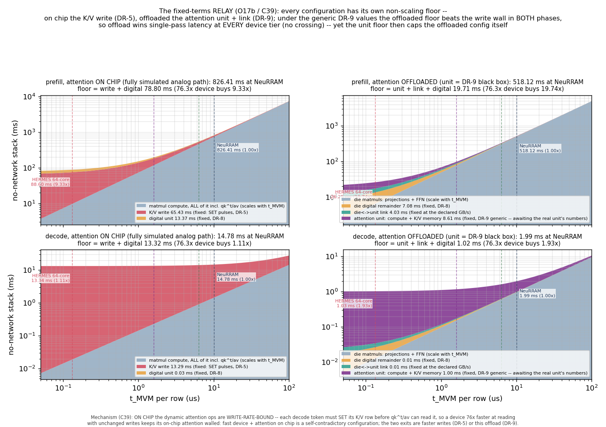
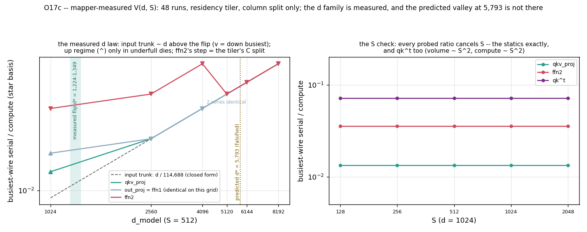
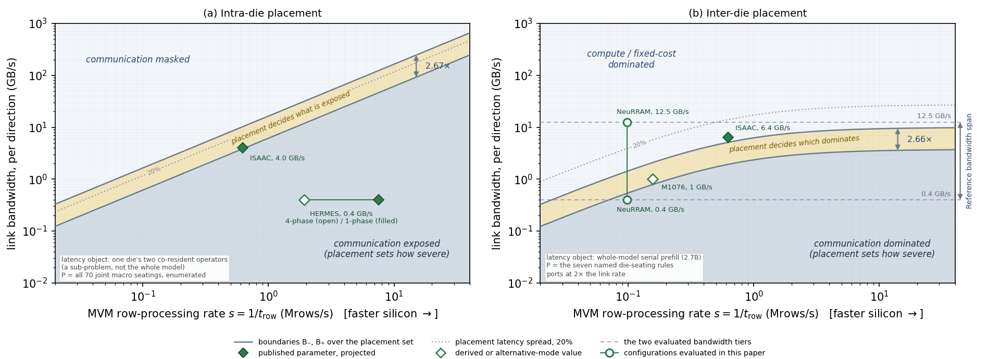
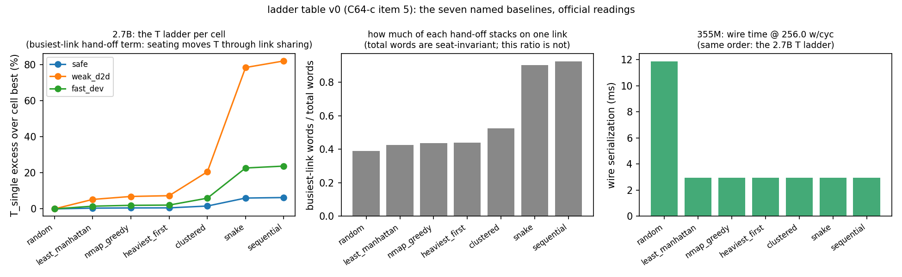
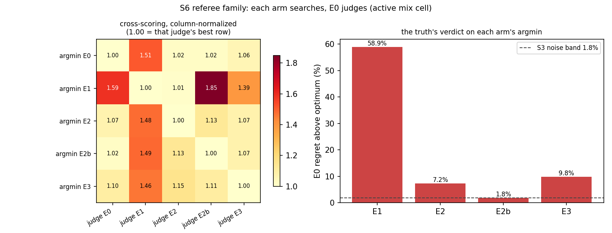
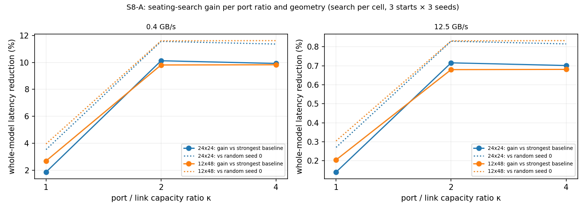
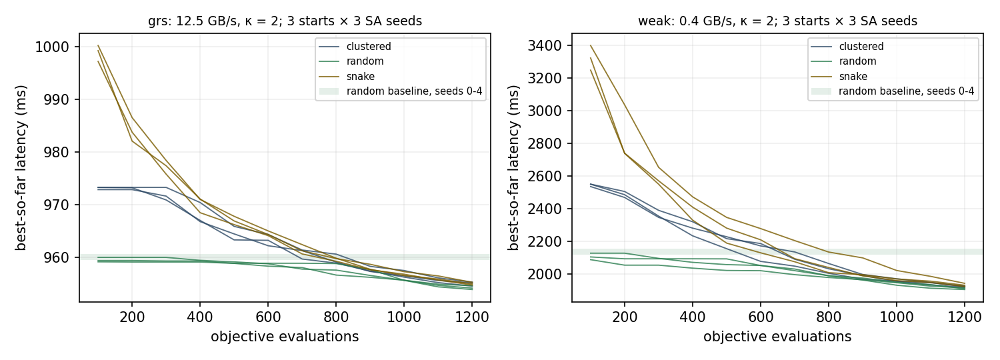
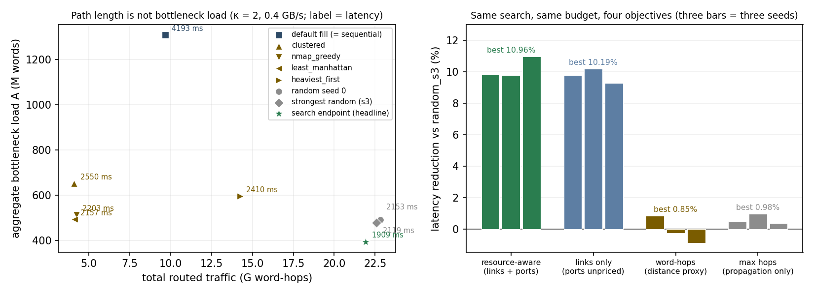
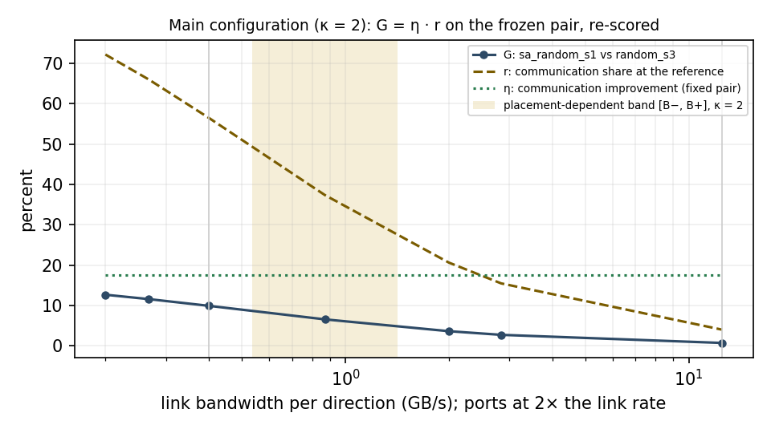
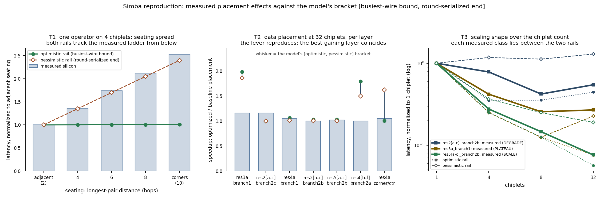

# cimsim: the platform and its results

> **Status (frozen 2026-09-22).** This document is the account of the
> platform and of what it has measured, written to the stance the paper
> takes. Every number here is reproducible from a committed script, has a
> ledger row with its numerator, denominator and statistic in
> [`main_config_results.md`](main_config_results.md) or a registry row in
> [`METRICS.md`](METRICS.md), and is pinned by the test suite (443 tests).
> The cost model is written out in [`../../formulation.md`](../../formulation.md);
> the chronological record of every change is [`FIXLIST.en.md`](FIXLIST.en.md);
> the user guide is [`../../docs/`](../../docs/README.md).
>
> **Reading order.** Section 1 states the question and the stance. Section 2
> describes the instrument. Section 3 is the phase diagram, Section 4 the
> deployment search, Section 5 the results at the main configuration,
> Section 6 the validation. Section 7 collects the findings of the earlier
> stages that the diagram rests on. Sections 8 to 11 give the scope, the
> platform inputs, how to run the platform, and the document index.

## 1. The question, and the stance

Compute-in-memory accelerators keep the weights resident in the arrays, so
only activations and partial sums move at run time. The simulators that
model such chips, CiMLoop among them, answer the mapping question: how a
weight matrix is tiled, bit-sliced and duplicated over the arrays. They do
not answer the placement question: which physical crossbar, macro or die
each mapped block occupies, and therefore which links and ports its
traffic loads. In the CNN era that omission was correct. The models were
small, the devices slow, and the arrays' compute masked every transfer.

Whether the omission stays correct is not a yes-or-no question. It depends
on the model width, the device speed, the organisation of the transfers
and the link tier together, and the dependence has a computable structure.
Placement is a phase. The value of a physical placement is conditional;
the condition can be computed from the workload, the fabric and the
execution mode; and where the condition holds, the placement can be
chosen. This platform exists to compute that structure and to turn it into
a deployment choice. Its results are of three kinds: a phase diagram that
says under which conditions placement decides the cost, a deployment
search that chooses a placement where it does, and the validation that
ties the cost model to published silicon and to a packet-level simulator.

The main configuration on which the results are frozen is a 2.7B-class
model (d 2560, d_ff 10240, 32 layers) at batch 1 with a 512-token serial
prefill, mapped to 544 of 576 dies on a 24 by 24 mesh with XY routing, at
the NeuRRAM row time of 10.14 us, with each die's injection and ejection
port at twice the link rate (kappa = 2), at 0.4 GB/s per link direction
with 12.5 GB/s as the contrast. On it the placement search reduces the
whole-model prefill latency by 9.91% against the strongest evaluated
baseline and by 54.5% against the default stacked fill, at a dynamic
energy change of -0.26%.

## 2. The instrument

### 2.1 Four layers on CiMLoop

CiMLoop (Timeloop, Accelergy and the CIM extensions) supplies the
per-operator mapping and the silicon-calibrated macro model, and both are
used unchanged as the lower layer. Above it the platform adds four layers,
each an overlay that leaves the Timeloop core untouched.

**The physical fabric.** A YAML file under `models/fabric/` declares the
levels (package, die, macro, core, crossbar), how many instances each
level has and in what grid, the link of each level with its scheme,
routing, propagation and energy per word, the port ratio, the analog
device's row time, the digital vector unit and the external attention
unit. The loader validates it and checks the device block against the
CiMLoop macro's cycle on every mapper run, so a fabric cannot declare a
speed its macro does not have. The main fabric is
`mlx300_multidie576.yaml`.

**Placement as an object.** Which instance of every level each mapped
block occupies is an explicit, serializable, verified object. A
deployment of a layer stack is the triple (gamma, alpha, beta): the
partition of the operator chain into contiguous blocks, the placement of
every operator's dies on the die mesh, and the assignment of an
operator's macros inside a die.

**Real traffic.** Timeloop's counters are reconciled into value units
(reads per bit slice, per bit and per cell column) with conservation
guards, and decomposed into the mapping's multicast and reduction
structure: a multicast slice crosses an upper edge once, idle instances
carry zero, and every flow has a source, a destination, a volume and a
routed path.

**Contention on shared resources.** Every flow is routed on the declared
scheme and its words are accumulated on every link direction it crosses
and on the source die's injection port and the destination die's
ejection port. The service time of a hand-off is its busiest resource's
load divided by the link rate, with port loads divided by kappa. The
busiest-resource occupancy is the least time any schedule can spend on
that resource for the given routing: exact for private links and a
shared bus, a lower bound for a routed grid, where the missing piece is
queueing. Ten interconnect schemes are in the registry (star, mesh,
torus, ring, h-tree, bus, concentrated mesh, express mesh, hierarchical
wide, switch); the placement results are on the mesh with XY routing.

### 2.2 The execution relations and the energy

Two execution relations combine the terms. At the package level a
batch-one prefill executes the hand-offs one after another, so the
latency is the sum of the non-communication cost R(s) = N/s + F (the
compute that scales with the device rate s, plus the weight writes and
digital-unit terms that do not) and the hand-off term H, itself the sum
over the 159 boundaries of the busiest-resource service time plus the
propagation of each boundary's longest path at 20 ns per hop. Inside a
die each operator overlaps its serialization with its own compute, so the
die's time is the sum over operators of the non-overlapping write and
propagation terms plus the maximum of compute and serialization.

Dynamic energy is the per-operator CiMLoop energy, the digital-unit
energy, and every delivered payload word charged once per link hop at 10
pJ, the midpoint of the measured Simba GRS band. Static power is not
modelled. The energy does not depend on the bandwidth or the port ratio;
only the surplus hops depend on the placement.

### 2.3 What is inherited, what is an input, what is measured

The device is CiMLoop's calibrated NeuRRAM-class macro (Wan et al.,
Nature 2022): 10.14 us per MVM row over seven input slices. Every
bandwidth and device figure used as a reference carries a source and a
status (measured, published, derived, design point, estimated) in
[`ANCHORS.md`](ANCHORS.md) and in `scripts/anchors.py`. The link
bandwidth, the port ratio, the device speed scale and the execution mode
are inputs of a run, not properties of the model. The compute, write and
energy of each operator come from one mapper run per operator and are
frozen into a per-operator account (`scale_2p7b_per_op.json`); the
evaluator, the search and the diagram are closed-form on that account and
never call the mapper.

### 2.4 The entry points

The platform is driven from one command line, `scripts/cimsim_cli.py`,
with the subcommands `baseline` (a named rule to a deployment file),
`evaluate` (latency, energy, per-hand-off loads and the binding resource
of one deployment), `search` (the annealer with the frozen protocol as
defaults), `phase` (the placement band of a fabric at its device rate)
and `booksim` (one hand-off through the packet simulator), all on any
fabric file and any per-operator account. The user guide in `docs/`
documents each page by page with its commands as run. The frozen results
are produced by the experiment scripts named in Section 10.

## 3. The placement phase diagram

### 3.1 Boundaries from the placement extrema

Fix the workload, the mapping, the fabric, the routing, the execution mode
and the port ratio. What remains free is the placement p. For a
comparison object whose costs separate, a boundary is the cost equality
B_c(p; s) = A(p) / R(s), with A the placement's aggregate bottleneck load
in words over links and ports and R the non-communication time at device
rate s. Over a declared placement set the extrema B_minus(s) = min B_c and
B_plus(s) = max B_c form an envelope. Above B_plus every evaluated
placement is dominated by compute and fixed terms; below B_minus
communication dominates for every placement, and the placement sets how
severe the loss is; between the two the placement decides which cost
leads. Under the intra-die overlap model the boundaries are the
per-operator masking thresholds A_min / C and A_max / C, with C one
operator's compute.

Link time depends only on the bandwidth and compute time only on the
device's row time, so every boundary is a closed-form line in the row
rate, and the bisection-swept thresholds land on it to 1e-9. The matrix
part of the stack collapses exactly onto one curve in the product of
bandwidth and row time.

### 3.2 The device axis and the fast edge



The fast edge is where the fixed terms take over. At the NeuRRAM row time
the on-chip prefill stack of the 355M-class model is 826 ms with a floor
of 79 ms from the K/V write and the digital unit; a device 76.3 times
faster buys 9.33 times in prefill and only 1.11 times in decode, because
each token must program its K/V row before attention can read it. A fast
device with attention on chip is a self-limiting configuration; the exits
are faster writes or offload. With attention offloaded the floor moves to
the attention unit and its link, and the same device buys 19.7 times in
prefill and 1.9 times in decode. The unit's link is the one place in the
system that needs digital-class bandwidth. The package panel's
boundaries flatten at the fast edge for the same reason.

### 3.3 The width family



Forty-eight mapper runs, d from 1024 to 8192 at S = 512 and S from 128
to 2048 at d = 1024, measured what the algebra could not. Above a flip
between d = 1220 and 1350 the busiest on-die wire is the input trunk and
its serialization over compute is d / 114,688 exactly, so the boundary is
linear in the width with slope one: the bandwidth at which the network
catches the compute is about 0.81 GB/s times (d / 1024) times (10.14 us
/ t_row) on the routed mesh, which gives 1.010 GB/s at d = 2560, 1.616 at
4096 and 3.232 at 8192 at the NeuRRAM rate. The d = 1024 production point
sits below the flip, where the dies are underfull and the mapper
replicates weights; its 0.808 GB/s was measured directly and is not
covered by the law. Every probed ratio, the attention operators included,
is independent of S: the diagram is a property of the model width and
the device, not of the prompt. At the die level the family coincides with
the on-die family from d = 2560 upward, because the mesh's four-way
multicast and ffn2's 4d-wide entry tensor give the same number by two
mechanisms.

Two arrows follow. Widening the model raises the boundary linearly, and
speeding up the device raises it in proportion; both push the mainstream
configuration out of the region where communication is free. At the
NeuRRAM tier the shared media cross the line first (an on-die bus at
3.3x, an interposer bus at 10 to 70x) and point-to-point links cross it
at the 0.1 GB/s die-to-die tier; at the HERMES device tier the routed
on-die boundary moves to 62 GB/s, past most published NoCs; at 70B width
under a fast device no published interconnect feeds the chain.

### 3.4 The diagram at the main configuration



Both axes are rates. The intra-die panel is the ffn die of the
GPT-2-medium class instance (d 1024, S 512): ffn1 and ffn2 on four macros
each, all 70 joint seatings of the 2 by 4 macro mesh enumerated. The
busiest macro-link load ranges from 3.146M to 8.389M words, a span of
2.67x, and with a per-operator compute of 5.19 ms the thresholds are
B_minus = 0.606 and B_plus = 1.616 GB/s. The package panel at kappa = 2
uses the seven named seating rules of the 2.7B stack: the bottleneck load
ranges from 492.8M words (the random fill) to 1308.6M (the stacked fill),
an observed envelope of 2.66x, and B_minus = 0.535, B_plus = 1.421 GB/s
at the NeuRRAM rate. The main point at 0.4 GB/s lies below the band on
both panels; the 12.5 GB/s contrast lies above the package band. The
intra-die envelope is certified by enumeration; the package envelope is
observed over the seven rules; the figure states which.

The reference points project published parameters onto this instance and
are not measurements of those chips running this workload. HERMES sits on
the intra-die panel at its published core-to-core link rate of 0.4 GB/s
at both MVM modes; ISAAC at its published inter-tile link rate of 4.0
GB/s and, on the package panel, at its published off-chip link rate of
6.4 GB/s, just above B_plus at its own row rate. Mythic publishes no link
rate; its marker is the product's 2 GB/s I/O capability matched to the
model's port capacity kappa B, which puts it at 1.0 GB/s inside the band.
Simba enters as the first digital chip point: on die it sits in the
masked region, at the die-to-die tier above the pure hand-off line and
below the spanning-chain boundaries, which is the exposure its own
placement experiment measured. The two evaluated bandwidths are drawn as
horizontal tiers across device speeds, and the two evaluated
configurations as circles joined at the NeuRRAM row rate.

### 3.5 What the diagram says about gains

For two placements with the same non-communication cost, the whole-model
latency reduction factorises as G = eta r, with eta the reduction of the
communication term and r the communication share of the reference. The
diagram says which cost leads; the product says how much a communication
improvement is worth at each bandwidth. The latency spread of a placement
set, (T_max - T_min) / T_min, and the search gain, (T_ref - T_sel) /
T_ref, have different denominators and are kept apart throughout. Search
settings are chosen from the diagram: fix the instance, sample the
bandwidth at declared multiples of its own boundaries, search once and
re-score everywhere, since the ordering of placements does not depend on
the bandwidth when the non-communication cost is seat-invariant.

## 4. The deployment search

### 4.1 The hand-off term and the port floor

Every boundary between consecutive operators of the 2.7B chain is an
R-split multicast: the producer set holds one piece of the output per die
and ships every piece to every consumer die, so a hand-off from a 5-die
set to a 5-die set is 25 flows and every consumer receives the full
tensor. Because every consumer must receive the whole volume through its
own ejection port, the bottleneck load of a boundary cannot fall below
that volume divided by kappa. This is the port floor, a property of the
mapping that no placement can go below. At kappa = 1 the floor of the
2.7B stack is 523.0M words, every search endpoint sits exactly on it, and
the best random fill sits 3% above it; the term has no resolution below
the floor.

### 4.2 The evaluator and the solver

The mapping and its logical traffic are extracted once. A placement move
recomputes only the boundaries it touches, and the incremental score
equals the full score to machine precision along engine-generated move
sequences: 1.34 ms at the median per move on the 544-die instance, 37 ms
for a full score, 2.6 s for a 1200-step annealing run, single-threaded.

The solver has three parts. A dynamic program over cut positions and
group sizes prices the blocks with the evaluator's own per-layer costs,
including the intra-layer hand-offs and each layer's entry hand-off; with
the package seam unpriced the maximum depth always wins, and under a
swept per-cut seam price the optimal depth becomes interior at two to
three stages. Simulated annealing over the die placement uses exchange,
migrate and whole-set swap moves with a two-step migration where the
hosts are saturated, Metropolis acceptance on a geometric schedule, and a
multistart over named seed placements; its ergodicity is argued in
[`ergodicity.md`](ergodicity.md). Inside a die the macro assignment is
enumerated exhaustively: 280 joint seatings on the attention die and 70
on the ffn die of the co-residency instance, and the annealer reaches the
enumerated optimum. On an instance small enough to enumerate jointly
(four blocks on two dies each on a 3 by 3 mesh, 181,440 states) the
sequential solve, partition first and seating second, reaches the
certified joint optimum exactly at both cells over five seeds, because on
a uniform-compute stack the cut decision is invariant to the seating.

### 4.3 The named rules and the referee



Seven placement rules were implemented from the literature and from the
deployment default, each an adaptation to this legal space that speaks for
the adapted rule and not for its source as a whole
([`baseline_provenance.md`](baseline_provenance.md)): the default stacked
fill (`sequential`), the boustrophedon fill (`snake`), the clustered
allocation that Gemini describes (`clustered`, each stage a compact
rectangle), SIAM's least-Manhattan rule (`least_manhattan`), NMAP's
construction with one pair-swap sweep on traffic times centroid distance
(`nmap_greedy`), a Graham/LPT-lineage rule (`heaviest_first`), and the
uniform random fill with five declared seeds. None of them prices links or
ports. At kappa = 1 they span 1.063x at 12.5 GB/s and 1.822x at 0.4 GB/s,
and the random fill is the best of them at both bandwidths.



Before searching at scale we asked whether the objective can be replaced
by a proxy. Five objectives searched the same space from the same seven
starts with the same budget and were judged under the resource-aware
truth: the distance proxy's selection is 58.9% above the optimum, the two
one-pattern arms 7.2% and 1.8%, the wrong-weave arm 9.8%, against a
multistart noise band of 1.8%. Three condition axes explain why rules of
thumb fail. The load axis inverts the ranking: the clustered rule is the
best of the seven under pure chain traffic and the worst under
many-to-many fan-out (30.0M words on its busiest wire against 18.3M for
the random fill). The cell axis masks the lever: inside a die the
exhaustive band is 1.51x on the attention die and 2.00x on the ffn die
at 0.4 GB/s, with the shipped contiguous assignment 18 to 20% above the
optimum, and the whole band collapses to a tie at 2 GB/s. The weave axis
redefines compactness: on a ring the best seating is the sequential
order, and the ring's own optimum reads 1.38x on the mesh chain. The
referee's verdict order survives a packet-level judge unchanged.

### 4.4 Choosing the port ratio



At kappa = 1 every good seating sits on the port floor, so the search can
only close the baseline's 3% distance to it: 1.86% against the strongest
baseline on the square grid, 2.69% on a 12 by 48 grid. At kappa = 2 the
ports stop binding, every candidate becomes link-bound, and the gain
rises to 10.1% and 9.8%. At kappa = 4 every baseline reads the same as at
kappa = 2 and the gain stays within the seed spread (9.9% and 9.8%): once
ports run at twice the link rate they never bind again. The hardware gain
of the port ratio itself, 6.7% for the best baseline on the square grid,
is a separate quantity and is not counted as a placement gain. The main
configuration is frozen at kappa = 2: each die's injection and ejection
capacity is an independent resource of twice the link bandwidth. This is
an architecture under evaluation, not a measured multi-chiplet NeuRRAM
system.

### 4.5 The frozen protocol

The search runs simulated annealing on the whole-model prefill latency at
0.4 GB/s from three start families (clustered, random, snake) with three
independent seeds each, for 1200 steps at alpha = 0.996 and t_0 = 20 ms.
For each seed the best of the three starts is taken; the headline is the
median of the three seeds with the range beside it; the best of the nine
runs is a separate, labelled number. The baseline set is the seven named
rules at seed 0, the random fills at seeds 1 to 4, and the default fill;
the strongest baseline is the minimum over that set.



All three families reach the random band by about 800 evaluations and
keep improving to the end of the budget; the last 200 evaluations still
lower the best latency by 1.4% to 4.1%, so the endpoints are
budget-limited values, not converged optima. The seeds and starts agree
to within 2% at the end.

## 5. Results at the main configuration

### 5.1 The headline

| layout | T (ms) | hand-off term (ms) | comm. share | bottleneck load (M words) | routed traffic (G word-hops) | E (J) | T at 12.5 GB/s (ms) |
|---|---|---|---|---|---|---|---|
| default fill (`sequential`) | 4192.5 | 3271.4 | 78.0% | 1308.6 | 9.67 | 2.394 | 1025.8 |
| `snake` | 4106.7 | 3185.5 | 77.6% | 1274.2 | 5.67 | 2.354 | 1023.1 |
| `clustered` | 2550.4 | 1629.2 | 63.9% | 651.7 | 4.10 | 2.338 | 973.3 |
| `heaviest_first` | 2409.8 | 1488.7 | 61.8% | 595.5 | 14.24 | 2.439 | 968.8 |
| `nmap_greedy` | 2202.7 | 1281.6 | 58.2% | 512.6 | 4.24 | 2.339 | 962.1 |
| `least_manhattan` | 2156.6 | 1235.5 | 57.3% | 494.2 | 4.12 | 2.338 | 960.7 |
| `random` seed 0 | 2153.1 | 1231.9 | 57.2% | 492.8 | 22.82 | 2.525 | 960.6 |
| `random_s3` (strongest baseline) | 2118.7 | 1197.5 | 56.5% | 479.0 | 22.59 | 2.523 | 959.5 |
| search, seed 0 | 1914.1 | 992.9 | 51.9% | 397.1 | 22.34 | 2.520 | 953.0 |
| search, seed 1 (headline) | 1908.8 | 987.6 | 51.7% | 395.1 | 21.93 | 2.516 | 952.8 |
| search, seed 2 | 1904.2 | 983.0 | 51.6% | 393.2 | 21.91 | 2.516 | 952.7 |

Prefill, 0.4 GB/s, kappa = 2. The default stacked fill takes 4192.5 ms.
The headline search layout takes 1908.8 ms, 54.47% below the default and
9.91% below the strongest baseline, the random fill at 2118.7 ms. The
first number is the cost a deployment choice can impose on the same
hardware; the second is the loss that remains beyond a good rule. The
five declared random fills take 2118.7 to 2153.1 ms, spread 1.62%, and
their minimum is the best of the whole baseline set; the headline is
not a gain over the random median. The gain over the three seeds ranges
from 9.66% to 10.12% with a median of 9.91%; the best of the nine runs
is 10.12%; all nine endpoints beat all five random fills. At 12.5 GB/s
the same protocol gives 0.70%, because communication is 4% of the
latency there.

In decode the headline layout gains 1.57% against the strongest baseline
at 0.4 GB/s. The ranking of the 21 layouts correlates with prefill at
0.987 and the prefill-selected layout ranks second, so the two phases
scale the same placement cost by a common factor and no decode search was
run. At 12.5 GB/s the decode communication share is 0.3% and the
differences among layouts vanish.

### 5.2 The mechanism



Why does a random fill beat the rules adapted from the literature, and
why does the search beat the random fill? The distance rules route 4.10 to
4.24 G word-hops at 2.9 mean hops; the random fills route 22.6 to 22.8 G
at 16 hops. The rules shorten the paths by a factor of five. But a compact
placement funnels the 25 flows of a 5-to-5 hand-off through the few links
between two groups: the busiest ffn2 link carries 10 flows under
`clustered`, 10 to 12 under `nmap_greedy`, 10 to 15 under
`least_manhattan`, and all 25 under the default fill, against 8 to 10
under a random fill. The aggregate bottleneck load of the rules is 494 to
652M words; that of the random fills is 479 to 493M. On this instance
latency is decided by link stacking, not by distance.

The resource-aware search keeps the dispersed layout, moves the mean
distance from 15.90 to 15.43 hops, and lowers the aggregate load from
479.0 to 395.1M words. Its busiest ffn2 links carry five flows, and 55 of
the 159 boundaries reach the port floor. The hand-off term falls by
17.5%, which at a communication share of 56.5% is the 9.91% whole-model
gain. The reduction sits on the attention, out-projection and ffn2
hotspots; the qkv term stays at about 39M words for every layout, because
it is already at its floor. The per-boundary loads are in
[`mechanism_table.md`](mechanism_table.md).

### 5.3 The intra-die level

On the one instance that has within-die levers, the GPT-2-medium class
co-residency configuration (d 1024, d_ff 4096, S 512, the attention die
holding qkv on three macros and the output projection on one, the ffn die
holding ffn1 and ffn2 on four each), the per-operator time is write plus
propagation plus the maximum of compute and serialization, and the layer
time adds the fixed rest of the layer and the two one-flow package
hand-offs of the layer's own chain. At 0.4 GB/s every operator is
serialization-bound under the shipped contiguous assignment. The
exhaustive optimum masks both attention operators under compute and, on
the ffn die, raises ffn1's serialization from 5.243 to 7.864 ms to lower
ffn2's from 10.486 to 5.243 ms, so that the sum of the per-operator maxima
falls: the layer time drops from 49.597 to 45.125 ms, a gain of 9.02%
(9.52% without the package hand-offs). At 0.1 GB/s the same optimum gives
22.3%; at 2 GB/s and above it gives zero, the masked region of the
diagram. This is the same instance as the diagram's intra-die panel: the
2.67x is the span of the ffn bottleneck load, the 9.02% the layer-level
gain of the joint assignment, two quantities of one instance
([`intra_die_correspondence.md`](intra_die_correspondence.md)). In the
frozen model the two placement levels are separable: a die placement
moves only the propagation term of this instance, by at most 0.0003% of
the stack, so the joint gain is the sum of the two levers. The 2.7B
mapping has no within-die levers.

### 5.4 What the objective contributes

With the feasible space, the solver, the budget, the starts and the seed
protocol held fixed and only the objective replaced, every output layout
was scored under the system latency of the main configuration. The
resource-aware objective reaches 10.96% below the strongest baseline at
its best seed; the word-hops proxy (traffic times distance) reaches 0.85%
and the maximum-hops proxy (propagation only) 0.98%; their selected
layouts are 11.4% and 11.2% slower than the resource-aware selection.
Pricing the ports changes the search's own result by less than 1%. The
solver is the same in every arm, so the difference is the objective's
expression of the physical cost.

### 5.5 Bandwidth, geometry, port ratio, phase



| point | B (GB/s) | region | T_ref (ms) | r | G |
|---|---|---|---|---|---|
| low | 0.200 | below B_minus | 3316.2 | 72.2% | 12.66% |
| B_minus / 2 | 0.267 | below B_minus | 2712.0 | 66.0% | 11.57% |
| main | 0.400 | below B_minus | 2118.7 | 56.5% | 9.91% |
| sqrt(B_minus B_plus) | 0.872 | inside the band | 1470.7 | 37.4% | 6.55% |
| 2 | 2.000 | above B_plus | 1160.7 | 20.6% | 3.62% |
| 2 B_plus | 2.841 | above B_plus | 1089.8 | 15.5% | 2.71% |
| contrast | 12.500 | above B_plus | 959.5 | 4.0% | 0.70% |

The strongest baseline and the headline layout re-scored at seven
bandwidths without a new search: the communication improvement eta of the
pair is 17.5% at every point, and G = eta r holds to machine precision.
The whole-model gain follows the communication share, from 12.7% at 0.2
GB/s through 9.9% at the main point and 6.6% at the geometric midpoint of
the band to 0.7% at 12.5 GB/s.

Geometry and port ratio: the six cells of the sweep give, against each
cell's strongest baseline at 0.4 GB/s, 1.86% / 10.12% / 9.92% on the 24
by 24 mesh and 2.69% / 9.81% / 9.82% on the 12 by 48 mesh at kappa = 1 /
2 / 4; at 12.5 GB/s every cell is below 0.75%. The binding resource of the
endpoint is a link in every kappa >= 2 cell. One further execution mode
was evaluated and stays in the record: under the platform's pipeline
caliber (a steady-state initiation interval, the maximum over the 32
single-layer stages, no fill or drain, no cross-stage sharing) the
selection changes and the rankings correlate with the serial ranking at
0.79 to 0.83; the serial-sum endpoints re-scored under the interval are
10.9% and 12.7% better than the strongest pipeline baseline at kappa = 1
and 4, while a direct search on the interval objective reaches 6.7% and
9.4% with a larger seed spread. That supports searching on the sum and
reporting under the maximum, and says nothing about contention that a
pipelined execution would add.

### 5.6 Dynamic energy

| layout | E (J) | E_comm (J) | comm. share | dT vs strongest | dE vs strongest |
|---|---|---|---|---|---|
| default fill | 2.394 | 0.097 | 4.0% | +97.9% | -5.1% |
| `clustered` | 2.338 | 0.041 | 1.8% | +20.4% | -7.3% |
| `nmap_greedy` | 2.339 | 0.042 | 1.8% | +4.0% | -7.3% |
| `least_manhattan` | 2.338 | 0.041 | 1.8% | +1.8% | -7.3% |
| `random_s3` | 2.523 | 0.226 | 9.0% | 0 | 0 |
| headline search layout | 2.516 | 0.219 | 8.7% | -9.9% | -0.3% |
| nine endpoints | 2.509 to 2.520 | 0.212 to 0.223 | 8.4 to 8.9% | -8.3 to -10.1% | -0.1 to -0.6% |

The operator energy (2.270 J), the elementwise energy (0.027 J) and the
one-hop charge of every delivered word (0.014 J) do not depend on the
layout; only the surplus hops do. The headline layout changes the system
dynamic energy by -0.3% against the strongest baseline and the nine
endpoints lie between -0.1% and -0.6%: the latency search carries no
energy penalty, because communication is about 9% of the dynamic energy of
a dispersed layout. The distance rules convert their short paths into an
energy advantage of 82% of the communication energy, 7.3% of the system
energy, bought with 1.8% to 20% more latency: the trade-off is real
between the compact and the dispersed family and absent inside the
search's family. The intra-die level has no modelled energy (no
coefficient on the macro link), consistent with the earlier finding that
intra-die energy is insensitive to layout. Details in
[`energy_export.md`](energy_export.md).

## 6. Validation



| check | instance | reading |
|---|---|---|
| silicon calibration | Simba placement experiments (Shao et al., MICRO 2019; Zimmer et al., JSSC 2020), one on-die operator, three bandwidths | the ordering bound sits below BookSim, BookSim below the closed pessimistic rail (2.40x), the rail below silicon (2.53x); network-internal residual +0.18% to +0.74%; protocol share 2.52x, declared separately |
| accounting check | HERMES, published per-core link rate | supply 2.61 GB/s per core against a predicted need of 1.93; headroom 1.36x; it audits the accounting caliber and the normalization, not the contention mechanism |
| resource count | 36-die package, three hand-off geometries | the analytic bottleneck load equals BookSim's own channel bound exactly; BookSim completes at 1.20x the bound where flows stack on a wire |
| ranking, cross-traffic | 36-die package, six seatings | Spearman 0.886, top seating agreed, selected-solution regret 1.000; the referee's verdict order preserved under BookSim with Spearman 1.000 |
| ranking, link-bound | 24 by 24 fan-out task, 9 stages of 17 dies, 13 candidates, about 154k packets per candidate, kappa = 1 | Spearman 0.953 with average ranks over 13 candidates; both judges select the same strongest random baseline; the search endpoints are 12 to 31% ahead of it under BookSim (27 to 29% analytically) |
| scope of the term | 36-die two-layer instance | placements tied at the port floor are spread by BookSim over 6 to 11%: equal service cost does not mean equal completion time |
| solver structure | 4 blocks on 2 dies each, 3 by 3 mesh, 181,440 joint states | the sequential DP then SA solve reaches the joint optimum exactly |
| efficiency | 2.7B, 544 dies, single thread | incremental score 1.34 ms median, full score 37 ms, one 1200-step run 2.6 s |

The validation is layered. Inherited calibration: the device is CiMLoop's
silicon-calibrated macro, declared as a fabric input and reconciled on
every run. Counting: Timeloop's counters reconciled into value units with
conservation guards, and the die-buffer axis audited against Timeloop's
own throttling in closed form. Semantics: swept thresholds land on
closed-form boundaries to 1e-9, the busiest-wire number is stated as the
bound it is, and normalization rules are declared before coordinates are
compared. External behaviour: one contrast per layer of the instrument,
HERMES for the accounting, Simba for the soft-placement effect, BookSim
for the resource count and the ranking. Robustness: the region calls at
the digital anchors survive a five-fold error, the workspace straddle
survives two-fold, and the accounting audit's resolution radius is 1.36x
([`robustness_table.md`](robustness_table.md)).

The Simba reproduction was pre-registered: parameters, criteria bands and
bias directions were frozen before each run, and the graded failures are
on record with the successes. Its two structural findings: the
enumeration finds zero-communication tilings that silicon's compiler did
not use, so measured placement gains are tiling-contingent; and the
busiest-wire abstraction's dropped terms are named and bounded, the
per-packet distance-coupled latency (the bracket's width) and the
placement-insensitive constants (the ratio dilutant). The packet simulator
gives each node one terminal channel at link width and no option changes
that, so the kappa = 2 gain of the main configuration is reported by the
system model itself and the kappa = 1 packet checks are the method
validation.

## 7. What the diagram rests on: the earlier findings

The platform was built level by level, and the findings of those stages
are the basis of the diagram's construction. They stay in the record at
their own instances and denominators; the ones that matter for reading
the diagram are these.

**Where energy goes.** On the calibrated macro, about 59% of an
operator's energy is analog compute and conversion and about 39% is
buffering (the die's SRAM alone 33%); the on-die macro NoC is under 1% and
the flat off-die port 0.7%, so transport is a few percent of dynamic
energy all in and the network rows are lower bounds. Within-die placement
is not an energy lever: the priced macro level moves a block by 0.25%
between a line and a mesh, and an independent reduction-clustering
solver lands under 0.1% by another route. The energy payoff, where it
exists, is between dies and only where operators span dies (about 4% of
the whole-machine account for the 2.7B class, with its geometry
attached).

**The on-die network at the NeuRRAM tier.** With the counters in value
units, the busiest on-die wire's occupancy hides behind the arrays'
compute at every published digital-ecosystem bandwidth (Simba 8.75, ESP
32, FlooNoC 80.6 GB/s per link): the whole 355M stack reads 1.00x for
every scheme at the perfect-overlap end, and moves 1% only below 0.2 to
1.9 GB/s per link, an order of magnitude below those NoCs. In the
estimated analog-reality band (0.4 to 8 GB/s on die, 0.1 to 2 GB/s die to
die) the shared media cross the line (an on-die bus 3.3x at 0.4 GB/s) and
the point-to-point die links cross it at the 0.1 GB/s tier (the 2.7B
chain 5 to 7x; the offloaded 48-die pipeline 12 to 19x). Every "hidden
behind compute" sentence is the reading of one cell of the diagram, the
NeuRRAM device times the digital-ecosystem link.


**Whether contention follows position is a property of the scheme.**
Under private links (star) permuting the instances leaves the
serialization bit-identical; under a routed grid congestion depends on
which slots are occupied and, once flows differ in volume, on where the
heavy talker sits (3V on the hub against 6V in the corner on a 3 by 3
grid); under a bus position moves only energy. Two layouts can rank in
opposite orders under distance and under congestion (the 3 by 3 grid
spreads distance worse but funnels less), so a single metric gives the
wrong recommendation. The hub-position lever is gated by the grid's width
along the routing's first axis, not by squareness or by empty slots, and
a torus zeroes it for eccentric hubs; a ring makes the ordering more
critical (6.55x to 12.26x) and a torus relaxes it (to 3.57x), and the
optimal ordering itself swaps with the weave. Routing algorithms cannot
move any busiest-wire number in this account; their habitat is the
queueing tier.

**The K/V write and decode.** ReRAM writes are expensive, which is why
these chips are weight-stationary; the one write inference cannot avoid
is the attention K/V. Charging it makes decode write-latency-bound (the
write is 90% of a decode step on the 355M-class model; decode latency
10.12x the uncharged baseline) and makes offload a throughput win, as
expected and now with numbers; the magnitudes move with the write
granularity (one SET pulse per row, no parallel programming) and are
ceilings. Attention is 34% of a decode step's energy and 93% of its
latency: an energy-only model concludes attention is minor exactly where
it owns the critical path.


**Offload.** Offloading attention removes the compute margin that hid the
die-to-die transfers, halves the D2D knees, and pays out a +124%
pipelined throughput dividend only where the package network is not the
bottleneck; the on-die network stays hidden. With the external unit
counted as a black-box interface (generic edge-NPU figures) the prefill
dividend survives, decode goes from 0.99 ms per token on the die side to
1.99 ms end to end because the unit reads the whole K/V every token, and
decode energy rises (1.76 mJ end to end against 0.67 mJ on chip). Offload
buys decode time and pays in energy; the unit's link is the one link in
the system that needs digital-class bandwidth.


**Die-to-die placement is a throughput and latency problem, not an energy
problem.** On the 48-die package of the GPT-2-medium class the
layer-to-die assignment moves energy by under 0.5%, single-pass latency
not at all, and pipelined throughput by up to 4x at the example
bandwidth, because the busiest die wire carries 1, 1, 4 or 47 hand-offs
under snake, sequential, adversarial and bus assignments. One level up,
the 2.7B chain's hand-offs are many concurrent flows sharing the mesh,
which is what the search prices.

**The mapping is the third hand.** Besides the hardware placement, which
sets where the boundaries sit, and the software placement, which is each
boundary's band, the mapping decides whether placement has any play at
all. On the dense, evenly tiled production die the on-die soft-placement
freedom is frozen to zero by the mapping (any two seatings carry identical
per-wire loads, because the grid is fill-exact, the mapping uniform and
the bundling fixed); it reopens when any of the three breaks, and the
realizable co-residency configuration under offload reopens it to a
mechanism lever of 3.00x on the attention die and 2.67x on the ffn die.
Sentences of the form "within-die placement never matters" are not
licensed; the condition is always attached.

**Value-dependent energy and sequence length.** Whether per-crossbar value
modelling is needed is a device-class question: bit-serial devices read
1.00x across crossbars, value-sensitive devices up to 1.20x on
ReLU-sparse CNN inputs. The attention energy share rises with S (34% at
S = 512, 49% at 1024) while its latency share is highest at small S; the
K/V cache is a traffic term only when attention is offloaded.


**The regime tags.** Every width-law number is a column-split reading; the
row split, measured separately, is a load-relocation valve between levels
(the on-die trunk relaxes up to 4x while full-width partial sums move the
bill to the die edge), so any use of that lever is stated at both levels.
Weight replication stays the better underfull exit except for C-heavy
shapes.

## 8. Scope

Priced, and part of every result: matrix compute and weight write on the
calibrated macro per operator; the digital vector unit's time and energy
for the non-matrix operators; hand-off communication on the declared mesh
under XY routing (busiest link or port, propagation over the longest
path, energy per word plus the distance surplus); inside a die, the
macro-level serialization of the co-resident operators against their own
compute.

Not priced in this version: static power; a package seam fee at a
pipeline cut, so cutting is free and the serial and pipeline calibers
differ only through the interval; energy of the intra-die assignment;
batching (the account is batch 1 with serial prefill); adaptive routing
and link-level flow control (the term is the occupancy bound; BookSim
supplies the queueing view); thermal, area and yield; the KV-offload and
host I/O streams that would share the die links.

Fixed conventions: R-split multicast at every hand-off; partial sums at
two words per element; the attention operator on one die or offloaded
whole; ports at a declared multiple of the link rate; one link bandwidth
for the die level.

Numbers that are not to be combined: the fan-out ranking check is a
communication-batch time, not the 2.7B whole model; the intra-die 9.02% is
layer-level on another instance and is not added to the 2.7B number; the
6.7% of the port ratio is hardware, not placement; the two hand-off
shares (all 159 hand-offs, 10.2% of serial latency at 12.5 GB/s; the 31
inter-layer hand-offs, 1.15%) have the same denominator but count
different things. [`METRICS.md`](METRICS.md) labels every published ratio
as certified (exhaustive) or observed (searched).

## 9. Platform inputs and the data requests

The platform is general; these are the fields one fills in to
instantiate it for a chip, and the data requests are for the company's
chip's values. Until then the example defaults keep the platform runnable
and the conclusions are stated as multipliers, orderings and thresholds.

| input | where | example default | what it moves |
|---|---|---|---|
| device row time | fabric `device` | 10.14 us (NeuRRAM, calibrated) | every latency; the device axis |
| link bandwidth per direction | `--bandwidth` / `score(d2d_gbps)` | 0.4 GB/s (12.5 contrast) | the hand-off term; the diagram's vertical axis |
| port ratio kappa | fabric `ports: {ratio}` / `--kappa` | 2 | whether ports or links bind; the port floor |
| package link energy, propagation | 10 pJ per word, 20 ns per hop (Simba GRS band) | `--d2d-pj-per-word`, `--d2d-ns-per-hop` | communication energy; the propagation term |
| lower-level link energies | derived from the macro anchor by wire-length ratio (DR-1) | | network energy share; rankings become joules |
| per-level link bandwidths on die (DR-2) | fabric `link.bandwidth_gbps` | unset | the on-die knee; first order in the analog-reality tier |
| die-to-die topology, routing, energy (DR-3) | fabric die level | mesh, XY, 10 pJ, 20 ns | the package results |
| SET pulse width, parallel programming, write-verify (DR-5) | `T_SET_NS`, `E_WRITE_PER_CELL_J` | 8520 ns, 100 pJ | the write term: decode 90%, 10.12x; the fast-edge floor |
| digital unit lanes, clock, per-op energies (DR-8) | fabric `digital` | 64 lanes at 1 GHz; Horowitz 2014 | the fixed terms of the layer |
| external attention unit (DR-9) | fabric `attention_unit` | 2 T MAC/s, LPDDR4-class K/V, 12.5 GB/s link | the offloaded floor |
| device class, value histograms (DR-6) | `hist_source`, `device_class` | opt-2.7b histograms; bit-serial | value-dependent energy |

## 10. Running the platform

Everything runs inside the CiMLoop container from `/home/workspace`
([`../../docs/01_setup.md`](../../docs/01_setup.md)).

```bash
python3 tests/run_tests.py                                   # 443 tests
python3 scripts/cimsim_cli.py baseline --rule clustered --out analysis/clustered.json
python3 scripts/cimsim_cli.py evaluate --deployment analysis/clustered.json --bandwidth 0.4
python3 scripts/cimsim_cli.py search --bandwidth 0.4 --out-dir analysis/my_search
python3 scripts/cimsim_cli.py phase --bandwidths 0.4,12.5 --out analysis/band.json --png analysis/band.png
python3 scripts/cimsim_cli.py booksim --deployment analysis/clustered.json --handoff ffn2@L3
```

The frozen results are regenerated by the experiment scripts:
`kappa_geometry_sweep.py` (the six search cells), `main_config_export.py`
(the main table and the ledger), `mechanism_table.py`, `energy_export.py`,
`objective_ablation.py` (`ABL_KAPPAS=2`), `rerun_seating_seeds.py`
(`SEAT_KAPPA=2`), `bw_slice_k2.py`, `search_withindie.py` and
`intra_die_integration.py`, `fig_phase_isobar.py` (`ISOBAR_KAPPA=2`), and
`plot_dac2027_v2.py --run-id <id>` for the paper figure set. The
per-operator account is produced by `run_2p7b_block.py` (a mapper run);
the module roles are in [`../scripts/README.md`](../scripts/README.md).
Files the container writes belong to root on the host; clear
`__pycache__` before running a script edited on the host.

## 11. Documents and artifacts

| document | content |
|---|---|
| [`main_config_results.md`](main_config_results.md) | every layout re-scored at the main configuration, the headline statistics, the ledger of every published percentage |
| [`paper_numbers.md`](paper_numbers.md) | every number the paper uses, one line each, with workload, hardware, level, denominator and statistic |
| [`METRICS.md`](METRICS.md) | the registry of published quantities, their denominators and quantifiers |
| [`mechanism_table.md`](mechanism_table.md) | per-boundary loads, hotspots and the binding resource per layout |
| [`energy_export.md`](energy_export.md) | dynamic energy of the frozen layouts by term |
| [`intra_die_correspondence.md`](intra_die_correspondence.md) | the intra-die instance as one instance of the diagram panel and the layer result |
| [`baseline_provenance.md`](baseline_provenance.md), [`baseline_traces.md`](baseline_traces.md) | what each placement rule implements of its source; replay traces |
| [`search_setting_design.md`](search_setting_design.md) | how the search setting was chosen from the diagram, with the port-floor and port-ratio rounds |
| [`SEARCH_SPEC.en.md`](SEARCH_SPEC.en.md), [`ergodicity.md`](ergodicity.md) | the search's specification as implemented; the annealer's reachability argument |
| [`ANCHORS.md`](ANCHORS.md), [`MATERIALS.md`](MATERIALS.md) | every reference figure with source and status; the registered exhibits |
| [`phase_diagram_isobar_caption.md`](phase_diagram_isobar_caption.md), [`ladder_v0.md`](ladder_v0.md) | the diagram's caption and marker semantics; the ladder figure panel by panel |
| [`figures_dac2027/`](figures_dac2027/README.md) | the paper figure sets with data, captions and the per-figure record |
| [`op_breakdown/`](op_breakdown/op_breakdown.md) | the per-operator ledger |
| [`FIXLIST.en.md`](FIXLIST.en.md) | the chronological record of every change; when two documents disagree it says which is current |

The JSON files beside these documents carry the same numbers for
programs; the most used are listed in [`README.md`](README.md).
