# System-Level CIM Simulator — Features & Results

> On top of **CiMLoop** (Timeloop + Accelergy + CiM extensions), we model the
> company's ReRAM CIM chip as a **system** (package → die → macro → core →
> crossbar, weights resident) rather than a single macro. **The central object is
> placement** (physical position/layout — the level existing on-chip CIM work,
> CiMLoop included, stops short of); the other models (attention K/V write etc.)
> serve to **validate that the composed simulation behaves as expected and to put
> numbers on known intuition**. All changes are **decoupled overlays** — the
> Timeloop core is untouched; uncalibrated parameters are placeholders.
>
> **Reading order**: §0 approach → §1 hardware → §2 denominators (where energy/time
> go; which levels carry a price) → §3 models & results per level → §4 whole-model
> GPT-2 three scenarios → §5 per-pair communication dumps → §6 assumptions &
> limitations → §7 DR data-request map → §8 placeholder params → §9 script index
> → §10 tests.

---

## 0. Approach

**Two distinctions** run through all of it:

1. **Mapping vs placement.** Mapping (how a weight matrix is partitioned,
   bit-sliced, duplicated) is logical, handled by CiMLoop's mapper — we take it as
   given. Placement (which physical crossbar/core/die each mapped block occupies)
   is the level **nobody models**. Resident weights make placement a one-time,
   irreversible decision that fixes every subsequent inference's communication
   distance.
2. **"A level exists" vs "a level is charged."** A hierarchy level can be present
   in the simulator and still be free: traffic counted, energy zero, latency zero.
   Much of this work is locating those places and pricing them.

**Everything falls into four categories** (same vocabulary as the report's
accounted-by columns):

| Category | Content |
|---|---|
| **kept** | the silicon-calibrated macro model: glb, readout/conversion chain, array drivers — untouched |
| **re-priced** | the router distance term (+0.3% of block energy on the 2×4 layout, mean 1.5 hops; sign pending DR-4); per-crossbar value refinement (≤1.002× on this device, hence not needed) |
| **added** | the K/V write model (energy + serial SET latency) |
| **awaiting data** | DR-1…6 (map in §7) |

**Three main conclusions** (details in §2–§4):

1. **Placement machinery is built at every level and its effects are measured**:
   crossbar position differs 1.70× (2×4 default layout; 3.69× on the 3×3 comparison variant, value units), region placement differs 17.8% (both are
   rankings); the macro level is priced (line vs mesh = 1.33× NoC energy =
   **0.25%** of a block; 2×4 default grid, C27). The unpriced levels (core/crossbar links, D2D) are
   exactly where the leverage should be larger → each gap is one DR.
2. **Where the leverage is, and is not**: ~59% of energy is analog compute +
   conversion, ~39% buffering (glb alone 33%); the macro NoC is 0.99% and the flat
   off-die port 0.69% → **within-die placement is not an energy lever** (and these
   transport shares are **lower bounds** — every unpriced term is a network term);
   the payoff route is **contention (bandwidth) and D2D**. The contention side is
   now built and measured (§2.3.1, co-residency basis + physical wire
   accounting + digital unit + value units, v5): the busiest on-die wire's
   occupancy **hides behind the analog arrays' compute** at the reference
   input and at all three silicon anchors — every scheme, both buffer
   positions, both conditions read 1.00× on the whole stack (zero-overlap
   end 1.01–1.15× at the Simba anchor; both ends rank the schemes
   identically); the stack first moves 1% at 0.2–1.9 GB/s per link, an
   order of magnitude below published on-die NoCs (Simba / ESP / FlooNoC are
   all digital accelerators' NoCs — the digital ecosystem's upper bound; reading
   position in §2.5). The earlier "4.1×/5.2×
   across schemes, 1.5× from the glb position" was a unit error in the wire
   volumes (C25) and is retired — **within-die placement is neither an
   energy lever nor, in the (NeuRRAM-class device × digital-ecosystem link)
   cell, a latency lever** (§2.5) — what crosses the line in the estimated
   analog-reality band is the shared media (on-die bus 3.3×, interposer bus
   10–70×) and the point-to-point die links at the 0.1 GB/s tier (the 2.7B
   chain doubles below 0.26–0.40 GB/s; C26); the leverage
   is one level up (W3, 48-die feasible configuration): pipelined, the
   layer→die assignment spans up to 4× in throughput (64 w/c example) at
   +0.48% energy.
   **Offload amplifies the die-to-die side of this**: removing the
   per-stage compute margin halves the D2D knees, while the on-die network
   stays hidden even once the decode write shield is gone; the +124%
   throughput dividend is collected only where the package network is not
   the bottleneck (§2.3.1d; summary
   figures: the two placement_impact panels). With the external attention
   unit counted as a black-box interface (generic NPU figures, §2.3.1e) the
   prefill dividend stays +124% (the unit keeps pace with the die stage), but
   decode goes from 0.99 ms per token on the die side to 1.99 ms end to end
   (the unit reads the whole K/V every token) and its ENERGY rises (K/V reads
   1.29 mJ per token against 0.67 mJ for the whole token on chip); the three
   streams converge on the attach point and wire-bind the pipeline at the
   example bandwidth, not at the measured anchor.
3. **Validation by composition**: that ReRAM writes are expensive is common
   knowledge (it is why these chips are weight-stationary), not a finding.
   Charging the one write inference cannot avoid (K/V) makes decode come out
   write-latency-bound and offload come out as a throughput win, as expected — with
   numbers: **decode latency 10.12×, write = 90% of the step, offload −93% latency
   / −34% energy**. The qualitative picture needs no calibration; the magnitudes
   move with DR-5.

**CiMLoop default vs our fix** (history):

| Dimension | CiMLoop default | Fix |
|---|---|---|
| Weight residency | streams weights from DRAM | wrong for ReRAM → `ws_chip2chip_link` resident (used to inflate energy ~36%/prefill, ~150×/decode) |
| Physical position | topological, no coordinates | distance overlay (§3.1); measured: moves neither total at today's params, see §2 |
| Attention write | QK^T/AV as plain matmuls | write cost/latency overlay (§3.2); the only material difference source (decode latency 10.12×) |
| Latency | cycles, interconnect infinitely fast | propagation + write latency (§2/§3); bandwidths still unset (DR-2) |
| Value-dependent energy | one distribution per layer | inject per model (§3.3); a synthetic workload once reused resnet's distribution |

---

## 1. Hardware model: package → die → macro → core → crossbar (weights resident)

```
package (ws_chip2chip_link: weights resident, no weight-DRAM streaming)
 └ die × N            N≈18 (4-bit) / 36 (8-bit); GPT-2 resident, 256-die package ample
    └ macro × 8
       └ core × 4
          └ crossbar × 8          = 256 crossbars / die
crossbar = the reused 256×256 4-bit ReRAM macro `wan_nature_2022`
```

- [`models/arch/3_chip/mlx_die.yaml`](../models/arch/3_chip/mlx_die.yaml) — DIE: 8 MB SRAM (`glb`) + 8 macros + inter-macro `router` + 4 cores/macro
- [`models/arch/2_tile/mlx_core.yaml`](../models/arch/2_tile/mlx_core.yaml) — CORE: local I/O buffers + 8 crossbars
- [`scripts/mlx_system.py`](../scripts/mlx_system.py) — hardware config + `LAYOUT`/`HOP_LATENCY_NS` + runners + `n_dies_for_weights()`

**Key: ReRAM weights are resident, not streamed.** Programmed once (SET 8520 ns +
endurance), top level `ws_chip2chip_link` (no weight DRAM; only activations move),
not `fetch_weights_lpddr4`. **The only per-inference write is attention K/V.**

**The instantiated system is a single die**: the top-level `chip2chip_link` has
**instances=1** — a **flat off-die port** charging each op's activation I/O a fixed
64.3 pJ/word (0.69% of op energy), with **no inter-die topology/routing/distance
behind it**. Multi-die workloads = each op costed on its own die and summed;
inter-layer hand-offs unrepresented (→ DR-3).

**Capacity (why multi-die is mandatory)**: GPT-2 medium has **302M** weights; one
die = 8.4 MB = **16.8M** 4-bit weights → **18 (4-bit) / 36 (8-bit) dies** resident;
a single layer (12.6M) fits one die.

---

## 2. Denominators: where energy and time go, and which levels carry a price

Any added cost matters in proportion to the term it lands on, so the denominators
come first.

### 2.1 Energy decomposition (ffn1, prefill, S=512; baseline's current calibration)

| Component | Group | Energy (µJ) | Share |
|---|---|---|---|
| `glb` | buffer (on-die SRAM) | 892 | **33.0%** |
| `integrator` | analog compute | 646 | 23.9% |
| `adc` | conversion | 483 | 17.9% |
| `wordline_cap` | analog compute | 223 | 8.3% |
| `output_buffer` | buffer | 157 | 5.8% |
| `sample` | conversion | 141 | 5.2% |
| `row_drivers` / `cim_unit` | analog compute | 39.1 / 38.7 | 1.4% / 1.4% |
| others (<1% each)† | — | 78.1 | 2.9% |
| **total** | | **2,700** | 100% |
| + core/crossbar wires (declared supplement)‡ | transport | +29.8 | +1.11% |

† `router` 0.99% (**on-die macro NoC**; block mean 0.65%, range 0.39–0.99%),
`shift_add` 0.74%, `chip2chip_link` 0.69% (**flat off-die port**), `input_buffer`
0.47%. The two transport components are **distinct things, stated separately** —
never merged as "the on-die network".

‡ The two lower wire levels, priced since C58 at derived rates (the calibrated
macro anchor × wire-length ratio) as an overlay **outside** the baseline
account — the baseline's 100% is untouched. Itemized: core wires 15.7 µJ +
crossbar wires 14.1 µJ; it landed inside the <2%-of-operator ceiling it was
predicted under (C25). The platform's own measured values (DR-1) replace the
derived rates outright when they arrive.

> **Under the current calibration, transport is <2% — and was a lower bound**;
> with the lower-wire supplement now priced, transport reads ~2.8% all-in
> (router + off-die port + the new column) and every remaining unpriced term is
> still a network term (inter-operator transport, the bus). The expensive part
> is **staging: glb alone is 33%**. Reading protocol: shares are against the
> currently priced cost → network rows read as **lower bounds**, all other rows
> as **upper bounds**. The table excludes the two terms we add: the K/V write
> (~0.9% of block energy, both phases) and the distance re-pricing (+0.3% on
> the 2×4 layout, C27).

### 2.2 Latency composition (share of a block's critical path, scenario A, stall-free)

| Term | Mechanism | prefill | decode | Accounted by |
|---|---|---|---|---|
| Compute | Timeloop cycles × cycle time | 79% | 10% | baseline (kept) |
| Bandwidth stalls | demand > link bandwidth | — | — | **mechanism present but inert**: no limits set, `Bandwidth throttling = 1.00` (DR-2)ᵇ |
| K/V write | serial SET before compute | 21%ᵃ | **90%ᵃ** | added (§3.2) |
| Propagation | hops × ns/hop, round trip | 0.006% | 0.13% | added (§3.1) |
| Inter-die hand-offs | D2D links between layers | 0%ᶜ | 0%ᶜ | added (W3, surplus-priced, §3.5); cannot reach the critical path at example inputs |

ᵃ Shares of a stall-free critical path; they rest on §3.2's write granularity (a K
append = 64 row-serial SET pulses at the ~8.5 µs placeholder width, no
parallel/incremental programming). A device that programs a column in parallel
collapses these numbers (DR-5).
ᵇ With real limits set, compute can only grow → the write share, the 10.12×, and
the 93% **can only fall**.

**Bandwidth sensitivity (W1; source
[`scripts/analyze_bandwidth_sweep.py`](../scripts/analyze_bandwidth_sweep.py)).**
Contention is modeled in two tiers. They lower-bound the same serialization at
different places, so they enter the critical path by **max, never by sum** (no
double-charging):

| Tier | Mechanism | Owns | Why |
|---|---|---|---|
| **T1** | Timeloop's native throttling (demand > supply → cycles stretch) | **storage hubs** (the glb read/write port) | it models aggregate rates well |
| **T2** | analytic per-link occupancy `volume/bandwidth`, worst link wins | **network links** (router; D2D later) | only we have per-link loads (the structured flows of §5) |

T2's implementation `crossbar_comm.link_occupancy()` is **level-agnostic**: when
D2D lands, die-to-die links feed the same function. With the shipped config no
bandwidth is set anywhere, so the term is identically zero and the system totals
cannot move.

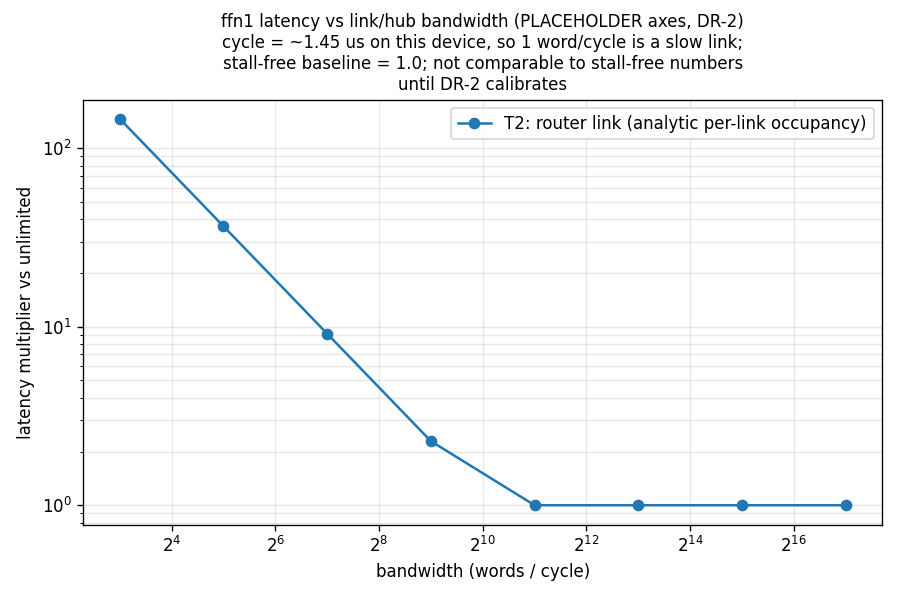

> **Where the knee is: ffn1's router trunk flips from compute-bound to
> link-bound between 256 and 2,048 words/cycle** (C25 value units; the earlier
> ~2.9e4 words/cycle rested on wire volumes 14–48× too large). The position
> follows from the op's real link volume (one macro edge: 65,536 input values
> down, 1.05 M partial-sum values up at 16 bits), the device cycle time
> (1.4486 µs per slice, the fabric's `device` block, checked against CiMLoop's
> calibrated macro model on every run), and the compute latency.
> In absolute units that is **≈ 0.2–1.9 GB/s** per link — an order of
> magnitude **below the range real on-die NoCs occupy** (8.75–80.6 GB/s). So
> on this analog device DR-2 (per-level link bandwidths) decides only the
> zero-overlap margin; on-die communication is not prefill's dominant latency
> term at any published digital-ecosystem bandwidth — analog CIM systems' own
> fabrics have no published anchor yet (§2.5).
>
> **That still would not make DISTANCE matter** (measured, see §2.3): today's T2
> reads per-link volumes only, never distance; permuting macro slots leaves the
> serialization time bit-identical. Bandwidth makes *communication* dominant;
> making *position* dominant additionally needs routed contention (O5).
>
> **Per-phase robustness** (same script): in prefill the first op to flip is
> `av` at ~3.6e4 w/c ≈ **25 GB/s** — inside the range real NoCs occupy, so
> prefill is **at risk**; decode is dominated by the **write** (13.3 ms) and
> communication only catches up at ~166 w/c ≈ **0.11 GB/s**, implausibly slow →
> **decode's 10.12× / 90% / offload 93% hold across the whole plausible band**.
>
> ⚠️ **Regime note**: stalls-on and stalls-off are **different accounting
> regimes**; the multipliers on this curve are placeholder-bandwidth
> sensitivities and **must not be cited as findings** before calibration. Every
> other latency number in this writeup is the stall-free regime. (The earlier
> "75×–1200×" claim had no traceable source and was retracted; this figure is
> its sourced replacement.)

### 2.3 Whether contention follows position is a property of the SCHEME (W2)

Contention is not inherently placement-blind or placement-sensitive; that is a
property of the interconnect scheme, and the scheme is now an input
([`scripts/interconnect.py`](../scripts/interconnect.py) plus `topology:` in the
fabric config):

| Scheme | Shared resource | Contention follows placement? |
|---|---|---|
| **`star`** (private links; the pre-W2 model) | none | ❌ **No — and that is a correct property, not a defect**: a private wire has no segment to contend for. Measured: permuting macro slots 0↔7 leaves the serialization bit-identical |
| **`mesh`** (XY routing) | each grid segment | ✅ yes |
| **`h_tree`** (k-ary tree) | each tree edge; the **root edge is shared by all** | ✅ yes, but through GROUPING rather than distance |
| **`bus`** (one shared medium) | the whole bus, one resource | ❌ position moves only energy (wire length to the driver); contention is always the whole level serialized — the **upper bound** |

**The mechanism, stated precisely (and pinned by tests)**: under a routed scheme
with *equal* flow volumes, congestion depends only on WHICH SLOTS are occupied —
permuting the logical nodes is provably a no-op. **Placement bites once the
flows differ in volume**: putting the heavy talker on the hub costs nothing,
putting it in a far corner loads the hottest segment. Measured (3×3, mesh, one
node at 4× volume): **3V on the hub vs 6V in the corner**. Real workloads are
heterogeneous, so this is a live mechanism, not a construction.

**A ranking reversal** (hand-derived and reproduced in code — the clearest
evidence the model really distinguishes layouts):

| Layout | heatmap spread (distance) | mesh peak segment (congestion) | total segment load |
|---|---|---|---|
| 3×3 | 3.69× (**worse**) | **3V (better)** | 10V |
| 2×4 | **1.70× (better)** | 4V (**worse**) | 12V |

**The same two layouts rank in opposite orders under the two metrics**: 2×4
spreads distance more evenly but, being elongated, funnels more flows onto one
segment. Uniform is not the same as uncongested — a single metric would give the
opposite recommendation.

### 2.3.1 Measured impact with contention ON (W2 results)

> **Basis change (O12, 2026-08-21).** Since O12 the published 355M basis is
> the **co-residency basis**: each op mapped inside its 48-die seating
> share, which forbids the weight replication an exclusive die allows (the
> mapper otherwise duplicates small ops' weights up to 8× into idle
> arrays). Without replication every prefill op computes in 5.19 ms; the
> stall-free stack is 813.06 ms (92% compute / 8% write); decode is
> unchanged; contention multipliers shrink across the board (schemes
> 1.00–2.42× at the reference input, hub lever 1.40×; at the Simba anchor
> 1.00–3.11× / 1.50×) and every knee moves down ~4×. **O22/O23 (2026-08-21)
> then made the wire accounting physical** (full-duplex direction-split
> links, 16-bit partial sums up the tree): on the same basis the scheme
> spread becomes 1.00–4.13×, the hub lever 1.50×, the Simba anchor
> 1.03–5.31× / 1.56×, and every knee moves back up ~2× — the partial-sum
> width outweighs the relief of separate wires, so the earlier numbers
> UNDERSTATED contention (v3 fixture; v2 kept as a reference). **O24 (same
> day)** put softmax / GELU / LayerNorm / residual adds into every total:
> they run on the die's digital vector unit (`fabric.digital`, platform
> input DR-8, generic 64 lanes @ 1 GHz), closed-form — +8.9 mJ (+3.1%) and
> +13.4 ms (+1.1%) on 355M prefill, decode practically unchanged; softmax
> leaves with the attention under offload. v4 fixture. **C25 (2026-08-27)
> fixed the UNITS of the wire volumes**: v1–v4 took Timeloop's "Total scalar
> accesses" as 8-bit words, while CiMLoop counts inputs in bit slices (7 per
> word), outputs in bits (8 per word) and once per cell column of a weight
> (2), and adds fills/updates to reads — every on-die wire carried 14×
> (inputs) / 48× (outputs) too much. In values (`traffic.py` takes the
> row-driver / ADC READS divided by the unit factors, with a guard that the
> leaves' slices reassemble the operand exactly once) **every on-die
> contention multiplier is 1.00× at every published (digital-ecosystem) anchor**, and the
> thresholds sit 14–48× lower; v5 fixture, groups 11/14/17 re-pinned.
> Historical numbers in
> this section not rewritten line-by-line are the **exclusive-die (v1)
> basis**, archived as `contention_system_fulldie.json` and the v1 fixture;
> the current numbers live in PROGRESS and the report.

Method: **one** real mapper run per phase supplies the flows and the
compute/write terms; every scheme × layout × bandwidth combination is re-scored
analytically on top (isolates the interconnect variable, and costs one
simulation instead of dozens). Operating point 16,384 words/cycle; **bandwidth
is a platform input** (users supply their own chip's value, §8), so the results
are **multipliers, orderings, and thresholds**, not absolute milliseconds.
Sources: [`analyze_contention_impact.py`](../scripts/analyze_contention_impact.py)
(single op), [`analyze_placement_tradeoff.py`](../scripts/analyze_placement_tradeoff.py)
(energy × latency), [`analyze_contention_system.py`](../scripts/analyze_contention_system.py)
(whole stack).

**(a) Single op (ffn1 prefill, stall-free 2.596 ms; physical wire
accounting + value units, v5).** Identical traffic, identical mapping; one
macro edge carries 65,536 input values down and 1.05 M partial-sum values
(16-bit) up; load on the busiest wire (in units of one edge): star 2× /
mesh-centre 6× / 2×4 8× / h-tree 8× / mesh-corner 9× / bus 16×, i.e.
occupancy 0.19 / 0.56 / 0.74 / 0.74 / 0.93 / 1.53 ms — **all hidden behind
the 2.60 ms of compute: 1.00× at the perfect-overlap end**; the zero-overlap
end reads 1.07× / 1.29× / 1.29× / 1.29× / 1.59×. The ratios between schemes
are what they were (scheme alone: 8.27× in occupancy); the absolute
multipliers fell from the earlier 3.43×–27.68× (counter units) to 1. ⚠️ The
layout's lever on the PEAK depends on the grid shape: on the fill-exact **2×4
the centre and corner hubs both peak at 4×** (the elongated grid funnels a full
column either way), so the buffer position is not a lever on this die. **The gating
variable is separated** (C28, `analyze_grid_gating.py`: same traffic, same
mapping, only the grid and the hub move): under xy routing a corner hub's exit
wire carries every macro NOT in the hub's own column, busiest = N − that
column; a 2-wide grid (2×4, 2×8, half-filled or checkerboard) keeps exactly
half the macros in that column, so the corner wire carries what the centred
hub's busiest wire carries — lever 1.00×; three columns or more (3×3 with the
empty slot 3→5 = 1.67×, 4×4 in both fillings 4→6 = 1.50×) have the lever.
**The gate is the grid's width along the routing's first axis — neither
squareness (the 4×2 half-fill block is not square and reads 1.50×) nor the
empty slot (the 4×4 fillings have none and read 1.50×).** The soft-placement
lever (the heaviest talker ×4 moved through the slots) exists whatever the
hub: 4→7 = 1.75× on the 2×4, 2.00× / 1.60× on the 3×3, 1.75× / 1.50× on the
4×4. Pinned in `tests/test_contention_anchors.py` (both grids) and
`tests/test_grid_gating.py` (the gating table).

**(b) This is a latency finding, not an energy finding — and since C59 that
sentence rests on wire models, not on an artifact.** Across the same variants
system energy spans **1.057×** while busiest-wire occupancy spans 8.25×. Until
C59 the account read every scheme's energy off the mean hop count, which tied
star ↔ bus-centre exactly — the O8 artifact. The per-scheme wire models broke
it: a bus transfer swings the whole serpentine line ((N−1) = 7 slot pitches,
endpoints irrelevant), so bus reads 2.858 mJ = 1.054× star's 2.711 mJ (router
term 7 vs 1.5 mean slot units — 4.67× at component level); the h-tree's wires
follow the physical halving-span table (registered, `anchors.
HTREE_MACRO_LEVEL_LENGTH_SLOTS`) and read 2.751 mJ. The one tie left is the
physically correct one: **bus-centre = bus-corner in energy** — the whole line
swings either way; the driver position matters only for latency. The mechanism
is unchanged in kind: energy reads a **wire quantity** (it now sees the medium,
still not the schedule), latency reads the **peak occupancy** (a max), and
their orderings can still disagree (energy ranks mesh-3×3-centre first;
latency ranks star first). Star/mesh rows are C59-invariant by construction;
the small drift vs the C27-era quote (2.7128 mJ) predates this round.

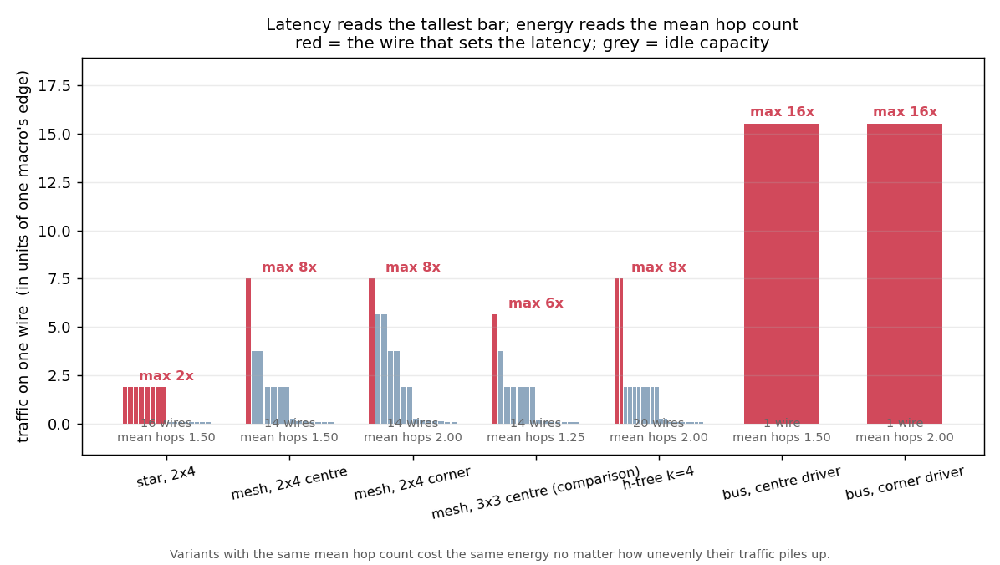

**(c) The system denominator (GPT-2 medium × 24 blocks, S=512; co-residency
basis, digital-unit terms in, value units v5).** Both phases are dominated by
compute or write — prefill: arrays 90.5% + digital unit 1.6%; decode: write
89.8% — and the on-die network cannot surface at the reference input:

| scheme / layout | prefill (stall-free 826.43 ms) perfect-overlap / zero-overlap end | decode (stall-free 14.80 ms/token) |
|---|---|---|
| star (lower bound) | 1.00× / 1.01× | 1.00× / 1.00× |
| mesh, glb centre | 1.00× / 1.04× | 1.00× / 1.00× |
| mesh, glb corner | 1.00× / 1.04× | 1.00× / 1.00× |
| h-tree k=4 | 1.00× / 1.04× | 1.00× / 1.00× |
| bus | 1.00× / 1.11× | 1.00× / 1.01× |

**At the reference input (16,384 w/c) the whole stack is 1.00× for all five
schemes**; even the zero-overlap end adds only 1–11%. Thresholds (bandwidth
below which the stack moves 1% / doubles, perfect-overlap end; 2^k grid
readings, exact crossings at the end of this paragraph): star 256 / 64,
mesh-centre 1,024 / 256, mesh-corner 1,024 / 256, h-tree 1,024 / 256, bus
2,048 / 512 w/c — a link has to fall to 0.2–1.9 GB/s before the stack moves
1%, and it doubles between 0.06 and 0.68 GB/s (the zero-overlap 1%
thresholds are 16,384 / 65,536 / 65,536 / 65,536 / 131,072 w/c). All three silicon anchors (Simba 8.75 / ESP 32 / FlooNoC 80.6 GB/s) sit
on the invisible side: 1.00× in every cell at the perfect-overlap end; at the
zero-overlap end Simba reads star 1.01× / the three routed schemes (mesh centre, mesh
corner, tree — a tie on the 2×4 grid) 1.05× / bus 1.15×, ESP at most 1.04×, FlooNoC at most 1.02× (full tables in
PROGRESS §5.2). **The analog-reality band** (estimated, §2.5, C26) at its
two ends: at 0.4 GB/s the perfect-overlap end reads star 1.00× / mesh centre,
mesh corner and h-tree all 1.31× / bus 3.33× (zero-overlap 1.29–4.24×),
at 8 GB/s every scheme is back to 1.00×; the exact thresholds (bisection on
the closed form, `sweep_axes.py`): 1% at 0.195 / 0.782 / 0.782 / 0.782 /
1.89 GB/s, doubling at 0.061 / 0.243 / 0.243 / 0.243 / 0.68 GB/s — the 2^k
grid readings above bracket them. The previously published 1.00–4.13× / 1.03–5.24× / hub lever
1.50×–1.55× are retired — they were the 14×/48× unit error (C25). The
physical wire accounting (O22/O23: direction-split full-duplex links, 16-bit
partial sums) stays; at the correct volumes it moves the multipliers from
1.00 to 1.00. **The O7 bracket** is still published at both ends; the three
qualitative readings are now: both ends **rank the schemes identically**
(pinned; zero-overlap star < the three routed schemes, which tie on the 2×4 grid, < bus); a "doubling"
threshold does not exist inside the anchor range (bus excepted, 0.68 GB/s);
the "1%" threshold is decided by the overlap assumption — with zero overlap
the bus still leaves 15% at the Simba anchor. The decode corner
counter-example of the exclusive-die basis (a corner hub under which part of
the traffic crosses no segment) does not appear on the co-residency basis,
but the mechanism stays pinned in
`test_partial_occupancy_couples_layout_to_active_slots`.

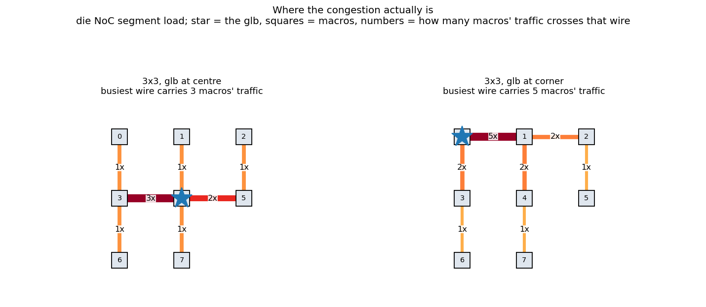
(3×3 comparison `contention_segment_map_3x3.png`: centre 6× / corner 9× on the
busiest wire in units of one edge; the load maps depend on traffic, routing
and word width, not on the compute basis.)

**(d) The offload (scenario B) version** (source
[`analyze_offload_contention.py`](../scripts/analyze_offload_contention.py),
closed-form over the static-op accounts; the die↔attention-unit link is not
modeled — the same stated caveat scenario B carries everywhere): offloading
attention removes both shields that kept the network invisible. **Prefill**:
the stall-free stack shrinks 826.43→505.48 ms and the per-die pipeline beat
23.80→10.63 ms (qk^t/av, the softmax and the K/V write leave with the
attention; the attention die keeps qkv+out_proj and half the LayerNorm /
residual work, the FFN die gains the GELU) — the compute margin halves,
every D2D knee doubles, and transfers hide less easily (D2D pipelined at
64 w/c: snake and sequential rows both degrade, 1.12× — on full-duplex
wires the row wrap rides the opposite direction, so sequential rows equal
snake; adversarial 4.47×; bus 52.5×). **On the die** (value units) the
offloaded stack is still 1.00× (zero-overlap star 1.01× … bus 1.13×, the
same in prefill and decode): once the write shield (90%) leaves with the
attention, decode's on-die network **still hides behind compute** — the
earlier "on-die contention reaches decode for the first time, 2.26×/4.35×"
was the unit error (C25) and is retired. **Offload is a throughput win that
amplifies the die-to-die communication problem** (the compute it removes is
exactly where the transfers used to hide); the on-die network is
unaffected. Three panels: prefill drops everywhere; the +124% pipelined
dividend (beat 23.80→10.63 ms) is paid out only where the package network is
not the bottleneck.
**(e) The external attention unit, end to end (O9).** Offload is no longer
the die side alone: the unit enters as a **black-box interface**
(`fabric.attention_unit`, platform input DR-9, generic public figures:
2 T MAC/s, 1 pJ per MAC, LPDDR4-class K/V memory at 25.6 GB/s and 50 pJ per
word, a die↔unit link of the die-to-die class at 12.5 GB/s and 10 pJ per
word, one unit serving every layer; sources in ANCHORS.md). Three streams
per layer — Q out (0.52 M words), K/V out (1.05 M), attention output back
(0.52 M) — travel from each attention die over the die grid to the attach
point; inside the unit QKᵀ + softmax + AV run at the rate, K/V are appended
and **the whole stored K/V is read once per layer**, serial with the compute
(stated). Prefill: 0.359 ms unit + 0.168 ms link = 0.527 ms per layer,
+12.6 ms and +17.6 mJ per model → 518.1 ms end to end (die side 505.5);
pipelined beat = max(die stage 10.63, unit stage 8.61) = 10.63 ms, so
**the +124% dividend survives the generic unit**, but below ~1.2 T MAC/s
the unit becomes the beat (−57% at 0.25 T; `offload_unit_sensitivity.png`).
**Decode**: the unit reads 25 MB of K/V per token (0.98 ms at 25.6 GB/s) →
1.99 ms per token end to end (die side 0.99; on chip 14.8), growing
linearly with context and overtaking the on-chip value near 7k tokens;
energy +1.29 mJ per token, almost all K/V reads — **1.76 mJ end to end
against 0.67 mJ on chip**: offload buys decode time and pays in energy.
**Convergence**: all streams meet at the attach point; under the snake
seating the busiest die wire goes from 1 hand-off to 36 hand-off
equivalents (sequential 25, adversarial 38, bus 143): at the 256 w/c example
bandwidth the pipelined beat is wire-bound at 10× the die stage; at the
12.5 GB/s anchor it is 1.00×. At the Simba anchor the end-to-end decode
multipliers read 1.01–3.28× (die side 1.03–5.61×: the unit's constant term
dilutes the network multipliers). The die-side numbers stay published as a
column; the unit's internal structure and any compute/memory overlap inside
it remain unmodeled.
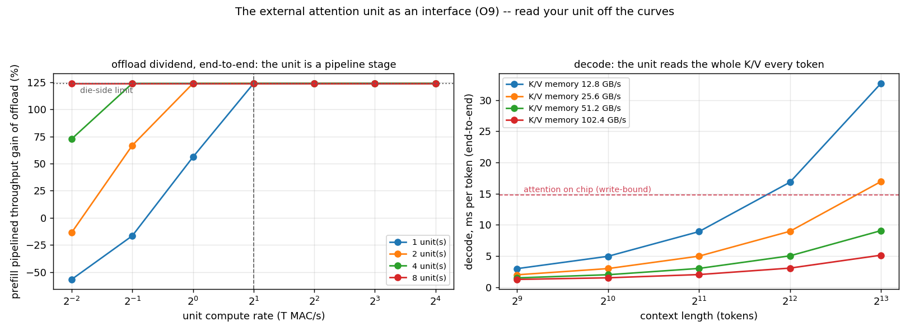


**Placement summarized per operating condition** (same layout, each figure
stands alone — they are not a comparison): three panels = within the die (glb
position → one request's latency) / across dies (layer→die assignment →
pipelined throughput) / the same choices priced in energy (full scale, no
axis zoom — essentially flat). Attention on chip: floorplan 1.00×,
assignment 2.0×, energy +0.48%; attention offloaded: floorplan 1.00×,
assignment 4.0×, energy +0.72% (offloaded, even snake is die-to-die
network-bound at 64 w/c, so the assignment lever grows; the on-die floorplan
hides behind compute in both conditions; 48-die feasible configuration,
64 w/c example input, co-residency basis, value units v5).
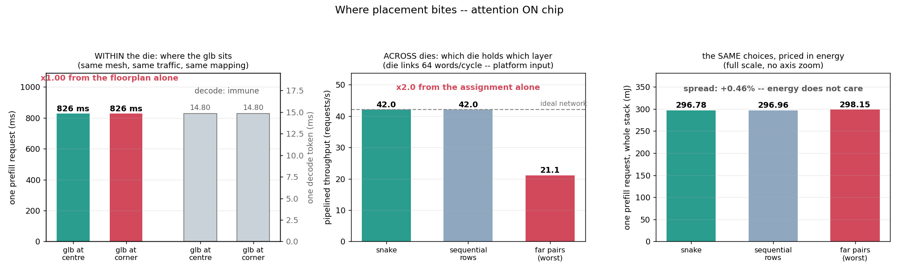
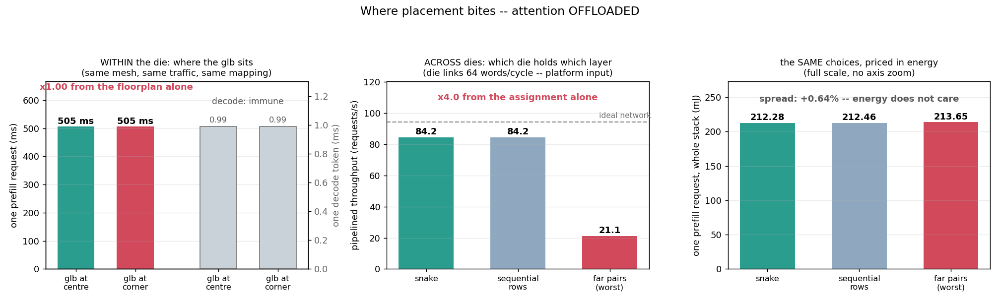

**Known coarseness (and which way it errs).** ① (closed by O7) The critical
path used to take only `max(compute, serial)` (perfect overlap); both ends
are now published — perfect overlap (the lower end, i.e. every number quoted
so far) and zero overlap (`write+compute+serial+prop`, the upper end). The
truth lies inside the bracket, and the identity upper − lower =
Σ min(compute, serial) is pinned as a test. The busiest wire's occupancy is
the lower bound of any schedule for the given routing (exact for compile-time
scheduled fabrics, optimistic for NoCs, §2.5); what remains unmodeled is
queueing in the NoC paradigm: only the busiest wire counts, so the load vectors `3,2,1,1,1,1,1`
and `3,3,3,3,3,3,3` are equivalent (the full per-wire vector is exposed to
consumers via `link_occupancy`'s `per_link` — the segment maps read it).
② CLOSED at C59 (was: bus energy charged by distance to the driver): every
bus transfer now charges the whole serpentine line, (N−1) slot pitches — an
explicitly replaceable example model — and the "star ↔ bus identical energy"
tie is retired (§2.3.1b). ③ CLOSED at C59 on the energy side: `h_tree`'s
energy wire lengths follow the physical halving-span rule, registered as
literals (`anchors.HTREE_MACRO_LEVEL_LENGTH_SLOTS`); the latency-side flat
`level_length` default is untouched (O8 ruled the latency side right).

### 2.4 The pricing boundary, and which way numbers can move

**The distance overlay can only act on a component with an energy model AND
fanout>1; in the die model only `router` (fanout=8, the macro level) qualifies.**
The core/crossbar-level `inter_*_spatial` carry zero energy in Accelergy, and the
off-die port is distance-blind by construction. Of the four levels data traverses,
**one is priced — and it is the smallest lever**.

**Directionality**: pricing any waiting term enlarges the denominator — the network
share of energy can only **rise**, glb/readout shares only **fall**; on the latency
side real bandwidths only grow compute → the write's 90% of decode, the 10.12×, and
offload's 93% are **ceilings**. The one open sign is the +0.3% distance re-pricing
(DR-4). **Three numbers move under none of this**: the closed-form validation
<0.1% (a volume identity), 1.70× / 3.69× (traffic structure × geometry, no calibrated price involved; 2×4 default / 3×3 comparison), and each token's K/V
being programmed exactly once in its lifetime (a structural invariant).

---

### 2.5 The reading position: what the anchors are, and are not (O25 / O17 / O26)

Every "hidden behind compute at any published bandwidth" sentence above is
the reading of ONE cell of a phase diagram whose axes are model scale ×
device speed × transfer paradigm × link tier; the v5 numbers sit in the
(NeuRRAM-class device × digital-ecosystem link) cell. The thresholds
themselves (0.2–1.9 GB/s on die; the 2.7B chain's 1–1.8 ms per layer of
die-link occupancy at GRS against 28.8 ms of compute) come from our traffic
and our device cycle — no anchor enters them; the anchors decide only where
they are read.

**What the anchors are.** Simba, ESP, FlooNoC and GRS are digital
accelerators' links (plus, since C40, UCIe-S 64 GB/s: an interconnect
STANDARD's ceiling, status `spec` — one epistemic step past post-layout,
no measured chip behind it): the upper bound of what fabricated interconnects
deliver, not operating points of analog CIM chips. The ESP anchor is
primary-sourced since C36 (Jia et al., ESSCIRC 2022: 5 data NoC planes ×
64 bit + 1 control plane × 32 bit at a measured 800 MHz; the paper's own
headline is 281 Gb/s tile-to-tile; the anchor's 32 GB/s = the 5 data
planes' 256 Gb/s — the quantity FlooNoC's table quotes; a multi-plane
aggregate, one physical plane is 6.4 GB/s, stated in the derivation). On
the analog side **one system now publishes a link rate (C36)**: HERMES's
chip spec table gives a maximum link data-rate of 3.2 Gbit/s = 0.4 GB/s
per PHYSICAL link (418 links, a Parallel Prism fabric) — landing exactly
on the analog-reality band's low end; the band stays the CLASS estimate.
The phase-diagram COORDINATE follows the C37 normalization rules (stated
in the registry): the t axis is PER-TOKEN row time (TOPS-derived times
are tile-shape invariant — no array-height folding), and a bandwidth
coordinate is the fabric's aggregate supply to the 32-array group one of
OUR links serves — HERMES: (418/64) × 0.4 × 32 ≈ 83.6 GB/s (the per-link
0.4 kept separately). **The self-consistency audit**
(`hermes_self_consistency`, headed for the validation chapter): need per
core per token 256 B ÷ 133 ns ≈ 1.93 GB/s vs supply ≈ 2.61 GB/s —
**~1.36× headroom**: a real analog chip provisioned its fabric just above
its own knee, the first external silicon point validating the knee
formula (C36 briefly compared the single physical link against the
per-macro knee — a granularity mismatch, corrected). The other systems that
describe their fabric: DMA + shared SRAM (TetraMem MX100: 10 NPUs +
RISC-V + 512 KB + 1 MB SRAM, 65 nm), board-level FPGA hubs (NeuRRAM's
inter-core buffers and partial-sum accumulation sit on the board; the
Tsinghua multi-chip system routes all 8 chips through an FPGA), and
compile-time scheduled point-to-point networks (Mythic AMP: per-tile
64 KB SRAM + router, product material only). In this
model they map to: DMA / shared SRAM → a shared medium whose bandwidth is the
T1 hub bandwidth; compile-time scheduled → the star scheme; NoC → the mesh
scheme (mapping table in ANCHORS.md).

**The analog-reality tier and the per-axis sweeps (O25 closed, C26).**
`scripts/anchors.py` is the single source: the digital anchors carry a
status (measured / secondary / post-layout), the analog-reality tier is an
estimated BAND (on die 0.4–8 GB/s: a 32–128-bit datapath at 100–500 MHz; die
to die 0.1–2 GB/s: board-level or older-node direct links), and every sweep
reads "the digital anchors + the two band ends". Chip points (a t_MVM
coordinate plus bandwidth coordinates, each with a status) live there too:
NeuRRAM 10.14 µs measured, Mythic 6.38 µs derived (C36: 25 TOPS ÷ 76 tiles
÷ 2·1024·1024), ISAAC 1.6 µs design point, HERMES 0.133 µs derived; MX100
is blocked on its source (arXiv:2410.14882 publishes no TOPS / MVM rate,
checked 2026-09-01 — a new worklist item, pending TetraMem's 22nm SoC
publication). The per-axis sweeps (`sweep_axes.py`: 8 points
per decade plus the anchor values and the 2^k points, both overlap ends;
figures `sweep_axis_*.png`, data `phase_sweep.json`, pinned in group 23)
read: ① on die, at 0.4 GB/s bus 3.33×, the three routed schemes 1.31× (a
tie on the 2×4 grid), star 1.00×; at 8 GB/s all 1.00×. The knee operator per
condition: qk^T in prefill on chip (ffn2 on the bus), ffn2 on every scheme
once the attention is offloaded — "S cancels" holds for the projections
only. ② The 2.7B chain (O13): 1.00× at GRS for every seating; 1% crossings
1.02–1.72 GB/s, doubling 0.26–0.40 GB/s; 4.9–7.0× at 0.1 GB/s, 1.00× at
2 GB/s (perfect-overlap end); ffn2's entry sets the busiest die link; with
the on-die link at 0.4 GB/s a further 1.19× stacks on top. The earlier [est]
"compute met near 0.5 GB/s" is replaced by these runs. ③ The 355M 48-die
pipeline: on chip at 0.1 GB/s the mesh orderings stay 1.00× and the
interposer bus reads 10.4×; offloaded, 0.1 GB/s reads 12–19× (mesh) / 70.5×
(bus) and 2 GB/s reads mesh 1.00×, bus 3.5× — the +124% dividend needs
1.2–1.9 GB/s or more (weave knob on this axis: mesh→torus compresses the
ordering-penalty spread 3.4×, ring widens it — §2.9). ④ The die↔unit link: end-to-end prefill 1.01× at GRS
(518.1 ms, the ledger's number), 1% at 9.8 GB/s, doubling at 0.098 GB/s;
decode 1.50× at 0.1 GB/s. ⑤ Partial-sum width 1 vs 2 words: the thresholds
roughly halve (bus 1% at 1.17 vs 1.89 GB/s). ⑥ T1 (the die-buffer hub;
O28 audited, C34): Timeloop's native throttling charges the glb in COUNTER
units (input fills ×7 bit slices, output fills+updates ×8 bit groups; the
write port binds — ffn1: 37,224,448 units, and the four cached points match
units ÷ bandwidth with zero error: the origin of the old "160× at 64 w/c",
C25's sibling on the T1 axis). The readable T1 axis is now analytic in
value units: the hub is one shared port (exactly the MX100-class DMA +
shared-SRAM medium), and per matmul op hub words = the T2 bus words + the
input tensor arriving once (P×C×N) — the "T1 = T2-bus boundary" the
registry's mapping rule promised holds, shifted by the in-fill share (ffn1
+6.25%). Readout: knee ffn2 in every condition; 1% at 2.27 (on chip; the
bus's 1.89 pushed up by the in-fill) / 2.33 (offloaded) GB/s; busiest-op
net = compute at 2.42 GB/s; MX100-class chips read 3.9–5.0× at the
estimated band's low end (0.4 GB/s) and 1.00× at its high end; decode-
offloaded equals prefill-offloaded exactly (S cancels in every hub ratio).
No shipped config declares a hub bandwidth, so the Timeloop push stays
inert (pinned in group 29).

**The phase diagram (O29 drawn, C35).** `analyze_phase_diagram.py` (zero
mapper; reads the stored JSONs + the registry) → `phase_diagram.png` (with
a grayscale check copy) + the grid readout table `phase_diagram_table.md`.
Two panels on the same (t_MVM × bandwidth) plane: slope −1 boundaries =
the mechanism; the d family per width tier with model names (d = 1024 the
production base); three shaded layers (on die: everything contends / the
organisation decides / placement-free); digital anchors as horizontal
lines with statuses, the estimated bands and chip bandwidths marked as
estimates; HERMES / ISAAC as error-bar points, NeuRRAM with its t
coordinate only (hub-IO); the two trend arrows; the collapse inset; and
validation points classed by measured / closed-form with colour AND shape
(grayscale-safe): the 17c probes on the left (ffn2's tiler step gets its
own “known step — expected” marker class, never conflated with genuine
disagreement), and on the right the measured B2 block-chain marks sitting
on the closed-form d = 2560 line at all four silicon speeds (four marks
since C36). **Die-level
semantics (corrected in review — not a layout nit):** the black d = 1024
line is the PURE hand-off stream (operators fit their die; only the hidden
state crosses; = the die↔unit link under offload); the blue d ≥ 2560
family are BLOCK CHAINS INCLUDING their spanning operators (column split,
tensor once: each receiving die takes the full input) — which is why they
sit above the purple SINGLE 4-die operator probe line; the three layers
are stated as pure hand-off / probe / block-chain family, and the capacity
ratio is the selector, not an axis. Pinned in group 30. **Current conclusion (NeuRRAM
tier, no device extrapolation): shared media cross the line in the
analog-reality tier (on-die bus 3.3×, interposer bus 10–70×), point-to-point
links cross it at the 0.1 GB/s die-to-die tier (2.7B chain 5–7×, offloaded
pipeline 12–19×); GRS and the three digital NoC anchors read 1.00× throughout.**

**The device axis (O17; 17a the input, C30; 17b the plane, C31).** The
device has been a fabric platform input since C30 (`device:
{cycle_seconds, input_slices_per_mvm}` → t_MVM; the registry's `CYCLE_S` is
its value; YAML bandwidths are declared in GB/s and converted at load, the
unit link 12.5 GB/s = 18,107 words/cycle; every run checks the CiMLoop
macro's cycle via `verify_cycle`). C31 makes it a MEASURED axis: the
(t_MVM × bandwidth) plane (the `plane` axis of `sweep_axes.py`, device grid
0.05–100 µs at 8 points per decade, crossed with axes A, B1, B3 and C; B2,
already crossed with axis A, is read at the silicon marks only). The plane
rests on the group 26 identity — at a fixed GB/s the seconds on a link do
not depend on the device — so the network term depends only on the
bandwidth coordinate and the compute term only on the device coordinate:
the whole plane is closed-form, no mapper rerun. The metric changes to the
BUSIEST OPERATOR's network / compute ratio r(g, t), not the whole-stack
multiplier, because t_MVM scales the MVM read path only: the K/V write
(65.43 ms of the 826.4 ms prefill stack), the digital unit (13.37 ms), the
external attention unit and every link's GB/s stay fixed (printed on every
figure). r = 1 is the closed form g = 11.310 GB/s × (ser/comp) × (10.14 µs
/ t), a slope −1 line in log-log; the bisection-swept thresholds land on it
to 1e-9 (pinned in group 27). Readings (prefill, attention offloaded; the
knee is ffn2 on every scheme): the boundary at the NeuRRAM tier is star
0.202 / the three routed schemes 0.808 / bus 2.02 GB/s → at HERMES (76.3×)
15.4 / 61.6 / 154 GB/s — Simba 8.75 and ESP 32 fall below the routed line,
FlooNoC 80.6 alone stays above it; the 2.7B chain's boundary moves 1.01 →
77 GB/s, 6.2× past GRS; the die↔unit link's boundary is 0.101 GB/s ×
(10.14 µs / t) in both phases (S cancels in net over compute) — "hidden
behind compute at any published bandwidth" flips inside the analog family,
and now as measured plane readings, not an extrapolation
(`device_plane.png`). The collapse variable is g × t_MVM (bytes through the
link per MVM-row time): the matrix-part multiplier is a single-variable
function of it and the three device curves coincide exactly; the
whole-stack multiplier is not — words/cycle is that unit only at the
NeuRRAM slice count (`device_plane_collapse.png`). The fixed-term
decomposition (`device_fixed_terms.png`; four panels since C39 —
prefill/decode × on-chip/offloaded on shared axes): a 76.3× faster device
speeds on-chip prefill 9.33× (826.4 → 88.6 ms) and decode by only
**1.11×** (14.78 → 13.34 ms: the decode stack is almost entirely the K/V
write) — the finding, not a bug. **The mechanism half-sentence (C39):**
on chip the dynamic attention operators are **write-rate-bound** — each
decode token must be SET into its K/V row before qk^t/av can read it, so
a device faster only on the read path keeps its on-chip attention walled:
a fast device with attention on chip is a self-contradictory
configuration; the exits are faster writes (DR-5) or offload (DR-9).
**The fixed-terms RELAY (the offloaded twin panels, all closed-form):**
offloaded, the die keeps the projections + FFN (scaling) and the new
floor is the unit + link (DR-9 generic: decode 1.02 ms, prefill 19.7 ms)
— **below the write wall in BOTH phases (13.32 / 78.8 ms), so under the
generic DR-9 values offload wins single-pass latency at EVERY device
tier: the expected 1–3 µs crossing threshold does not exist** (decode is
already 14.78 vs 1.99 ms at NeuRRAM); but the unit floor then caps the
offloaded config itself: a 76.3× device buys offloaded decode only 1.93×
(prefill 19.7×) — near-full decode scaling needs offload AND a faster
unit. DR-5 and DR-9 are thereby welded onto one argument: DR-5 sets the
on-chip ceiling, DR-9 the offloaded one, and the crossing condition is
whether unit + link fixed time exceeds the write wall. Pinned in group 27
(the offloaded totals tie the ledger: 518.1 / 1.99 ms). The silicon marks come only from the registry
(`anchors.device_marks()`; four since C36): NeuRRAM 10.14 µs measured,
Mythic 6.38 µs derived, ISAAC 1.6 µs design point, HERMES 0.133 µs derived
(63.1 TOPS ÷ 64 cores ÷ 2·256·256); the
continuous surface between them is the model's closed form, not a
measurement — read it the way the digital anchors are separated from the
estimated analog band. Since C33 the plane draws the **d-family boundary
lines** (O29's boundary family, one set per panel): on die (routed) one
line per width tier — d = 1024 the **production base** (co-residency C14;
its knee ffn2 sits ×2 above the trunk line through its C split), 2560
(OPT-2.7B) / 4096 (Llama-7B width) / 8192 (Llama-2-70B width) on the trunk
law ×4; ffn2's tiler step is an on-figure annotation, not a kinked line.
The die-level family is the tiler closed form (the hand-off tensor once:
ffn2's S×4d entry; d = 1024 = the C13 half-layer hand-off S×d), and the
d = 2560 line passes exactly through the measured B2 mark (asserted at
build time). The family at t_ref: 0.808 / 1.010 / 1.616 / 3.232 GB/s on
die and 0.101 / 1.010 / 1.616 / 3.232 GB/s at the die level — the two
levels coincide for d ≥ 2560: mesh's ×4 multicast equals ffn2's 4d-wide
tensor, one number by two mechanisms. The scaling law is now MEASURED (O17c done, C32:
`run_scaling_probes.py`, 48 mapper runs, single core ~35 minutes,
resumable; column split, full input per die, one full die per piece, the
O15 row split untouched; dh = 64, prefill). REGIME TAG (A2, C61): every
number in this subsection -- the trunk ratio d/114,688, the flip d* =
1,220-1,350, the x4 routed multiplier and the thresholds derived from
them (0.81 GB/s at d = 1024 included) -- is a COLUMN-SPLIT-regime
reading; the row-split (O15) readouts land in new `row_split` rows
only, never by editing these.

**The row split, measured (A2, C61 -- O15 resolved).** The law's one
declared exception ran end to end (identity rerun 18/18 bitwise first;
hand gate 13/13; 25 forced-C mapper points, feasibility frontier
empty). What it turned out to be is not a good/bad switch but a
**load-relocation valve between levels**: at trunk-regime widths the
per-die input trunk thins and the on-die busiest wire RELAXES up to 4×
(ffn2 0.0714 → 0.0179 at d = 4096/8192), while the bill moves to the
die edge -- full-M unmerged partial sums, psum-dominated at every
natural split (closed form 2Mn > C, 20/20; ffn2's minimal split is an
exact tie, 2Mn = C = 4096). **Hard rule, and the first constraint the
search side must encode if the split regime ever joins the variable
set: any use of this lever is stated at BOTH levels -- the on-die
number alone yields exactly the wrong recommendation.** The per-level
verdicts genuinely split (die swaps to psum while macro stays trunk at
small n); die counts move both ways (qkv 10 vs 15 at d = 5120 -- row
split can tile better), so the valve relocates load, not area. The S
weld holds (ffn2 ratio S-free, projections/FFN scope only). The
underfull probe REFUTED its pre-written direction: a voluntary 2-die
row split at d = 1024 is exactly 2× worse on-die for the M-heavy ops
and better only for C-heavy ffn2 -- **for the company: weight
replication stays the better underfull exit, except for C-heavy
shapes**. Bonus sentinel, pinned: ffn1's row ratio equals its column
ratio at every width with the direction flipped dn→up (the C = d,
M = 4d arithmetic) -- two independent code paths must forever emit the
same number, and this pin goes red first if either breaks. Data:
`a2_row_split.{json,md}` (new rows), `a2_identity_rerun.json`,
`a2_hand_gate.json`; pins group 46.

**The whole-model static spread, measured (A4, C62-b — O16 under its
only realistic hypothesis).** All 32 layers of the 2.7B class seated
simultaneously — 544 dies (17/layer by the standing block rule) on a
declared 24×24 grid — replacing "block × 32" extrapolation with one
measured flat seating (closed form on the stored mapper-measured
account; zero new mapper runs). Whole machine vs extrapolation:
**+1.27% latency at GRS** (+5.2% at 2, +10.0% at 0.4, +12.0% at
0.1 GB/s) and **+1.83% energy** — the published block rows are indeed
the lower bound, now with the surcharge quantified. The energy
increment decomposes by nature: 4% accounting caliber (the ×4
multicast the pre-estimate missed) vs **96% declared geometry** (the
inter-layer hop surplus plus the dominant layer-offset variation:
layer 0 is the one row-tight cluster, the other 31 straddle row
wraps). Whole-machine D2D energy is **~4.0% of the account — cited
with its geometry attached, never as a bare constant**. Semantics
fence: this is the batch-1 PURE-SERIAL number (layer-sequential);
direct comparison against the 48-die pipeline readouts is forbidden.
The temporal-rewrite alternative is bounded out in one closed-form
line (544 dies reprogramming 16.78 M cells per pass). The seating map
plus a 16-package × 2-layer seam example ship as the die-level search
test payload. Data: `a4_full_model.{json,md}`; pins group 47.

**O19 batch (C63):** the duplex item closed-as-already-done (the
direction-split account has been live since O22; stale sentences
retired, the contract pinned). The **`switch` weave** joined the
registry (non-blocking to port bandwidth, placement-irrelevant by
construction — ordering spread exactly 1.00 vs mesh 6.55× / ring
12.26× / torus 3.57×, busiest port identical under every ordering;
the N² wiring price declared in the identity, in no account; the
"switch vs mesh" decision is now computable): `switch_weave.{json,md}`
+ `switch_ordering.png`, pins group 48. **`cmesh`** followed (k nodes
per router, [1,1] degenerates to mesh exactly; the concentration cost
carried by the shared router local port — an amendment filed before
readouts): on the 2×4 grid concentration is FREE up to k\*=4 and
binding beyond (bottleneck 4.0/4.0/4.0/8.0 over k=1/2/4/8) — "how many
nodes per router is free" is a computed crossover now:
`cmesh_weave.{json,md}` + `cmesh_concentration.png`. **`express`**
closed the batch (uniform station-free family, skip s; physical hops ==
Manhattan — shortcuts save router crossings and contention, never wire):
the price-curve readout replaced the planned spectrum sentence — on 3×3
express s=2 TIES torus exactly (lever 1.000 at 2.0× wire); on 6×8 the
lever gets WORSE at s=2 (2.000 vs 1.667) even as both absolutes improve,
and torus dominates every express point — express is an
absolute-decompression valve (centre busiest 16 < mesh 24), not a
sensitivity antidote: `express_weave.{json,md}` +
`express_price_curve.png`. **`hier_wide`** (FlooNoC-class: cmesh local
tier + a multi-channel wide backbone, lane = src % W) delivered the
fidelity upgrade's sentence: at the FlooNoC anchor every variant ties
the poured-mesh 4.000× numerically while the binding resource migrates
to the local gateway port at every W — the anchor's wideness cannot be
consumed on this host, so the poured reading was right numerically and
wrong structurally: `hier_wide.{json,md}` + `hier_wide_fidelity.png`. The batch closed with the **routing knobs**
(`reply: yx`, `routing: o1turn` — default-byte-neutral): three stacked
findings retired the on-record XY/YX asymmetry — for hub flows
retrace-of-XY IS the YX path (path-identical, pinned), sink-convergent
patterns are conservation-fixed on the busiest wire, and the o1turn
parity stand-in never beats plain XY on any tested pattern — routing
algorithms cannot move any busiest-wire number in this account; their
habitat is the queueing tier, outside the O26 bound:
`routing_params.{json,md}` + `routing_params.png`. **O19 is closed: ten
schemes, nothing queued.**

**The search milestone (worklist step 7) is OPEN (C64):** the founding
spec is repo-resident at [SEARCH_SPEC.en.md](SEARCH_SPEC.en.md) (space /
objective / referee family / solver split / path, with the accepted
amendments marked in place); S5/O6 are retired with the collaborator's
withdrawal (the 47% figure permanently unpublishable; 11% flat stays).
S1 day 1 shipped: the Π search space with tiler-folded legality (the
O10-type counterexample is a pinned rejection) and the A4 payload as the
legal standard case — group 49. Three findings, each replacing
a guess: (1) above the flip the busiest wire IS the input trunk — down =
S×d words per macro edge exactly, ratio = d / 114,688 (= 16,384
words/cycle × 7 slices): "knee ∝ d" with slope exactly 1, the closed form
the phase diagram's (O29) boundary family draws; ffn2 (C = 4d) steps with
the tiler's macro C split (0.0714 at d = 4096 → 0.0446 at 5120) — the law
is mapper-dependent exactly where the tiler changes shape, but that is a
quantisation step on the trunk line, not a shape change. (2) The flip is
measured at d* = 1,220–1,350 (qkv 1,224 / out_proj 1,288 / ffn1 1,349;
ffn2 down-dominated everywhere) — the ideal-capacity prediction 5,793 is
FALSIFIED, 4.3× off: it ignored the macro fanout (the up traffic divides
across 8 macro edges) and that multi-die pieces fill their die exactly;
the d = 5120 / 6144 runs added to pin the crossing prove the trunk line
runs straight through the predicted crossing — no valley there. Below d*
the dies are underfull and the mapper replicates weights to split P
(compute halves at d = 1024): the left branch is mapper-shaped. (3)
S-independence is stronger than declared: every probed ratio (qk^t
included) is exactly flat over S = 128–2048 — qk^t's volume follows S²
but so does its compute (ratio pinned at 1/14); "attention follows S" is
about absolute volume, not the knee ratio. Bonus identity: the d = 2560
probes reproduce the 2.7B block's ratios on a different package (48 vs 24
dies) — the on-die law does not see the package. The scheme multipliers
are verified, not extrapolated (C33): the stored per-macro-edge flows
re-scored under mesh / bus (closed form, zero mapper) — the routed
multiplier is **×4.00 exactly at every d and op** (d-independent; the
family's routed lines are therefore measured), while the bus multiplier is
NOT constant: ×13.3 in the underfull d = 1024 regime sliding to the
deep-trunk asymptote ×8.25 (the "×10" O17b reads at the production base is
basis-specific); the star re-scoring reproduces the stored serialization
to 1e-9 (the probes' fabric is the star). The old "partial-sum up,
falling until d ≈ 5,800" story came from the v5 co-residency accounting
and is replaced by the measurement (the 7B / 70B extrapolation was
withdrawn earlier). Figure `scaling_law_vds.png`, data
`scaling_probes.json` / `scaling_law_summary.json`, pinned in group 28.

**What the busiest wire means (O26 done, C29).** For a given routing, any
schedule — a compile-time one included — needs at least volume ÷ bandwidth on
each wire, so the busiest wire's occupancy is the least serialisation any
schedule can reach: exact for private links (nothing shared) and a shared bus
(one resource, any work-conserving arbitration reaches it), a lower bound for
a routed grid or tree (the missing piece is the arbitration of the flows that
share a segment); the max end is the exact ideal of the scheduled paradigms
and the optimistic bound of the NoC paradigm, the sum end the fully
serialised bound; re-routing changes the per-wire volumes and is a search
move, not a contention refinement. "No queueing" is a gap of the NoC column
only, not a coarseness of the model: queueing / BookSim-class checks apply to
the digital column; for scheduled fabrics the open question is feasibility,
expressed by the fabric-level platform input `schedule_slack` (≥ 1, default
1.0 = the bound; `link_occupancy` multiplies every wire's occupancy by it).
The identity is pinned in group 25: on the frozen ffn1 flows the fully serial
schedule ≥ the bound, the per-wire greedy schedule = the bound, on a bus the
serial schedule = the bound; at slack 1.5 every occupancy scales 1.5× and the
scheme order is unchanged.

### 2.6 External validation: the Simba reproduction (worklist step 1, C41–C48)

The instrument's SOFTWARE-placement channel now has an external contrast:
NVIDIA's Simba (Shao et al., MICRO'19; Zimmer et al., JSSC'20) measured
fixed silicon with only the assignment varied — precisely the move our
search makes. We rebuilt Simba in the fabric schema at its papers'
EXPERIMENT operating point (0.72 V, 1.03 GHz, GRS 11 Gb/s mode = 5.5 GB/s
per link direction — the experiments did not run the 12.5 GB/s max; X-Y
routing, weights preloaded, layer-sequential), declared its digital MACs
as an equivalent-throughput device (explicit `device_class` — device
physics is NOT under validation; the ReRAM self-check stays hard
elsewhere), and expressed its ResNet-50 layers as closed-form conv
traffic on the existing dim-classification tables (touched-extent
volumes — no im2col overcount; a hand-check gate locked
multicast/reduction structure and conservation against hand integers
before any target ran). A pre-registration (working record
`analysis/SIMBA_PREREG.md`) froze parameters, criteria bands anchored on
pixel-read figure values, bias-direction declarations and three-tier
triage rules BEFORE each run; every under-specified choice (Fig 9's
seatings decoded from the figure, the greedy-placement procedure, per-
point tilings) was declared in dated amendments first. A review round
added the PACKET BRACKET: [busiest-wire bound, round-serialized end]
for NoC-paradigm links — the pessimistic end is a declared discipline,
not a bound; the 17/16 header-flit share is an unconditional tightening;
production configs are untouched.

Figure: `simba_validation.png` (generator
[`analyze_simba_validation.py`](../scripts/analyze_simba_validation.py)).
Verdicts, honest ones included:

- **T1, the 2.5× seating spread** (res4a_branch1, four chiplets, the five
  decoded seatings): the serialization bound is seating-FLAT — the
  distance-insensitivity of the busiest-wire bound is itself a finding —
  while the pessimistic rail tracks the measured ladder FROM BELOW
  (1.35/1.70/2.05/2.40 vs 1.36/1.74/2.12/2.53), residual 0.7–5.2% growing
  linearly with distance: the fingerprint of acks / multicast rounds /
  end-of-transfer sync, handed to the BookSim step as a measurement task.
  Both rails stay below silicon at every bar.
- **T2, the data-placement gain** (32 chiplets, greedy vs the paper's
  sequential baseline): the lever REPRODUCES — greedy never loses, and
  the best-gaining layer coincides with silicon's (res3a_branch1). The
  corner-vs-center broadcast sub-case is contained by the bracket
  [1.004, 1.622] ∋ ~1.05. Ratios overshoot on two layers because the
  placement-INSENSITIVE constants (synchronization ≈ 6,000 of ~10,000
  cycles at 32 chips, per JSSC Fig 18) are deliberately absent from our
  denominator.
- **T3, the scaling classes** (three layers over 1/4/8/32 chiplets): the
  measured class is bracketed by the two rails 3/3 (a labeled post-hoc
  reading); the pre-registered choice to grade the pessimistic rail alone
  scored 1/3 and is logged as the first falsified pre-registration
  choice — elbows need a point INSIDE the bracket, which is exactly what
  BookSim calibrates.
- **Two structural findings.** (a) TILING FREEDOM: our enumeration finds
  zero-communication tilings (legal per JSSC §III-B) that silicon's
  compiler did not use — so measured placement gains are
  tiling-contingent, and our "best-tiling" baselines can beat silicon's
  realized mapping outright. (b) The busiest-wire abstraction's dropped
  terms are now NAMED and BOUNDED: per-packet distance-coupled latency
  (the bracket's width) and placement-insensitive constants (the ratio
  dilutant) — not "more communication modeling".
- **The phase diagram closes the loop**: Simba enters as the first
  DIGITAL chip point (t = 497 ns per input row through a PE's resident
  32 KiB, derived; on-die 560 GB/s per 32-array group; D2D on the GRS
  line). On-die it sits in the placement-free region; at the D2D tier it
  sits above pure hand-off but below the spanning-chain boundaries —
  "die-spanning operators exposed" — and Fig 9's spanning operator is
  exactly the exposure the diagram predicts, at the size T1 measured.

With HERMES auditing the ACCOUNTING caliber (§2.5) and Simba auditing the
SOFT-PLACEMENT effect, the validation chapter now carries one external
contrast per layer of the instrument.


### 2.7 The soft-placement band, priced at the anchors (worklist step 2, C49)

The attribution framework says hardware placement sets WHERE the boundary
lines sit and software placement is each line's width. This table prices
that width closed-form at the anchor operating points (zero mapper; table:
`soft_lever_table.md`, data `soft_lever.json`, generator
`analyze_soft_lever.py`; pre-registered cell semantics and per-cell
direction expectations in FIXLIST step 2, written before the run). Cells
carry a TRIPLE — whole-stack worst/best, mechanism (busiest-wire)
worst/best, and the fixed-term share that connects them.

Two rows with distinct semantics, never mixed: **A1 real** (one joint
seat permutation of the 8 macro bundles on the production 2×4) =
**1.000 exactly — and the adjudicated reading is STRUCTURAL DEGENERACY,
not a null search result**: any two seatings carry IDENTICAL per-wire
loads (checked wire by wire for every lever op, pinned), because three
conditions stack — the fill-exact grid, the uniform mapping (per-leaf
even division certified by the traffic extraction's conservation guards
on Timeloop's own counters), and the shipped bundling. The on-die
soft-placement freedom is FROZEN TO ZERO BY THE MAPPING at this
operating point. **A2 synthetic ceiling** (the ×4
heavy-talker stressor, not a realizable seating): mechanism 1.75×
constant (pure geometry); whole-stack fold — prefill 1.609× at
0.4 GB/s → 1.000 at 2 GB/s and above; decode 1.084× → 1.000 (the write
wall dilutes; fixed shares 76% / 97% at 0.4). Band visibility: >1% only
below ~1.37 / ~1.08 GB/s (prefill / decode), >10% below ~1.06 / ~0.33.
Expectation reconciliation: every pre-written direction held; the
inherited "1.31× at 0.4" is SUPERSEDED by the v6 ledger's 1.609×
(recorded as a finding), the inherited "1.5–1.7× at the band's low end"
is confirmed.

The reading, conditioned to its premises (the search chapter's
motivation): in the dense, evenly-tiled operating point of the
production die, on-die soft-placement freedom is frozen to zero by the
mapping — and each of the three conditions reopens the space when it
breaks (a non-fill-exact grid; non-uniform per-macro loads, which the
C28 stressor demonstrates and MoE-class expert routing or
variable-length attention naturally produce; re-bundled co-residency).
This must NOT be read as "on-die placement never matters". It is the
attribution framework's clean THIRD HAND: besides hardware placement
(where the lines sit) and software placement (the band width), the
MAPPING decides whether placement has any play at all. In THIS
configuration the searchable freedom concentrates at the die level,
where the measured bands are wide — and the evaluator prices both
levels, so a workload that reopens the on-die space needs no new code.
(Simba says the converse from silicon: fast device + wide NoC puts its
on-die corner in the placement-free region while its D2D tier carries
the measured levers, §2.6 — two different mechanisms, one conclusion
about WHERE the play sits.)

**A3 — the reopening, measured on a REALIZABLE configuration (C49-b).**
The degeneracy theorem called for a non-synthetic probe, and the
production seating supplies one: under offload the die keeps only the
co-resident projection set, whose blocks tile integrally at d=1024 (qkv
3 macros, out_proj 1, ffn1 4, ffn2 4 — the attention-half die keeps
FOUR slots free). Joint seatings exhaustive (280 / 70): the mechanism
lever is **3.00× (attn die) / 2.67× (ffn die)** — EXCEEDING the ×4
synthetic stressor's 1.75 (A2's "ceiling" is scoped to the
uniform-mapping world; natural concentration ×8/k plus real free-slot
geometry moves more) — folding to a whole-stack **1.434× at 0.4 GB/s**
(decode 1.057×), 1.000 above the knee. Every pre-registered direction
held; the magnitude pre-estimate (1.1–1.8×) was undershot by the data
and is recorded as a finding. The connector, verbatim from the table:
after offload what remains on the die IS this co-resident projection
set — the on-die space reopens in that configuration, and the evaluator
needed no new code.


### 2.8 The validation chapter, in five layers (the frame the worklist executes)

Everything above §2.5–§2.7 slots into one five-layer frame — the paper's
validation chapter and the order the remaining work closes in:

1. **Inherited calibration** — the device is CiMLoop's silicon-calibrated
   macro, declared as a fabric input and reconciled on every run; every
   anchor and chip point carries provenance and a status
   (measured / post-layout / spec / estimated / derived), §2.5.
2. **Counting** — Timeloop's counters reconciled into value units (reads
   per bit-slice, bit and cell-column factors), conservation guards that
   raise instead of smearing, the exact-energy identity, and the die-buffer
   axis audited against Timeloop's own throttling in closed form.
3. **Semantics** — swept thresholds land on closed-form boundaries to
   1e-9; the busiest-wire number is stated as the bound it is (exact for
   star/bus, optimistic for routed grids, `schedule_slack` ≥ 1); the
   packet bracket makes the NoC-paradigm gap two-sided; normalization
   rules are declared before coordinates are compared.
4. **External behaviour** — one contrast per layer of the instrument:
   HERMES audits the accounting caliber (×1.36 headroom, §2.5); Simba
   audits the soft-placement effect (§2.6, with the honest verdicts);
   the soft-lever table prices the band our own search will move in
   (§2.7); and the cycle-accurate reference (BookSim, C52) certifies
   the busiest-wire bound's reachability by a real router (+0.18-0.74%
   network-internal, distance-ordered) and splits silicon's 2.53x into
   1.0056 (network-internal, measured) x 2.516 (protocol share --
   declared, now with a measured anchor).
5. **Robustness** — run (C54, `robustness_table.md`; criteria
   pre-registered and review-amended): the region calls at the digital
   anchors survive 5× error and the worst-endpoint protocol overlay; the
   workspace straddle survives 2× and fails 5× only in the direction
   that strengthens the placement case; measured-structure rows are
   error-immune by construction. The honest reds ARE the table's
   credibility: the accounting audit's resolution radius is 1.36×
   (beyond that it is blind, quantifying "audits accounting, certifies
   no mechanism"); the bound-below-silicon property has its tightest
   margin 1.68× at the tiling-divergence point (pure model-error
   headroom is larger; triage pre-written); the packet bracket's
   containment dies at 5×, as a bracket should.

### 2.9 The weave knob: torus and ring join the registry (A7, C60)

The registry gained its first folded schemes — **torus** (wrap-around mesh)
and **ring** (the 1D cycle) — under the folded wire model: a wrap link is
not free in 2D packaging, so every hop on a folded axis is 2 slot pitches,
and the accessors split (`hops()` = physical length for the ns_per_mm and
C58 price-per-length chains; `router_hops()` = crossing count for
per-router packet constants; validation refuses packet parameters on a
folded scheme until the packet path reads the count explicitly). Both are
point-to-point, so the C59 energy identity and the C58-c
order-inheritance theorem apply on physical length. Three results:

1. **The hub-position lever can be zeroed by topology.** The 3×3
   comparison grid's corner/centre peak lever (the pinned 5/3) reads
   exactly **1.00** under torus — the wrap restores the symmetry the
   corner hub broke. The antidote works precisely for ECCENTRIC hubs
   (from a central hub, wrap never helps a path ≤ half-width: count means
   are equal, and folding then costs 1.67–2.0× mean physical wire on
   grids this small). The 2×4 production grid was already hub-insensitive
   on the peak; its conclusions do not move.
2. **The honest seating recommendation is three sentences** (the
   pre-registered "ring removes the far end, spread narrows" FLIPPED on
   the data and is booked as a finding — a 1D cycle's far end is longer
   than a 2D mesh's): ring is exactly optimal for in-order pipeline flow
   (sequential rows reads 1.000, its native ordering) **but makes the
   ordering MORE critical** (worst/best spread 6.55× → 12.26×); it is
   **torus that relaxes ordering criticality** (6.55× → 3.57×); mesh
   sits between. The weave knob's lever on the ordering-penalty axis is
   **3.4×** (12.26 vs 3.57) — a third hand beside the scheme and
   bandwidth knobs on that boundary.
3. **The optimal ordering itself swaps with the weave** (mesh and torus:
   snake; ring: sequential rows) — a direct instance of the
   paradigm-dependence clause: without the weave parameter even the
   ordering BASELINE is chosen wrong. The search-side consequences are
   filed: the baseline library registers orderings per weave, and the
   mis-paradigm adjudication arm has a ready-made example.

Frozen claims are untouched (production on-die insensitivity, the 12–19×
D2D band — mesh-caliber readouts, the 1.4–2× soft lever); the changes
live in the design-implication layer. Readouts:
[`analyze_torus_ring.py`](../scripts/analyze_torus_ring.py) →
`torus_ring.{json,md}`; pins group 45 (the die-level count and physical
spread columns coincide structurally — both 6×8 axes fold, the uniform
scalar cancels in ratios; asserted elementwise).

## 3. Models & results, level by level

### 3.1 Distance and placement (macro level and below) — the central work

CiMLoop communication = `volume × fixed per-word energy`, position-blind. We overlay
distance:

- [`scripts/placement_aware.py`](../scripts/placement_aware.py) — `perceive →
  placement prior → distance model → re-aggregate`; energy (`position_aware_cost`,
  base = the component's own reported `Energy (total)`) + latency
  (`position_aware_latency`). Priors (`place_grid`/`place_linear`) and patterns
  (`to_center`/`tree`/`all_to_all`/`neighbor`) pluggable; explicit assumption
  `reference_hops` (→ DR-4) cancels in ratios — **relative comparisons are robust**.
- [`scripts/crossbar_comm.py`](../scripts/crossbar_comm.py) — aggregate traffic
  decomposed into **per-pair** (node↔node) flows: a nested floorplan gives each
  crossbar coordinates; multicast/reduction trees yield `(src→dst, volume,
  distance)` + heatmap + geometric `level_max_hops`.

**Macro level (priced; reaches the system totals)**: with 8 macros the geometry is
exact, no simulation needed — to-hub mean hops 1.5 on the 2×4 grid (1.3125 on the 3×3
comparison grid) vs 2.0 (line) → **line = 1.33× the macro NoC energy** (1.52× on the 3×3); full setting sweep 3.00×
(neighbor 1.0 → linear all-to-all 3.0). Times the level's denominator (router =
0.65% of block energy) → **moves the whole block by 0.25%** (0.34% on the 3×3): placement demonstrably
changes a calibrated cost — and at this level the lever is small.

**Crossbar level (relative map; default 2×4 layout = 1.70×, 3×3 comparison =
3.69×, value units v5)**: under the v1 real traffic structure (`traffic.py`: a multicast slice
crosses an upper edge once, idle instances carry zero, shared volume attributed
by share), ffn1 uses the full array. On the **default 2×4 / 4×2 layout** (fill-exact,
no gray slots) a corner crossbar costs **1.70×** a central one; the 3×3 comparison
variant stretches that to 3.69× — the spread is itself a function of the layout, which
is the point of the map (the uniform-era 3.58× is retired per the CHANGELOG;
the 3.69× cited in §0/§2.4 is the 3×3 comparison value). **The structural difference shows on partially-utilized ops**: a small
2×2 matmul really uses only **32/256** crossbars with the idle region at zero —
the uniform model smeared that into a full-array spread. The level still carries
zero energy → a **ranking**, awaiting DR-1; rankings are what a search consumes.

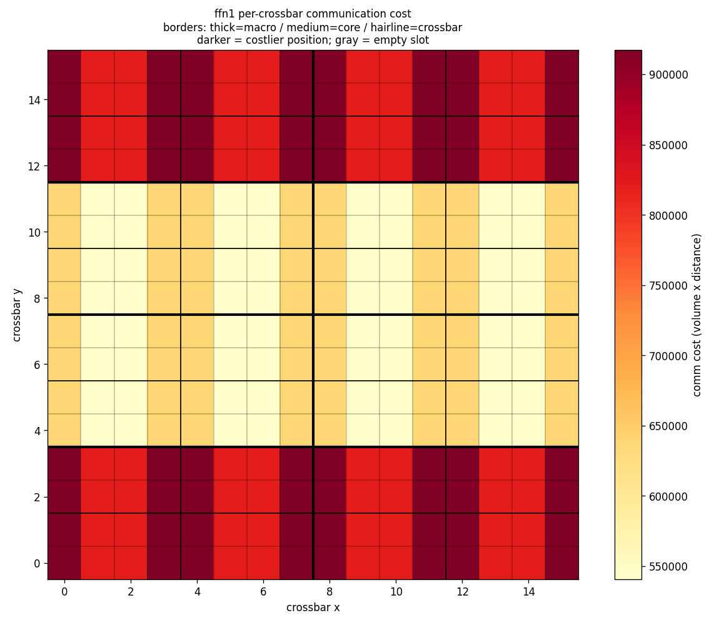

**Region level (relative map, 17.8%)**: hardware and mapping fixed, only which
cores each of 6 matmuls occupies changes — dataflow order beats size order by
**17.8%** (volume-weighted all-pair Manhattan; source
[`scripts/analyze_region_locality.py`](../scripts/analyze_region_locality.py),
reusing io_study's deterministic floorplan). **The metric matters**: NN-min reads
31.2% but flatters adjacency (`ffn1→ffn2` scores 1 under both orders while its
volume-weighted mean distance is 3.47 — the equal pair of bars in the figure).

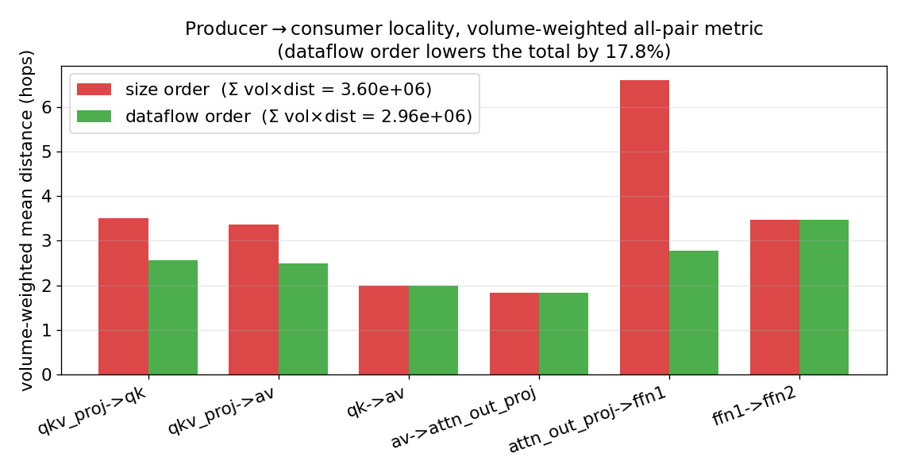

**Independent corroboration from the search side**
([`scripts/die_solver.py`](../scripts/die_solver.py), collaborator): the same
claim reached from the **reduction structure** rather than from distance —
keeping each M-block's C-tiles inside one macro drives cross-macro reduction
merges from 4 to **zero**, at a cost of one extra core (27 -> 28 of 32). On-die
reduction energy 0.89 -> 0.79 uJ (flat router) / 1.48 -> 0.79 uJ
(distance-weighted; the latter rests on a component that does not yet exist —
FIXLIST O6).

**With the denominator supplied**
([`scripts/analyze_placement_impact.py`](../scripts/analyze_placement_impact.py)
runs his four matmuls through our full pipeline):

| quantity | value | share of system |
|---|---|---|
| system energy of the 4 matmuls | 1,229.0 uJ | 100% |
| his reduction term (baseline) | 1.482 uJ | 0.121% |
| his saving (distance-weighted = **47% of the term**) | 0.692 uJ | **0.056%** |
| his saving (flat = 11% of the term) | 0.099 uJ | 0.008% |
| CiMLoop's own router energy, same 4 ops | 9.23 uJ | 0.75% |

> **Two conclusions.** (1) **The magnitudes reconcile**: his lambda-1 reduction
> term is **0.161x** CiMLoop's own router charge — he models the *inter-core
> partial-sum subset* of what CiMLoop charges in aggregate, not a competing
> total. (2) **Two independent routes land in the same place**: the on-die
> energy lever is **under 1% in both accountings** (ours 0.25% at the macro
> level, his 0.056% from reduction clustering). This *strengthens* conclusion 2
> of §0 rather than weakening it — **the energy payoff is not within a die; it
> is in contention (DR-2) and D2D (DR-3)**.
>
> (Caveat: the measurement uses our default gpt2_medium histograms on BERT
> shapes, so the value-dependent part carries a few percent of error — not
> enough to move the order-of-magnitude judgement.)

**Propagation latency (all three levels, placement-dependent since A-3)**:
worst-case hops computed from the ACTUAL layout × placeholder ns/hop. Default
2×4 / 4×2 layout: 16×5 + 4×2 + 2×1 = **180 ns/op** (the 3×3 comparison grid reads 12/3/2 → 136 ns; C27);
0.008% (prefill) / 0.17% (decode) of block latency. What makes it **matter** is
bandwidth (DR-2): without link limits there is no contention for distance to act
through.

### 3.2 The attention K/V write (crossbar level) — validation + quantification

Expensive ReRAM writes are not news (the µs-scale SET is why these chips are
weight-stationary), but K/V is the write inference **cannot avoid**, and the
baseline maps QK^T/AV as plain weight-stationary matmuls — charging **nothing**.
Modeling it is both a necessity for a system simulator and a **validation target
for the whole composition**: if the system model is right, decode should come out
write-latency-bound and offload should pay in throughput — §4 bears both out.

Model: `write_cells × E_WRITE_PER_CELL_J` (energy) + `write_rows × T_SET_NS`
(latency), both derived from the one **append-only** geometry in `block_ops`
(prefill programs all S tokens; decode appends the new one; rewriting the cache
each step would violate residency and burn endurance in seconds). **Axis
asymmetry**:

| op | weight shape | decode adds a token | write cells | SET pulses |
|---|---|---|---|---|
| `qk^t` | K^T: `dh(rows) × S(cols)` | a new **column** | dh | **dh = 64** (64 wordlines) |
| `av` | V: `S(rows) × dh(cols)` | a new **row** | dh | **1** (one wordline) |

→ decode vs prefill: **write energy ↓512×, write latency only ↓5×** — the direct
reason decode is write-latency-dominated.

**Measured**: whole-model write energy prefill 2.52e-3 J / decode 4.9e-6 J (~0.9%);
write latency prefill **65.4 ms** / decode **13.3 ms** (90% of decode latency).
Energy vs latency view (one block):

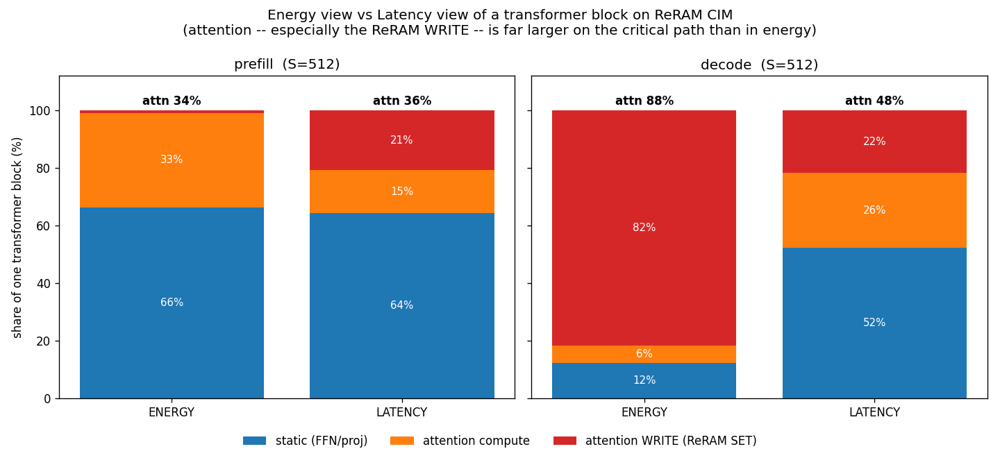

| phase | attention share (energy) | attention share (latency) | write share of block latency |
|---|---|---|---|
| prefill S=512 | 33.7% | 35.6% | 21% |
| decode S=512 | 33.7% | **93.3%** | **90%** |

> **The decode split is the telling one**: attention is 33.7% of energy but 93.3%
> of latency. Energy and latency give opposite verdicts — an energy-only model
> concludes attention is minor in exactly the regime where it owns the critical
> path.

### 3.3 Value-dependent energy (crossbar level)

**Magnitude**: the value-dependent part is ≈ **a quarter of an op's energy**
(measured: realistic vs all-zeros distribution = 24.9%) → getting the distribution
right matters. A synthetic workload once reused resnet's distribution; now
[`scripts/value_stats.py`](../scripts/value_stats.py) injects per simulated model +
op type.

**Per-crossbar spread**
([`scripts/crossbar_value_real.py`](../scripts/crossbar_value_real.py): real
weights + real activations, per-tile re-simulation; two stages to avoid the
torch/timeloop segfault):

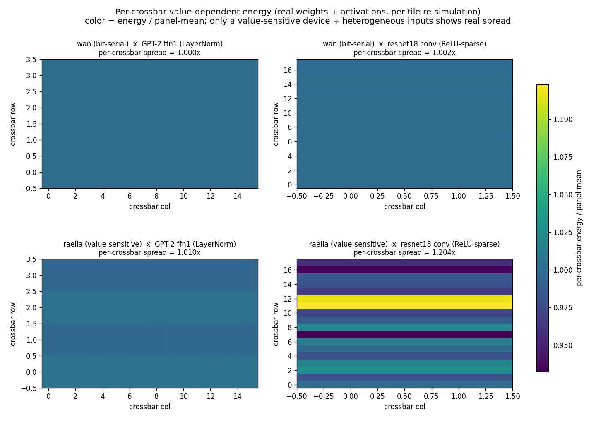

| per-crossbar energy spread | GPT-2 ffn1 (LayerNorm) | resnet18 conv (ReLU-sparse) |
|---|---|---|
| **wan** (bit-serial) | 1.000× | 1.002× |
| **raella** (value-sensitive) | 1.010× | **1.204×** |

1. **Device class is the first-order factor**: bit-serial energy is set by
   precision/ADC steps → per-crossbar ≈ 0; raella-class devices exploit
   value/bit sparsity → real spread.
2. **Input heterogeneity is the workload factor**: sensitive device × CNN
   (ReLU-sparse, 80–91% zeros per block) = 1.204×; LayerNorm-flattened GPT-2 only
   1.010×. Spread varies along contraction row-blocks; **weight distribution barely
   matters (~1%)**.
3. **Whether to model it is a device-class question (DR-6)**; this device
   (bit-serial) does not need it. (Light approximate mode:
   [`crossbar_value.py`](../scripts/crossbar_value.py)
   `value_mode="uniform"|"per_crossbar"`.)

### 3.4 Sequence scaling & KV-cache ([`scripts/llm_workload.py`](../scripts/llm_workload.py))

Six ops scale with **S** and **phase**; each op is a normal die-hierarchy run,
composable with crossbar_stats/comm/placement_aware. Measured (prefill, incl. K/V
write; source [`scripts/analyze_seqlen_kv.py`](../scripts/analyze_seqlen_kv.py)):

| S | 64 | 128 | 256 | 512 | 1024 |
|---|---|---|---|---|---|
| attention energy share | 10.7% | 14.8% | 22.0% | **33.7%** | **49.1%** |
| attention latency share (stall-free) | 52.6% | 46.0% | 43.2% | 35.6% | 38.4% |

Energy share rises monotonically with S²; the latency share is highest at *small* S
(write latency ∝ S until the 256-row cap, while compute keeps growing), the curves
crossing near S≈512.
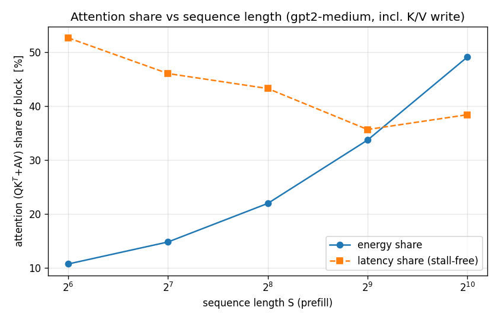

**KV-cache (a traffic term only when offloaded)**: with attention resident, K/V
live in the arrays and there is **no** "re-read the cache each step" stream; it
appears once attention is offloaded — read ∝ G² (dominant), write ∝ G:
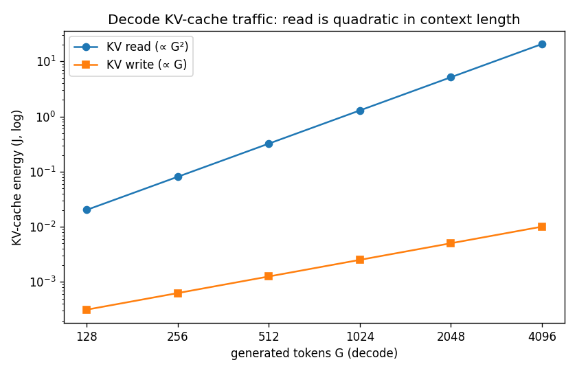
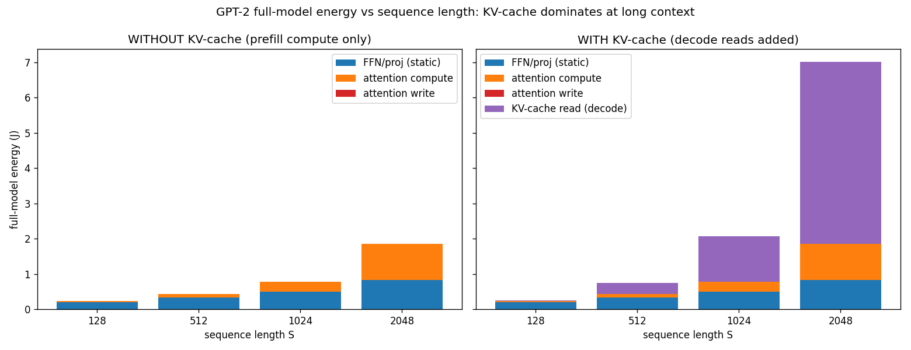

### 3.5 Die-to-die (D2D, W3) — the same registry, one level up

The die level is no longer degenerate: the multi-die variant
[`mlx300_multidie48.yaml`](../models/fabric/mlx300_multidie48.yaml) (48 dies on
a 6×8 package grid; at the honest capacity a layer is 1.5 dies, so the
feasible assignment is TWO dies per layer — attention half + FFN half, the
latter filling its die exactly; the attention die also hosts the growing
K/V arrays, bounding this seating's validity to **2,048 tokens** under full-attention semantics — the computed cell ceiling (16.78M − 8d² cells over 4d cells per token; the guard raises past it by default, O21/C38; since A3/C62-a an opt-in window mode truncates instead, valid at ANY S with the semantic change declared on file: equivalent sliding-window attention, accuracy impact outside this platform's scope — declaration tier only, no eviction machinery, nothing re-priced)) gives the
die link a scheme (mesh / star /
bus, the same registry), a bandwidth, a per-word energy (10 pJ — the midpoint of Simba GRS's
measured 6.6–14 pJ/word band, see ANCHORS.md), and `reference_hops`. All three
channels are reused across the boundary: distance via `ic.hops(a,b)`
(node→node — star routes through the central switch on both spokes, mesh
XY-routes), contention via the **same** `link_occupancy` (flows tagged
`nodes:(a,b)`), and energy under the **replace** rule — the flat chip2chip
charge already bills every word once, so the overlay bills only the SURPLUS
`max(hops − reference_hops, 0)`; a single die and adjacent dies add zero by
construction (acceptance pinned in `tests/test_d2d.py`; the former xfail was
promoted per the XPASS protocol, see tests/CHANGELOG).

**The operating mode decides whether the layout can reach the totals** — the
correct way to read every D2D number (source
[`analyze_d2d.py`](../scripts/analyze_d2d.py), system denominators from
contention_system.json):

- **Single pass** (one request walks the 48 units in series): each hand-off
  transfer (2.97 ms @256 w/c) hides behind the WHOLE stack's compute
  (747.6 ms, co-residency basis), so at any sane link speed the total never
  moves. The honest statement is **invisible in this mode** — a chart that
  showed a difference here would be the dishonest one.
- **Pipelined** (the real serving mode: different microbatches on different
  dies, every hand-off transferring concurrently each beat): the transfer
  races the SLOWER HALF-LAYER's compute (23.80 ms, digital-unit terms in) and the **busiest die wire
  sets the beat** — the assignment becomes a direct throughput multiplier.
  The beat too is published as an O7 bracket: max(stage, busiest wire) at
  the perfect-overlap end, stage + busiest wire at the zero-overlap end —
  in the network-bound regime the ends differ by exactly one stage.

**The whole account (one prefill pass, full stack ×24 layers, scenario A;
die bandwidth at the example 256 w/c):**

| layer→die assignment | total energy (mJ) | total latency, single pass (ms) | throughput, pipelined @256 (req/s) | @64 |
|---|---|---|---|---|
| **snake** | **296.780** | 826.43 | **42.0** | **42.0** |
| ideal network | — | 826.43 | 42.0 | 42.0 |
| sequential rows | 296.963 | 826.43 | 42.0 | 42.0 |
| far pairs (adversarial) | 298.148 | 826.43 | 42.0 | 21.1 |
| bus (sequential) | 296.963 | 826.43 | 7.2 | 1.8 |

Read the three columns together: **energy barely moves** (worst case
+1.37 mJ = +0.46% — the extra traversals billed at the measured 10 pJ/word; the replace rule
charges only the increment beyond the flat port, and the bus row is
understated per O8); **single-pass latency does not move at all**;
**throughput moves a lot** — at 64 w/c adversarial keeps 1/2 and bus 1/24
(snake and sequential rows are covered by the longer compute beat and no
longer degrade). **The D2D layout is a throughput problem, not an energy
or single-request-latency problem.** The mechanism: the busiest die wire
carries 1/1/4/47 hand-offs (snake / sequential / adversarial / bus) — that
integer multiplies the pipelined beat in the network-bound regime. With
full-duplex direction-split wires (O22) the sequential-rows wrap walks
back on the opposite-direction wires and no longer collides with the
in-row hand-offs (2 → 1), the adversarial order's back-routes halve the
same way (8 → 4), the bus is unchanged; the bandwidth below which
throughput suffers steps with the assignment (snake 16 w/c, sequential
16, adversarial 64, bus 1,024 — power-of-two grid readings: the
digital-unit terms lengthen the beat by 1.3%, which tips the 32 w/c point
just under the 1% line; the zero-overlap ceilings sit ~64× higher — snake
2,048, bus 131,072 — so D2D "invisibility" too presumes double-buffered
overlap). Decode
carries d_model words per boundary and is untouchable in either mode (the
write's 90% shields it).
Note: the energy column is scenario total A (exclusive-die-mapping energy account + placement re-pricing + K/V write + the digital-unit operators 8.9 mJ + the embedding read 0.03 mJ);
per-op energy moves <2% on the co-residency basis, and the in-column deltas
(+0.18/+1.37 mJ) come from surplus hops alone, independent of the basis.

Validation: the pipeline identities (interval = max(stage, busiest-wire
beat); no bandwidth ⇒ the compute beat exactly), **the sequential/snake
interval ratio in the network regime equals the load ratio 2.0 exactly**, the
bus beat identity 23×words/bw, and the assignment ordering
(snake < sequential < adversarial) are all pinned in `test_d2d.py`
(group 15, 11 tests).

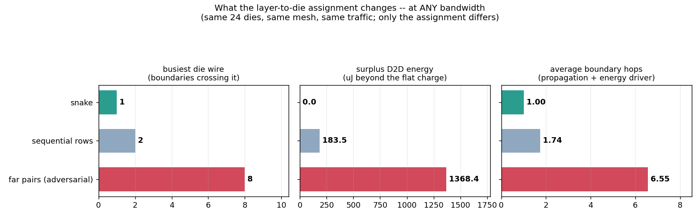

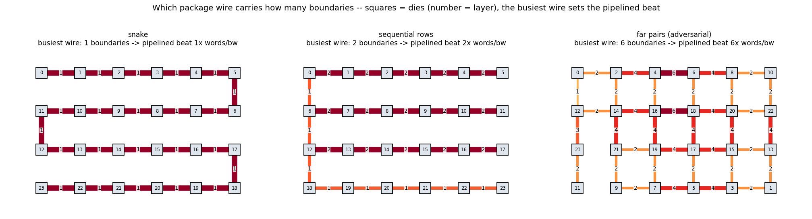

---

#### 3.5.1 Operators spanning dies (the 2.7B tier, O13)

The static operators of a 2.7B-class model (d=2560, ff=10240, 32 layers)
exceed one die; the residency tiler splits them by output columns over
4/2/5/5 dies, and the attention scores, softmax and weighting share one die.
One block's five die-sets (17 dies) are seated DISJOINTLY on the 24-die
package in data-flow order (three styles: nearest the attach point / in
order / spread), every operator's input is routed from the dies owning the
previous operator's output over the die mesh, and what crosses a die-to-die
wire is **the tensor once** (the receiving die's buffer holds it; the layer
hand-off convention). At the measured D2D anchor (12.5 GB/s): one 4-die
operator reads 1.00× at every seating (zero-overlap end 1.03–1.06×), 0–35 µJ
extra (against its own 2.24 mJ); the whole-model prefill reads 1.02× at every
seating (the on-die network's share; zero-overlap 1.26–1.28×) with 27–31 mJ
of D2D surplus = 1.2–1.3% of the model's 2297 mJ; offloaded decode
1.00–1.01×. **The previously published 3.10–6.20× / +58% (one operator) and
1.22–2.14× / +34–36% (whole model) are retired**: that accounting took
Timeloop's row-driver / ADC counters as die-edge words (14× the input tensor,
48× the output piece, the latter at 16-bit partial-sum width) and routed
everything through the attach point; decomposed, the volume basis did almost
all of it and the routing only cut the energy by another third
(`scale_tiers.json` keeps the v1 and the tensor-once-but-hub-routed
comparisons). Reading: at the measured anchor, the die-set seating of a
spanning model is a ~1% energy lever and no latency lever; the 2.7B latency
lever stays on the die (1.33× at the Simba NoC anchor). Not done: the joint
seating of all 32 layers (O16), which can only lengthen the hand-offs.
Test group 22.

## 4. GPT-2 system-level three scenarios (whole model, S=512, ×24 layers)

- **(C) baseline** — unmodified CiMLoop, no overlays;
- **(A) full + overlays** — + distance energy/latency + K/V write energy/latency;
- **(B) offload** — only static ops on-chip. C/A execute identically and differ
  only in what is charged; A/B differ in what runs on-chip.

### 4.1 prefill
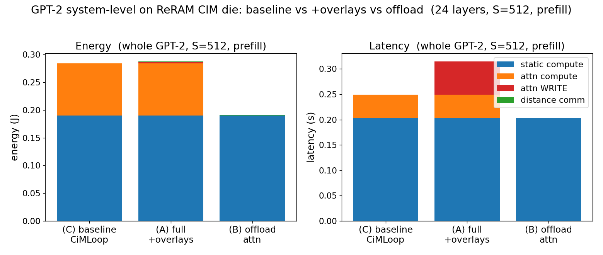

| Scenario | Energy | Latency |
|---|---|---|
| (C) baseline | 0.284 J | 0.249 s |
| (A) full + overlays | 0.296 J (**1.04×**) | 0.328 s (**1.32×**) |
| (B) offload attention, end to end (with the external unit, O9) | 0.212 J | 0.222 s |
| (B) of which the die side | 0.195 J | 0.210 s |

A−C latency = 0.0788 s = the 65.4 ms write latency + 13.4 ms on the digital
unit; offload (A→B) saves 28% energy, 32% latency end to end (die side only:
34% / 36%). The external unit at the generic defaults (2 T MAC/s, 1 pJ/MAC,
K/V memory 25.6 GB/s, link 12.5 GB/s; the link energy priced at the die
placement's mean 3.5 hops from the attention dies to the attach point, one
source `unit_link_hops` for every script) costs 17.6 mJ / 12.6 ms per model.

### 4.2 decode (one generation step)
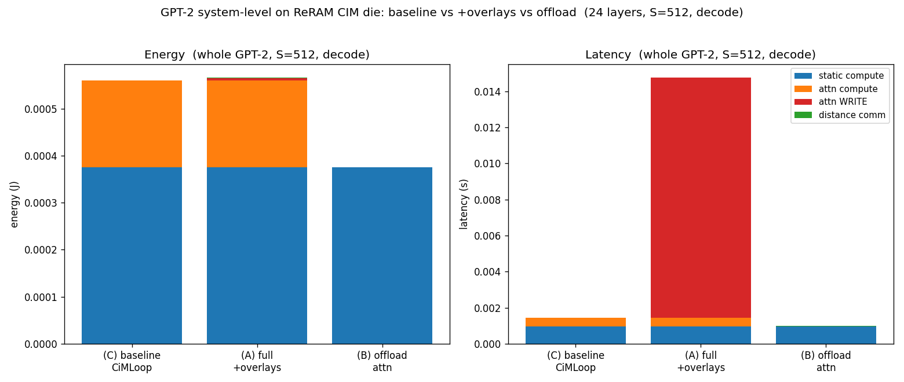

| Scenario | Energy | Latency |
|---|---|---|
| (C) baseline | 5.60e-4 J | 1.46 ms |
| (A) full + overlays | 5.84e-4 J (**1.04×**) | **14.8 ms (10.13×)** |
| (B) offload attention, end to end (with the external unit, O9) | 1.67e-3 J | 2.01 ms |
| (B) of which the die side | 3.83e-4 J | 1.00 ms |

A−C = 13.3 ms = the 13.3 ms write latency + 0.03 ms on the digital unit;
**offload saves 86% latency end to end but the energy rises to 2.87× A** —
per token the external unit reads the layer's whole K/V (512-token context,
25 MB) back from its memory, 1.29 mJ/token, 77% of B. Die side only it is
still 93% latency / 34% energy saved. The throughput argument (latency)
holds, the energy argument flips; both grow linearly with the context, and
near 7k tokens the end-to-end decode latency catches up with on-chip
(§2.3.1(e)).

### 4.3 Attribution per level (read every result with its level and denominator)

| Level | Metric | Measured ratio | That level's share | Status |
|---|---|---|---|---|
| **crossbar — K/V write** | SET pulses×T_SET; cells×E_write | **decode latency 10.12×** | write = **90%** of decode latency (0.9% of energy) | measured, **in the totals** |
| **macro (×8) — comm energy** | router energy × hops/ref | mesh→line **1.33×** (1.52× on the 3×3); setting sweep 3.00× | router = **0.65%** of block → **0.34%** block effect | measured, **in the totals** (A/B/C use grid+to_center) |
| macro/core/crossbar — propagation | actual-layout max_hops × ns/hop | default 180 ns/op (3×3 comparison 136), **placement-dependent** (A-3) | 0.006% / 0.13% of block latency | wired |
| crossbar (256/die) — relative map | v1 real traffic × Manhattan | **1.70×** (3×3 comparison 3.69×; idle-zeroing on partially-used ops) | that level's energy is 0; nothing to scale | measured, **not in the totals** |
| region (6 matmuls) — relative map | volume-weighted all-pair Manhattan | **17.8%** (BERT) | same | measured, **not in the totals** |
| core/crossbar link energy | — | — | **0%** (`inter_*_spatial` zero-energy) | **not modeled → DR-1** |
| bandwidth / contention | busiest wire volume/bandwidth, per scheme (full-duplex per-direction wires, 16-bit partial sums) | prefill stack 1.00–4.13× at the reference input (§2.3.1, co-residency basis + physical accounting) | zero until a bandwidth is set (shipped default) | **built (W1/W2); value is a platform input** |
| inter-die (D2D) | surplus hops × pJ/word; die-wire occupancy | cannot reach the critical path at example inputs (§3.5) | flat port 0.69% + surplus (zero on the shipped single-die default) | **built (W3); values are platform inputs** |

> - The qualitative picture (decode write-bound, offload = throughput win) needs no
>   calibration; **the magnitudes (10.12×/90%/93%) are set by the write-granularity
>   assumptions and move with DR-5** (and are ceilings — §2.3 directionality).
> - Judge offload by **A vs B** (B vs C is apples-to-oranges); B's end-to-end
>   figure includes the receiving unit (O9 black-box interface, generic
>   defaults); the die side is listed on its own.

### 4.4 Where to see the searched mappings
Every op goes through the Timeloop mapper (`models/include/mapper.yaml`: EDP,
`random_pruned`, 10k-mapping cap, stop after 100 without improvement,
single-threaded/reproducible). Best mappings in
`gpt2_system_mappings_{prefill,decode}.txt`.

---

### 4.5 The per-operator ledger (one entry point)

`python3 scripts/op_breakdown.py [--scheme --bw --no-shares --phases --out]`:
one mapper run per operator, outputs under `analysis/op_breakdown/` (JSON,
md, per-item CSV, operator-type CSV, three figure kinds). Three views:
**operator type × whole-model share** (the six matmuls ×24 layers, plus
softmax / GELU / LayerNorm / residual adds on the digital unit (O24,
closed-form), the embedding read (priced; timed only with an off-chip
bandwidth set) and the LM head (a real 8-die matmul, last token only);
under both conditions — attention on chip / offloaded, where qk^t, av and
softmax carry "offloaded to the external unit (see the attention-on-the-external-unit
row)" and one more row is the external unit itself (O9 black-box interface:
link out / unit compute / K/V memory / link back, each on its own row)) →
**per-operator totals** →
**every item on its own row** (all 24 CiMLoop components, placement
re-pricing per component, K/V write, weight rewrite, D2D surplus, a residual
row; latency: compute, write, busiest-wire occupancy, network exposed at
both O7 ends, propagation, D2D hand-off, unmodeled rows). Categories are
deliberately not merged. Conservation pinned in group 19; whole-model totals
equal the system script's. Attention on chip, prefill, operator-type shares
(mesh-centre, 16,384 w/c; value units v5 — the on-die occupancy hides behind compute, so the perfect-overlap latency is compute + write):

| operator type | model energy (mJ) | energy share | model latency (ms, perfect-overlap end) | latency share |
|---|---|---|---|---|
| Q/K/V projection | 49.78 | 16.7% | 124.6 | 15.1% |
| attention scores QKᵀ (incl. K write) | 63.41 | 21.2% | 137.7 | 16.7% |
| attention AV (incl. V write) | 34.34 | 11.5% | 177.0 | 21.4% |
| output projection | 19.06 | 6.4% | 124.6 | 15.1% |
| FFN layer 1 | 64.17 | 21.5% | 124.6 | 15.1% |
| FFN layer 2 | 59.00 | 19.7% | 124.6 | 15.1% |
| softmax (digital unit) | 4.84 | 1.6% | 6.29 | 0.8% |
| GELU (digital unit) | 1.70 | 0.6% | 4.72 | 0.6% |
| LayerNorm ×2 (digital unit) | 1.20 | 0.4% | 1.97 | 0.2% |
| residual adds ×2 (digital unit) | 1.17 | 0.4% | 0.39 | 0.05% |
| embedding lookup (off-chip read, once per model) | 0.03 | 0.0% | priced, not timed (no off-chip bandwidth set) | — |
| LM head (8-die matmul, last token, once per model) | 0.08 | 0.0% | 0.01 | 0.0% |
| **counted total** | **298.77** | 100% | **826.4** | 100% |

Attention offloaded (end to end: die + external unit at the generic defaults,
link priced at the die placement's mean 3.5 hops), prefill:

| operator type | model energy (mJ) | energy share | model latency (ms, perfect-overlap end) | latency share |
|---|---|---|---|---|
| Q/K/V projection | 49.78 | 23.3% | 124.6 | 24.0% |
| output projection | 19.06 | 8.9% | 124.6 | 24.0% |
| FFN layer 1 | 64.17 | 30.0% | 124.6 | 24.0% |
| FFN layer 2 | 59.00 | 27.6% | 124.6 | 24.0% |
| GELU (digital unit) | 1.70 | 0.8% | 4.72 | 0.9% |
| LayerNorm ×2 (digital unit) | 1.20 | 0.6% | 1.97 | 0.4% |
| residual adds ×2 (digital unit) | 1.17 | 0.5% | 0.39 | 0.1% |
| embedding lookup (off-chip read, once per model) | 0.03 | 0.0% | priced, not timed (no off-chip bandwidth set) | — |
| attention on the external unit (QKᵀ + softmax + AV, K/V in the unit's memory) | 17.57 | 8.2% | 12.64 | 2.4% |
| LM head (8-die matmul, last token, once per model) | 0.08 | 0.0% | 0.01 | 0.0% |
| **counted total** | **213.75** | 100% | **518.1** | 100% |

The external-unit row decomposes (whole model) as energy = unit compute 13.29
+ K/V memory 2.52 + link 1.76 mJ; latency = link out 3.02 + unit compute 6.64
+ K/V memory 1.97 + link back 1.01 ms. Decode (one token) under the same
condition: 1.755 mJ / 2.02 ms per model, of which the external unit is
1.290 mJ (73.5%) / 1.01 ms (49.9%), almost all of it K/V memory (the layer's
whole K/V is read back per token: 1.26 mJ / 0.99 ms); the die side keeps
0.465 mJ / 1.48 ms.

The four digital-unit operators total 8.9 mJ (3.0%) and 13.4 ms (1.1%),
more than half of it softmax, and their energy is glb passes rather than
arithmetic; offloaded, softmax leaves with the attention and GELU /
LayerNorm / residual (7.1 ms) stay. On the energy side the bulk is glb
(on-die SRAM staging) plus analog compute/conversion; with attention
offloaded the on-chip glb share drops from 43.9% to 31.8% (qk^t and av are
the glb-heaviest operators: 63% / 76%). The digital unit's width decides
the latency share — see `digital_sensitivity.png` (21% at 8 lanes @
0.5 GHz).


## 5. Per-pair communication dumps (auto-saved on every run)

Every `run_op` saves `analysis/comm/<op>_<phase>_comm.{csv,json}`: aggregate bus
volumes decomposed into every `crossbar↔core↔macro↔glb` link's volume + physical
distance. Three-level tree `glb → 8 macros → 32 cores → 256 crossbars` → **296
edges** per op.

**CSV** (one link per row; example `qk^t` prefill):
```
level,           src,   dst,     volume_words, distance_hops, volume_x_distance
glb<->macro,     glb,   macro2,  28835840,     12.0,          346030080   <- far-corner macro
glb<->macro,     glb,   macro4,  28835840,     1.5,           43253760    <- near-center
macro<->core,    macro0,core0.0, 7208960,      3.0,           21626880
core<->crossbar, core0.0,xb4,    901120,       0.25,          225280
```
**JSON**: hierarchy shape + all flows + per-crossbar cost + spread summary
(`max_over_min: 3.58`; cheapest `id=132@(7,7)` near-center, priciest `id=66@(14,0)`
far corner).

**Three takeaways (v1 structured)**: ① ffn1 position spread 1.70× (3×3 comparison 3.69×; plus the
idle-zeroing effect on partially-utilized ops); ② `volume×distance` still
concentrates at the top, now on real volumes: `glb↔macro` **60%**, `macro↔core`
24%, `core↔crossbar` 16% (the v0 65/25/10 rested on a 32× multicast overcount of
the input trunk; ffn1 is output-dominated and outputs don't multicast, so the
top-level conclusion survives the correction); ③ prefill is on-die-traffic-heavy,
decode communication is tiny overall; inter-die activations are far below on-die
volumes — not a bottleneck:

| Interconnect (model total, words) | prefill | decode |
|---|---|---|
| router (macro NoC) | 13.1 G | 25.7 M |
| glb (on-die SRAM) | 8.25 G | 16.1 M |
| chip2chip (off-die port) | 5.03 G | 9.83 M |
| inter-die activations (logical) | 12.1 M | 23.5 K |

---

## 6. Assumptions & limitations

1. **Per-op search, no cross-layer/cross-die co-optimization**: each op is
   EDP-searched independently then aggregated; layer→die placement is assumed, not
   searched; no inter-layer fusion/global schedule.
2. **One layer/die, no packing**: each op uses one die's 256 crossbars
   (`chip_in_system.meshX=1`); ffn1 uses ~26% of a die, the rest idles → 24 dies is
   conservative; capacity packing would need ~6–8.
3. **Oversized layers unhandled**: a layer > 1 die needs `meshX>1` (arch supports
   it; never run). GPT-2 medium never triggers it.
4. **Energy position-awareness stops at the macro level** (DR-1); propagation
   latency is placement-dependent since A-3.
5. **Write model**: one SET pulse per row, no write-verify — both scale decode
   latency directly (DR-5).
6. **Placeholder magnitudes**: distance absolute scale, per-hop latencies, write
   energy, off-die port cost — all uncalibrated. Ratios robust; absolutes not.
7. **Value-distribution granularity**: one distribution per layer; per-crossbar
   spread verified to be a device-class question (§3.3, DR-6).
8. **Offload accounting**: B counts only what stays on-chip (§4); **the
   attention-receiving unit and the die↔unit link are not modeled** — the
   offload contention results (§2.3.1d) are therefore an on-chip-side lower
   bound.
9. **Contention-model coarseness (identical on-die and die-to-die)**: the
   overlap assumption is closed out (O7, C16) — both the perfect-overlap
   and zero-overlap ends are published, the truth lies inside the bracket;
   the busiest-wire occupancy is the lower bound of any schedule for the
   given routing (O26); what remains missing is queueing in the NoC
   paradigm: only the busiest wire counts, so equal-peak load vectors are
   equivalent (the full per-wire vector is exposed). Bus energy is charged by distance-to-driver and understated
   (O8).
10. **Pipelined-mode assumptions (all optimistic)**: perfect microbatch
    pipelining, no bubbles, transfer/compute double-buffered, weights
    resident; pipelined decode presumes multiple independent streams. In the
    single-pass mode boundary transfers actually happen in sequence; the
    occupancy model stacks them anyway — a conservative upper bound there
    (in the pipelined mode the assumption is exact).
11. **One D2D traffic class only**: inter-layer hidden state; KV-offload
    streams or host I/O sharing the die links would add contention — not
    modeled.

12. **Anchor identity and tiers**: all four bandwidth anchors are
    digital-ecosystem links; the analog-reality tier (DMA / bus fabrics,
    board-level die links) is not in the registry (O25) and the device-speed
    axis is not drawn (O17) — every "hidden" in §2–§4 is the reading of that
    one cell (§2.5).

**Relaxation route**: ① capacity packing → ② giant layers across dies (`meshX>1`) → ③ a queueing model for the NoC paradigm (the overlap bracket is published; O7 closed; scheduled fabrics use `schedule_slack`, O26) → ④ the analog-reality tier and the device axis (O25 / O17).

---

## 7. DR data-request map (each → which numbers move, and which way)

> **Framing**: the platform is general, so these are not calibration items the
> tool cannot run without — they are **platform inputs**, the fields one fills
> in to instantiate the platform for a specific chip. The DR list is the
> request for *the company's chip's* input values; until then the example
> defaults in §8 keep the platform fully runnable, and conclusions are stated
> as multipliers / orderings / thresholds that do not depend on the example
> values themselves.

| DR | Data requested | Numbers it moves | Direction |
|---|---|---|---|
| **DR-1** | per-hop/per-word energy of core- and crossbar-level links | network energy share; the 3.69×/1.70× maps and the 17.8% | network share ↑; rankings become joules (ceiling ~2% of an operator after C25) |
| **DR-2** | link bandwidths at each level | compute latency; write share, 10.12×, 93% | compute ↑, the rest ↓; latency becomes placement-sensitive. **The knee is located at 0.2–1.9 GB/s per macro link (§2.2, C25 value units), an order of magnitude below the published on-die NoCs — in the digital-ecosystem column this request decides the zero-overlap margin, not a multiplier. If the chip's fabric is DMA / bus or a board-level die link (analog-reality tier, §2.5) it returns to first order: the 2.7B die chain doubles below 0.26–0.40 GB/s and moves 1% below 1.0–1.7 GB/s, the offloaded 48-die pipeline reads 12–19× at 0.1 GB/s (measured, `sweep_axes.py`, §2.5). Since the anchored soft-lever table (§2.7) this is priced directly: the on-die placement band is >1% only below ~1.4 / ~1.1 GB/s (prefill / decode) and the REALIZABLE co-residency lever reads 1.43× / 1.06× at 0.4 GB/s — the analog-reality column is where this input is first order** |
| **DR-3** | D2D topology/routing/latency/bandwidth/energy | network energy share; whole-package placement spread | network share ↑; unlocks the go/no-go experiment |
| **DR-4** | what the router's calibrated per-word energy represents: one hop or an average multi-hop transfer | the router term; the **sign** of the +0.3% re-pricing | resolves the one open sign |
| **DR-5** | SET pulse width, cells programmable in parallel, incremental programming, write-verify, endurance | the write term: 21%, 90%, 10.12×, 93% | **these stand or fall with it. Across the device axis it stays THE one device-side input that moves decode: a 76.3× faster device buys only 1.11× on-chip decode (the write wall) vs 1.93× at the offloaded unit floor (§2.5 fixed terms)** |
| **DR-6** | device class (precision- vs value/sparsity-driven) + ADC calibration point | whether per-crossbar value modeling is needed | gates the refinement (§3.3) |

**Why DR-4**: the router's calibrated vector-access energy is 48.3 pJ vs the glb's
3.3e4 pJ ≈ **1:680** — it likely represents a single short hop rather than an
average multi-hop transfer. Until settled, the network share is uncertain in one
direction only: **toward underestimation**.

---

## 8. Platform inputs (currently example defaults)

| Parameter | Placeholder | Source | Affects | DR |
|---|---|---|---|---|
| `E_WRITE_PER_CELL_J` | 1.0e-10 J | wan SET ~100 pJ | write energy | DR-5 |
| `T_SET_NS` | 8520 ns | wan SET pulse | write latency (the bottleneck) | DR-5 |
| `E_DRAM_PER_WORD_J` | 5.0e-11 J | typical DRAM | KV-cache energy | — |
| `HOP_LATENCY_NS` | 1–5 ns/hop | placeholder | on-die propagation | rel. DR-2 |
| `slot_pitch_um` (per-level grid step, µm) | crossbar 100 / core 300–400 / macro 600–800 / die 25,000 | example (derived consistently from the nesting) | no consumer yet; declares the physical meaning of a hop so ns_per_hop / hop_scale can later be derived (delay ∝ length, energy ∝ wire capacitance ∝ length) | DR-1/2 related |
| `DIE_HOP_LATENCY_NS` | 20 ns/hop | placeholder | inter-die latency | DR-3 |
| per-level `bandwidth` (T2 links / T1 hubs) | unset (= unlimited) | — | stalls; knee at 512–2,048 w/c ≈ 0.2–1.9 GB/s (C25) (§2.2) | DR-2 |
| `device` (fabric level: `cycle_seconds`, `input_slices_per_mvm`) | 1.4486 µs, 7 (t_MVM = 10.14 µs) | — | every latency; every GB/s ↔ words/cycle conversion (bandwidths are declared in GB/s in the YAML and converted at load); checked against the CiMLoop macro's cycle on every run (C30) | the device axis (O17b) |
| `schedule_slack` (fabric level, ≥ 1) | 1.0 (= the bound) | — | multiplies every wire's occupancy: 1 = the least time any schedule can spend for the given routing (exact for star and bus, a lower bound for mesh / tree), > 1 = a schedule that cannot reach it (C29) | scheduled-paradigm feasibility |
| `reference_hops` | 1.0 | placeholder | distance-energy scale/sign | DR-4 |
| histogram source | `gpt2_medium` | real workload | value energy | DR-6 |
| weight bits / layer→die | 4-bit / 1 layer per die | placeholder | die count, inter-die volume | — |

---

## 9. Script index

| Script | Purpose |
|---|---|
| `fabric.py` + `models/fabric/*.yaml` | physical fabric config (single source of truth; `CIMSIM_FABRIC` picks variants) |
| `placement.py` | explicit Placement (per-level slot tables + verify + JSON; `sequential_fill` reproduces the legacy floorplan bit for bit) |
| `interconnect.py` | interconnect scheme registry: `star`/`mesh`/`h_tree`/`bus`/`torus`/`ring` (the last two folded, C60: `hops` = physical length, `router_hops` = crossing count), selected per level by `topology:` in the fabric config (§2.3, §2.9) |
| `traffic.py` | real traffic structure (multicast trunks once, idle zeroed, divisibility guard against Timeloop counters) |
| `make_figures.py` | one driver for every figure (7 stages; `--tag` for config variants without clobbering canonical) |
| `mlx_system.py` | hardware config (resident die hierarchy) + LAYOUT + runners + `n_dies_for_weights` |
| `placement_aware.py` | distance overlay: energy (`position_aware_cost`) + latency (`position_aware_latency`) |
| `crossbar_stats.py` | per-crossbar stats + communication structure + `hierarchy()` |
| `crossbar_comm.py` | per-pair flows + heatmap + geometric hops + `save_flows()` (auto-dump) |
| `llm_workload.py` | sequence scaling + write cost/latency + KV-cache + die-to-die + histogram injection |
| `value_stats.py` | general value-histogram loader (per model / layer type) |
| `crossbar_value.py` | fast per-crossbar value approximation (uniform / per_crossbar) |
| `crossbar_value_real.py` | real per-crossbar value pipeline (real weights+activations, per-tile re-sim; two stages) |
| `analyze_system_gpt2.py` | whole GPT-2 three-scenario comparison, `[S] [phase]` (§4) |
| `analyze_energy_vs_latency.py` | energy-vs-latency view (§3.2) |
| `analyze_seqlen_kv.py` | sequence-scaling + KV-cache figures (§3.4) |
| `analyze_region_locality.py` | region-placement comparison + 17.8% (compute on host / plot in container, §3.1) |
| `analyze_position_aware.py` | placement × pattern sweep (resnet18) |
| `analyze_crossbar_value_compare.py` | device×workload 2×2 per-crossbar energy figure (§3.3) |
| `analyze_bandwidth_sweep.py` | two-tier contention bandwidth sensitivity sweep (§2.2) |
| `analyze_contention_impact.py` | single-op contention: scheme × layout × bandwidth + segment load map (§2.3.1a) |
| `analyze_placement_tradeoff.py` | energy × latency divergence: 7-variant scatter + per-link load vectors (§2.3.1b) |
| `analyze_contention_system.py` | whole-stack contention: GPT-2 both phases × scheme × bandwidth + threshold table; `--replot` redraws from JSON (§2.3.1c) |
| `analyze_offload_contention.py` | scenario-B (offload) contention/D2D: the multipliers once decode loses its write shield (§2.3.1d) |
| `analyze_d2d.py` | D2D: layer→die assignment × die scheme × die bandwidth + thresholds + die-grid load map (§3.5) |
| `analyze_grid_gating.py` | what gates the hub-position lever: 3×3 / 2×4 / 4×4 / 2×8 × hub × filling on the same traffic; the corner rule N − column; `grid_gating.png/json` (§2.3.1a) |
| `figstyle.py` | the figure rule: identical series merged into one labelled curve, tied bars bracketed, coincident points one label |
| `anchors.py` | the anchor registry (single source): digital anchors with status, the estimated analog-reality band, chip points (t_MVM + bandwidth coordinates), one cycle constant and the conversion (§2.5) |
| `analyze_phase_diagram.py` | the phase diagram (O29): two panels on the (t_MVM × bandwidth) plane — d family + three layers + anchor lines + chip points + validation points + collapse inset; `phase_diagram.png` (with grayscale copy) + `phase_diagram_table.md` (§2.5) |
| `run_scaling_probes.py` | the O17c scaling-law probes: 48 mapper runs (d ∈ {1024..8192} × S ∈ {128..2048}), column split, one full die per piece, resumable; `scaling_probes.json` (§2.5) |
| `analyze_scaling_law.py` | the measured V(d, S): trunk closed form, the flip d*, S-independence; `scaling_law_vds.png` + `scaling_law_summary.json` (§2.5) |
| `simba_workload.py` | the Simba reproduction workload (C42): ResNet-50 conv layers as closed-form ops, touched-extent volumes (anti-im2col), conv→TrafficStructure on the existing dim tables (§2.6) |
| `simba_targets.py` | the three reproduction targets (C44–C47): T1 seatings, T2 baseline/greedy placement, T3 scaling points; the packet bracket (A3); `simba_t1/t2/t3.json` (§2.6) |
| `analyze_simba_validation.py` | the per-target measured-vs-bracket figure; `simba_validation.png` (§2.6) |
| `sweep_axes.py` | per-axis bandwidth sweeps: on-die / die-to-die (48-die, 2.7B chain, 4-die probe) / unit link / partial-sum width, both overlap ends, read at the digital anchors + the band ends; plus the T1 hub axis (value units, C34) and the (t_MVM × bandwidth) device plane (C31/C33: closed-form boundaries + the d family + collapse + fixed-term decomposition); `phase_sweep.json` + `sweep_axis_*.png` + `device_plane*.png` + `device_fixed_terms.png` (§2.5) |
| `analyze_anchored_sweep.py` | anchor-column readout: on-chip / offloaded × scheme × five columns (three digital anchors + the band ends), the offloaded column end to end with the external unit (§2.3.1c/e) |
| `analyze_scale_tiers.py` | 2.7B tier: operators spanning dies × assignment × anchor (§3.5) |
| `run_2p7b_block.py` | 2.7B one-layer block per-operator components (feeds the tier) |
| `analyze_digital_sensitivity.py` | digital vector unit lanes × clock vs latency share (§4.5) |
| `analyze_offload_unit_sensitivity.py` | external attention unit interface sensitivity: rate × unit count (prefill dividend), K/V bandwidth × context (decode per token) (§2.3.1e) |
| `op_breakdown.py` | per-operator ledger, one entry point: type shares / per-operator totals / every item, both conditions (§4.5) |
| **search side** (collaborator) | |
| `die_solver.py` | reduction-clustered placement solver: lambda-1 hierarchical metric + two placers (see §3.1 note) |
| `placement_sim_compare.py` | encodes a placement as average hops for the simulator ⚠️ **cannot run today**, see FIXLIST O6 |
| `analyze_placement_impact.py` | supplies the system-level denominator for the solver's saving |

```python
from scripts import llm_workload as lw
res = lw.run_block(lw.GptConfig(), S=512, phase="prefill")   # or "decode"
lw.report_block(res, title="prefill S=512")                  # energy + latency tables
```
```bash
python3 scripts/analyze_system_gpt2.py 512 prefill    # whole-model system level (or: 512 decode)
```

---

## 10. Tests (`workspace/tests/`)

```bash
python3 tests/run_tests.py           # fast suite, a few seconds (in the container)
python3 tests/run_tests.py --slow    # plus one real end-to-end mapper run, ~2 min
```

These tests do **not** check whether the model matches reality (that waits for
calibration data). They check three more basic things:

1. **We read the simulator's output correctly**: every component energy that
   `perceive` extracts from a frozen stats file matches an independent
   line-by-line extraction of the same file, and the components sum to the op
   total. This pins the July unit-mismatch bug (a dedicated tripwire: the value
   the buggy formula would produce must stay far above the true one; if they
   ever get close, the reconstruction crept back in).
2. **The code computes what the docs say**: the write geometry (prefill programs
   all S tokens, decode appends exactly 1; K touches 64 wordlines, V touches 1),
   the distance geometry (1.3125 / 2.0 on the 3×3 comparison grid; mean 1.5 hops on the 2×4 default), and "ratios don't depend on
   reference_hops" are all checked against **hand-derived formulas** — no
   simulation involved.
3. **Nothing changed silently**: today's outputs (e.g. the 2x2 example's 3.579x
   position spread) are frozen as golden files; any code change that moves them
   trips the test. Goldens are versioned (`_v0` = uniform-traffic model); when
   the traffic structure upgrade lands, re-baselining to `_v1` with a changelog
   entry is the normal procedure, not a failure.

The six system-level totals (a ~45-min run) are not in the automatic suite;
they go through `tests/compare_baseline.py`, which diffs a fresh
`gpt2_system_totals_*.json` against the frozen `system_golden_v0.json` (the
acceptance gate for re-plumbing work; model upgrades re-freeze with
`--freeze v1` plus a changelog entry).

The **xfail list is empty since C58**: the last expected-fail (lower-level link energies unpriced) was closed by the A5 round — derived prices charged in the platform overlay, the CiMLoop account untouched — and promoted per protocol (`test_lower_level_links_are_priced`; the propagation one was promoted at A-3, the D2D one by W3 into `test_d2d.py`, group 15). DR-1's arrival swaps the derived constants. The contention mechanism anchors (1.75×–13.96×, 1.67×, the mean-hops tie pairs — their energy side split off and broken at C59, the latency-side numbers intact — the decode corner counter-example's mechanism, on direction-less synthetic flows) are pinned in `test_contention_anchors.py` (group 14); the published single-op readout under the physical accounting and value units (1.00× perfect-overlap, 1.07–1.59× zero-overlap; the v3 3.43×–27.68× retired) is pinned in the same file's v5 test. After C25 group 11 pins values (65,536 / 32,768) and the ×7, ×8, ×2, ×3 decomposition of the counters, and group 17 gained the v5 block. After C27 groups 14 and 17 gained v6 blocks (the 2×4 default: the three routed schemes tie, corner / centre 1.00×), the 3×3 mechanism anchors load `mlx300_3x3.yaml` explicitly and keep their numbers, and group 9 checks both grids. Group 26 (C30): the device as a fabric input (declaration + provenance in every config, run cycle = declaration and a divergence rejected, the registry reads the device, GB/s declarations converted at load, link seconds invariant under a 10x faster device, the former literal sites read the fabric, no cycle / 18112 literal in any script). Group 25 (C29): the occupancy as the bound of every explicit schedule, `schedule_slack` default / validation / scaling / inheritance. Group 24 (C28): the hub-lever gating table (six grids × hub, the corner rule, the verdict, the soft-placement lever, the 2×4 cell recomputed independently) and the figure-rule helpers. Groups added since: 17 anchored readouts and the O7 bracket; 18 the feasible 48-die seating; 19 ledger conservation (whole-model totals = the system script); 20 the digital vector unit; 21 the external attention unit interface (the streams sent out equal the die's foregone writes and projections, an infinite unit reduces to the die side, decode scales with the context, the end-to-end dividend never exceeds the die side, the streams route to the attach point); 23 the anchor registry and the per-axis sweeps (digital values and statuses, the estimated band, chip points with a status per coordinate, no anchor-printing script with its own constant, the conversion identities, the digital columns reproducing the v5 pins, the band-end readouts, the exact thresholds, the knee operators, the three D2D workloads and the unit link, the partial-sum width). Group 23 additionally pins, since C36–C40: the primary-sourced ESP anchor (status measured, multi-plane aggregation stated), the Mythic / HERMES t coordinates and statuses, the HERMES self-consistency audit (need 1.93 vs supply 2.61 GB/s per core, ×1.36 headroom), and the UCIe `spec` tier with the D2D column order. Group 27 (C31): the device plane (the bisection-swept thresholds land on the closed-form line to 1e-9, the r surface equals the closed form pointwise, the matrix-part multiplier collapses exactly in g×t_MVM while the whole stack does not, the three silicon marks come from the registry with the right statuses, the HERMES fixed-term decomposition prefill 9.33× / decode 1.11×, and the network seconds at a fixed GB/s carry no device — the group 26 identity restated on the plane's own data). Group 28 (C32/C33): the measured scaling law (the trunk-regime ratio = d/114,688 exactly with the busiest direction down, the flip d* measured at 1,220–1,350 with the 5,793 prediction falsified by >4×, ffn2's tiler step, every probed ratio S-independent qk^t included, column split throughout with the d=2560 probes reproducing the 2.7B block's ratios, the 48-run count; the scheme re-scoring: routed ×4.00 constant, bus drifting ×13.3→×8.25, star reproducing the stored values). Group 27 additionally pins the d family (production base = the plane's own mesh line, the trunk ×4 closed form, the die-level tensor-once closed form, d=2560 passing through the measured B2 mark, the width-tier model names). Group 29 (C34): the T1 audit (the cached Timeloop points == counter units ÷ bandwidth with zero error, the write port's 37,224,448 units, hub = bus + in-fill as a per-op identity, ffn1 +6.25% / ffn2 +20%, the thresholds and the MX100-class reading, decode-offloaded == prefill-offloaded, no shipped config declares a hub bandwidth). Group 30 (C35): the phase diagram (the layer edges and the corrected ordering pure hand-off < probe < every chain-incl.-spanning line; the validation classes: trunk exactly 1.0, ffn2 exactly ×2 at d ≤ 4096 and back on the line from 5120; the B2 marks on the d=2560 line at all three silicon speeds; the outputs and pinned table rows). Groups 31–36 (C41–C47), the Simba reproduction: the frozen experiment-point preset and the explicit device-class contract (the verify_cycle bypass keyed on the field, the guard's exempt list exactly `simba.yaml`), conv volumes and closed-form structure with the refusals (halo P/Q, stride-with-pad), the day-4 hand-check gate (multicast/reduction membership, conservation, anti-im2col, the conv≡matmul bridge — all hand integers), and the three targets' outcomes pinned INCLUDING the graded failures (T1b optimistic-rail miss, T2b double-sided band miss, the falsified A4-3 rail choice) plus the packet-bracket closure identity — moving any of those numbers is a model change that must re-open the triage record.

Note: all-green does **not** mean physically correct. It only guarantees "the
code equals the documented model"; whether the model is right waits for the
calibration chain (public silicon data + company parameters). The one place in
the repo where two independent derivations confirm each other is the <0.1%
closed-form validation of the I/O model.
