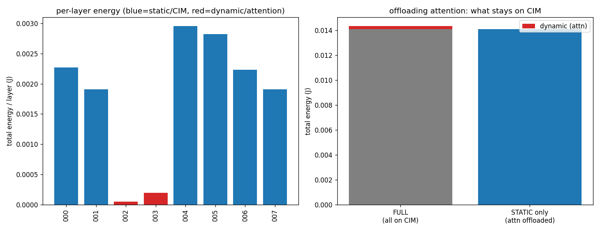

# System-Level CIM Simulator — Feature Overview

> On top of **CiMLoop** (Timeloop + Accelergy + CiM extensions), we add the
> system-level factors it abstracts away, for the company's ReRAM CIM chip:
> **resident multi-die hierarchy, placement/topology-aware cost, crossbar-level
> analysis, LLM workload (sequence scaling + attention K/V write + KV-cache),
> latency modeling, and value-dependent energy correction**. Most additions are
> **decoupled overlays** that do not touch the Timeloop core; uncalibrated numbers
> are placeholders.
>
> **Reading order:** §0 motivation → §1–5 feature modules → §6–7 whole-GPT-2
> results + communication stats → §8 modeling assumptions & limitations →
> §9–10 reference (parameter table / script index).

---

## 0. The gaps we close

| Dimension | CiMLoop default | Consequence / our fix |
|---|---|---|
| **Physical position** | Topological, no coordinates/distance | Near/far layouts cost the same → distance overlay (§2). ⚠️ Measured: at today's parameters it **moves neither energy nor latency** — see §6.3 |
| **Latency / time** | Only cycles, interconnect assumed infinitely fast | System latency under-counted → latency modeling (§5) |
| **Attention write** | QK^T/AV as plain matmuls | Ignores writing K/V every inference → write cost/latency (§4.2/§5). **Currently the only source of a material difference (decode latency 10.12×)** |
| **Weight residency** | Streams weights from DRAM by default | Wrong for ReRAM (non-volatile, resident) → resident multi-die (§1) |
| **Value-dependent energy** | Uses that layer's `histograms` | Synthetic workload once reused another layer's dist. → inject per model (§4.5) |

---

## 1. Hardware model: package → die → macro → core → crossbar (weights resident)

```
package (ws_chip2chip_link: die-to-die link, weights resident, no weight-DRAM streaming)
 └ die × N            N≈18 (4-bit) / 36 (8-bit); GPT-2 resident, 256-die package has ample room
    └ macro × 8
       └ core × 4
          └ crossbar × 8          = 256 crossbars / die
crossbar = the reused 256×256 4-bit ReRAM macro `wan_nature_2022`
```

- [`models/arch/3_chip/mlx_die.yaml`](../models/arch/3_chip/mlx_die.yaml) — die: 8 MB SRAM (`glb`) + 8 macros + inter-macro `router` + 4 cores/macro
- [`models/arch/2_tile/mlx_core.yaml`](../models/arch/2_tile/mlx_core.yaml) — core: local I/O buffer + 8 crossbars
- [`scripts/mlx_system.py`](../scripts/mlx_system.py) — hardware config + `LAYOUT`/`HOP_LATENCY_NS` + runners + `n_dies_for_weights()`

**Key: ReRAM weights are RESIDENT, not streamed.** ReRAM is non-volatile /
weight-stationary: weights are **programmed once and stay**, and are not rewritten
during inference (SET = 8520 ns + endurance limits). The top level is
`ws_chip2chip_link` (**no weight DRAM, only activations flow die-to-die**), not
`fetch_weights_lpddr4` (which re-streams weights every inference — an SRAM-CiM
assumption, wrong for ReRAM; it inflated energy ~36%/prefill, ~150×/decode). The
**only per-inference writes are attention K/V**.

**Capacity (why multiple dies are required):** GPT-2 medium has **302M** weights;
one die = 8.4 MB = **16.8M 4-bit weights** → needs **18 (4-bit) / 36 (8-bit) dies
resident**; a single layer (12.6M) fits on one die.

---

## 2. Placement / topology-aware cost (energy)

CiMLoop communication = `volume × fixed per-word energy`, **position-invariant**.
We overlay distance:

- [`scripts/placement_aware.py`](../scripts/placement_aware.py) — `perceive →
  placement prior → distance model → re-aggregate`. Priors (`place_grid`/
  `place_linear`) and patterns (`to_center`/`tree`/`all_to_all`/`neighbor`) are
  pluggable. Key explicit assumption is `reference_hops`; **relative** comparisons
  are robust, absolute values depend on it. Distance acts only on interconnect,
  never compute/storage.
- [`scripts/crossbar_comm.py`](../scripts/crossbar_comm.py) — decomposes aggregate
  traffic into **per-pair** (node↔node) flows: a nested floorplan gives each
  crossbar coordinates, and walking the multicast/reduction tree yields
  `(src→dst, volume, distance)`, giving **per-crossbar cost that varies by
  position** + a heatmap.

**Result** — same volume, cost varies ~**3.58×** by position:


---

## 3. Crossbar-level analysis

**Tool:** [`scripts/crossbar_stats.py`](../scripts/crossbar_stats.py) — per-crossbar
compute/weight/input/output (average), per-level bus traffic, and the
mapping-parsed communication structure (multicast/reduction/bit-slice); the
per-pair flows (§2/§7) use it as input.

But averages hide per-crossbar variation. Crossbars actually differ for two
reasons: **physical position** (communication cost, §2/§7, 3.58×) and **the
operand distribution each one sees** (value-dependent energy, below).

### 3.1 Per-crossbar value-dependent energy (real per-tile re-simulation)

**Question:** each crossbar holds a different weight tile and sees a different
input slice — does its energy differ as a result?

**Method** ([`scripts/crossbar_value_real.py`](../scripts/crossbar_value_real.py),
two-stage to avoid a torch/timeloop segfault): load **real weights** (GPT-2 medium
/ resnet18) + **real forward activations**, tile the weight [C×M] into 256×256
crossbar blocks, and **re-run CiMLoop's single-crossbar energy per block** with that
block's own weight+input histogram, then sum. Energy is nonlinear in the
distribution, so this is a genuine per-crossbar simulation, not a redistribution of
the total.

**Result (2×2, device × workload):**


| per-crossbar spread | GPT-2 ffn1 (LayerNorm) | resnet18 conv (ReLU-sparse) |
|---|---|---|
| **wan** (bit-serial) | 1.000× | 1.002× |
| **raella** (value-sensitive) | 1.010× | **1.204×** |

**Findings:**
1. **Device decides it.** wan/wang/basic are **bit-serial** — energy is set by
   precision / phases / ADC steps, not values → per-crossbar ≈ 0 for any workload.
   **raella (ISCA'23)**, built to exploit bit/value sparsity, is value-driven → a
   real spread.
2. **Input heterogeneity is the workload lever.** On raella, the CNN (no LayerNorm,
   ReLU-sparse inputs whose channel blocks are 80–91% zeros) spreads **1.204×
   (20%)**; GPT-2 (LayerNorm homogenizes channels) only 1.010×. The spread is along
   the contraction ROW block (which 256 input channels a crossbar sees), not the
   weight column — weight distribution barely matters (~1% even at extremes).
3. So **per-crossbar value-dependent energy is only worth modeling on a
   value-sensitive device with heterogeneous inputs.** Whether it matters for the
   company chip hinges on its device class (plain bit-serial MAC vs value/bit-
   sparsity-exploiting).

(A lightweight switchable mode [`crossbar_value.py`](../scripts/crossbar_value.py)
`run_op(value_mode="uniform"|"per_crossbar")` does a fast activity-scaled
attribution; the real answer above comes from the per-tile re-simulation.)

---

## 4. LLM workload modeling

[`scripts/llm_workload.py`](../scripts/llm_workload.py) generates the 6 ops of a
GPT transformer block, with shapes scaled by **S** and **phase**; each op is still
a normal die-hierarchy run, so it composes with crossbar_stats/crossbar_comm/
placement_aware.

### 4.1 Sequence-length scaling
attention (QK^T/AV) ∝ S², FFN/projections ∝ S → attention is no longer artificially small.


### 4.2 Attention write cost
QK^T/AV are activation×activation → K/V must be **programmed into ReRAM** every
inference, not amortized. Overlay `write_cells × E_WRITE_PER_CELL_J` (energy) and
`write_rows × T_SET_NS` (latency), both derived from the one append geometry in §5.

> **Measured verdict: this term matters in latency, not energy.** Whole-model write
> energy is 2.52e-3 J (prefill) / **4.9e-6 J** (decode, ~0.9% of decode energy), but
> write latency is **65.4 ms** (prefill) / **13.3 ms** (decode, **90% of decode
> latency**). The SET pulse is 8520 ns — very long — while the per-cell programming
> energy is tiny.

### 4.3 KV-cache (decode)
Each step reads the whole KV-cache: read ∝ G² (dominant), write ∝ G.


### 4.4 Static vs dynamic (offload)
ReRAM is weight-stationary — good for static weights (FFN/projections); dynamic
attention is the offload candidate.


### 4.5 Value-dependent energy correction (model-matched histograms)
CiMLoop energy is **data-value-dependent**: each layer's `histograms` set the ReRAM
analog current / ADC / cell conduction → energy. The synthetic workload once reused
ResNet's distribution; now [`scripts/value_stats.py`](../scripts/value_stats.py)
**injects per simulated model + op type** (change model → change `hist_source`), no
leakage.

---

## 5. Latency modeling

Latency structure ≠ energy: energy **sums**, latency is a **critical path** (max over
parallel, sum over serial). Three parts:

| Part | Source | Mechanism |
|---|---|---|
| compute + bandwidth stall + IO | Timeloop native cycles | insufficient bandwidth → stall → cycles↑ (`bandwidth_limiter` is this knob) |
| distance propagation latency | overlay `position_aware_latency` | `hops × hop_latency_ns`, serial across phases, max over parallel |
| ReRAM write latency | overlay `write_latency_s` | SET 8520 ns serial **per wordline**, before compute; pulse count = the number of **rows** the write touches (`Op.write_rows`, below) |

**The axis asymmetry of the K/V append** (energy and latency derive from one geometry,
in `block_ops`): the K/V arrays are resident and **append-only** — prefill programs all
S tokens, decode adds only the new one. But the two ops append along different axes:

| op | weight shape | decode adds a token | write cells | SET pulses |
|---|---|---|---|---|
| `qk^t` | K^T: `dh(rows) × S(cols)` | a new **column** | dh | **dh = 64** (spread over 64 wordlines) |
| `av` | V: `S(rows) × dh(cols)` | a new **row** | dh | **1** (one shared wordline) |

→ decode vs prefill: **write energy ↓512×, but write latency only ↓5×**. This is
directly why decode ends up write-latency-dominated.

> ⚠️ **Retracted:** an earlier claim here — "give the router a finite bandwidth →
> latency balloons 75×–1200×" — **has no traceable source** (no script or result file
> in the repo produces it), and has been removed. **The mechanism is real but is not
> currently active**: the router's `Read/Write bandwidth` are both **unset** and the
> stats report `Bandwidth throttling = 1.00`, i.e. **the present configuration produces
> no stalls at all** — which is also why our latency is distance-insensitive (§6.3).
> Reviving the claim requires an `analyze_bandwidth_sweep.py`.

**Energy vs latency view** (single block):


| phase | attention share (energy) | attention share (latency) | write latency of block |
|---|---|---|---|
| prefill S=512 | 33.7% | **35.6%** | 21% |
| decode S=512 | 33.7% | **93.3%** | **90%** |

> In prefill, FFN/projections are still the single largest component (energy 66%) —
> at S=512 the transformer is FFN-heavy, which is normal. **The decode split is the
> revealing one: attention is only 33.7% of energy but 93.3% of latency** (write alone
> is 90%) — with weights resident the per-token compute collapses and the block is
> almost entirely that serial SET phase. **Energy and latency give opposite verdicts
> here.**

---

## 6. GPT-2 system-level search (whole-model three-way comparison, resident multi-die)

The whole GPT-2 (gpt2-medium, 24 layers) runs on the resident multi-die hierarchy,
three scenarios:

- **(C) baseline** — raw CiMLoop, no overlays;
- **(A) full + overlays** — + position-aware comm + distance latency + ReRAM write energy & latency;
- **(B) offload** — only static ops on chip, dynamic attention offloaded.

### 6.1 prefill (S=512, ×24 layers)


| Scenario | Energy | Latency |
|---|---|---|
| (C) baseline CiMLoop | 0.284 J | 0.249 s |
| (A) full + overlays | 0.288 J (**1.01×**) | **0.315 s** (1.26×) |
| (B) offload attention | 0.191 J | 0.203 s |

Overlays reveal (A vs C): **energy +1%, latency +26%** (A−C = 0.0655 s, **exactly the
65.4 ms of write latency**); offload benefit (A vs B): saves **34% energy, 36% latency**.

### 6.2 decode (S=512, ×24 layers, single generation step)


| Scenario | Energy | Latency |
|---|---|---|
| (C) baseline CiMLoop | 5.60e-4 J | 1.46 ms |
| (A) full + overlays | 5.66e-4 J (**1.01×**) | **14.8 ms (10.12×)** |
| (B) offload attention | 3.75e-4 J | 0.987 ms |

With weights resident the per-token compute is tiny, so the **ReRAM K/V write becomes
the absolute dominant term — but only in latency**: A/C latency is **10.12×** (A−C =
13.3 ms, exactly the write latency), while A/C energy is only **1.01×**. **Offload saves
34% energy, 93% latency.**

### 6.3 Conclusions
> - **The headline is a latency result, not an energy result.** The baseline's **energy
>   is essentially right** (1.01× in both phases): on this device **~96% of energy is
>   analog compute + ADC**, and the entire on-die network is **0.12%** (measured on
>   ffn1: router + chip2chip = 1.38e-6 + 1.84e-6 J; the GLB is a further 4.1%). Neither
>   distance nor the write can move the total.
> - **The baseline's latency is wrong**: it **does not model the ReRAM SET write at
>   all**, so **decode is under-counted 10.12×**; the write is **90% of decode latency**.
>   This term depends on no calibration choice — it is a missing cost, not a re-priced
>   one.
> - **For generation-heavy decode, offloading attention pays off enormously — on
>   throughput grounds, not energy** (latency −93%, energy only −34%).
> - **Position-awareness moves neither total at today's placeholder parameters**: energy
>   because communication is 0.12%; latency because the distance term is **0.006%
>   (prefill) / 0.13% (decode)** (measured: `dist_latency` totals just 1.96e-5 s for the
>   whole model). **This is an honest negative result**: within-die placement is not an
>   energy lever on this device. Making it bite needs two things we don't have — per-level
>   **link bandwidths** (a link with no bandwidth cap can never stall) and **D2D costs**.
>   What the position model gives today is the ability to **see** differences that are
>   structurally invisible to a position-blind model (3.58×, 17.8%, 21.7× across
>   patterns), which is exactly what a placement search consumes — a search needs
>   **rankings**, not absolutes.
> - Judge offload by **A vs B** (B vs C is apples-to-oranges).

### 6.4 Where to see the mapping-search result
Every op goes through the Timeloop **mapper search** (config `models/include/mapper.yaml`:
objective **EDP**, `random_pruned`, up to **10,000** valid mappings per op, stop after
100 with no improvement, single-thread reproducible). **The chosen best mapping is in
`gpt2_system_mappings_{prefill,decode}.txt`** — each op's loop nest (how P/C/M are
tiled and spread over package→die→macro→core→crossbar→columns/rows, `Spatial-X/Y` =
spatial parallelism) is the search's output.

---

## 7. Per-pair communication stats files (auto-saved every run) + analysis

Every `run_op` auto-saves `analysis/comm/<op>_<phase>_comm.{csv,json}`, decomposing
aggregate bus traffic into **every `crossbar↔core↔macro↔glb` link**'s volume +
physical distance.

### 7.1 File contents and example
Down/up is a **three-level tree**: `glb → 8 macros → 32 cores → 256 crossbars`, so
each op has **296 edges** = 8+32+256.

**CSV** (one line per link, example `qk^t` prefill):
```
level,           src,   dst,     volume_words, distance_hops, volume_x_distance
glb<->macro,     glb,   macro2,  28835840,     12.0,          346030080   ← far-corner macro
glb<->macro,     glb,   macro4,  28835840,     1.5,           43253760    ← near-center macro
macro<->core,    macro0,core0.0, 7208960,      3.0,           21626880
core<->crossbar, core0.0,xb4,    901120,       0.25,          225280
```
**JSON**: hierarchy shape + all flows + **per-crossbar cost** (id/coord/cost) +
position-spread summary (`per_crossbar_cost: {min: 4.28e6, max: 1.53e7,
max_over_min: 3.58}`; cheapest `id=132@(7,7)` near center, most expensive
`id=66@(14,0)` far corner).

### 7.2 Three key findings
1. **Position spread 3.58×**: same volume, corner crossbars cost 3.58× the center
   (the crossbar-aware core effect).
2. **Distance-weighted cost concentrates at the top level**: volume is conserved per
   level (ffn1: 637M words each), but `volume×distance` is **~65%** at `glb↔macro`,
   ~25% at `macro↔core`, ~10% at `core↔crossbar` → **distance-reduction gains are
   mainly at the top `glb↔macro` interconnect**.
3. **prefill is on-die-NoC-dominated; decode communication is tiny overall** (no
   weight traffic once resident); die-to-die activation is far below on-die traffic
   and is **not the bottleneck**:

| Interconnect (model total) | prefill (all ops) | decode (all ops) |
|---|---|---|
| router (on-die NoC) | 13.1 G | 25.7 M |
| glb (on-die SRAM) | 8.25 G | 16.1 M |
| chip2chip (die-to-die, native) | 5.03 G | 9.83 M |
| die-to-die activation (logical, inter-layer hidden state) | 12.1 M | 23.5 K |

---

## 8. Modeling assumptions & limitations (know these before calibration)

The current simulation is **per-op search + 1 layer/die without packing + one weight
distribution per op type** — three clear placeholder simplifications:

1. **Per-op search, not cross-layer/cross-die joint.** Each op is EDP-searched to
   optimum independently, then aggregated; **the layer→die placement is our
   assumption, not searched.** Timeloop does no layer fusion / global schedule.

2. **1 layer/die, leftover capacity unused.** Each op uses only one die's 256
   crossbars (`chip_in_system.meshX=1`); ffn1 weights fill ~26% of a die, and the
   **rest is idle — we do not pack the next layer in.** → die count = `n_layers=24`,
   **conservative (over-provisioned)**; real capacity packing (~4 layers/die) needs
   only ~6–8 dies.

3. **Oversized layers not handled.** If a layer > 1 die (larger model / higher
   bit-width) the current setup is insufficient; set `chip_in_system.meshX > 1` to
   spread one op spatially across dies (arch supports it, not yet exercised). Every
   GPT-2 medium layer fits, so this is untriggered.

4. **Value-dependent distribution granularity:** across layers, one averaged
   distribution each for static/dynamic (all 24 layers' static ops share one).
   Within a layer, the real **per-crossbar** variation was verified with real
   weights + activations (§3.1): it is **device-dependent** — bit-serial (wan) ≈ 0,
   value-sensitive (raella) + heterogeneous inputs (CNN) up to 1.204×. So whether
   per-crossbar value modeling is needed depends on which class the company device is.

5. **Topology / bit-width / hop costs are all placeholders** (see §9), pending company
   parameters.

**Relaxation roadmap (by value):** ① capacity packing (realistic die count) →
② oversized layers across dies (`meshX>1`). (Per-crossbar value distribution already
verified, see §3.1.)

---

## 9. Placeholder parameters (pending company calibration)

| Parameter | Placeholder | Origin | Affects |
|---|---|---|---|
| `E_WRITE_PER_CELL_J` | 1.0e-10 J | wan SET ~100pJ | attention write energy |
| `T_SET_NS` | 8520 ns | wan SET pulse | attention write latency (bottleneck) |
| `E_DRAM_PER_WORD_J` | 5.0e-11 J | typical DRAM | KV-cache energy |
| `HOP_LATENCY_NS` | 1–5 ns/hop | placeholder | on-die distance latency |
| `DIE_HOP_LATENCY_NS` | 20 ns/hop | placeholder | die-to-die latency |
| per-level `bandwidth` | placeholder | — | compute/IO latency (very sensitive) |
| `reference_hops` | 1.0 | placeholder | distance-energy absolute value |
| histogram source | `gpt2_medium` | real workload | value-dependent energy |
| weight bit-width / layer→die | 4-bit / 1 layer per die | placeholder | die count, die-to-die volume |

---

## 10. Script index

| Script | Purpose |
|---|---|
| `mlx_system.py` | hardware config (resident multi-die) + LAYOUT + runners + `n_dies_for_weights` |
| `placement_aware.py` | distance overlay: energy (`position_aware_cost`) + latency (`position_aware_latency`) |
| `crossbar_stats.py` | per-crossbar stats + communication structure + `hierarchy()` |
| `crossbar_comm.py` | per-pair flows + heatmap + geometry hops + `save_flows()` (auto-dump) |
| `llm_workload.py` | sequence scaling + write cost/latency + KV-cache + die-to-die + histogram injection |
| `value_stats.py` | general value-histogram loader (by model / layer type) |
| `crossbar_value.py` | fast activity-scaled per-crossbar value energy mode (uniform / per_crossbar) |
| `crossbar_value_real.py` | REAL per-crossbar value-energy pipeline (real weights+activations, per-tile re-simulation; two-stage) |
| `analyze_gpt2_offload.py` | GPT-2 static/dynamic offload analysis |
| `analyze_energy_vs_latency.py` | energy vs latency view chart |
| `analyze_system_gpt2.py` | whole GPT-2 system-level three-way comparison, args `[S] [phase]` |
| `analyze_crossbar_value_compare.py` | device × workload 2×2 per-crossbar energy comparison (§3.1) |

```python
from scripts import llm_workload as lw
res = lw.run_block(lw.GptConfig(), S=512, phase="prefill")   # or "decode"
lw.report_block(res, title="prefill S=512")                  # energy + latency tables
```
```bash
python3 scripts/analyze_system_gpt2.py 512 prefill    # whole-model system-level (or 512 decode)
```
