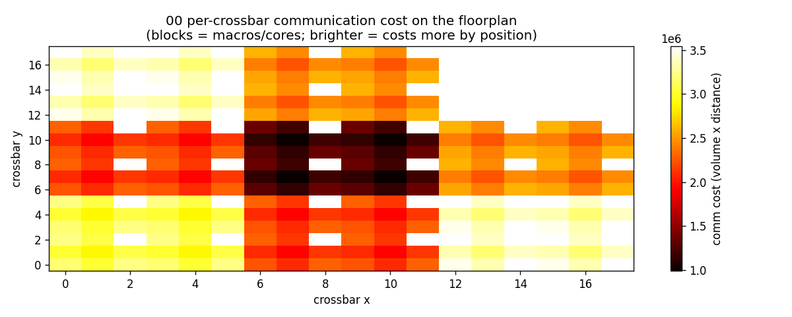
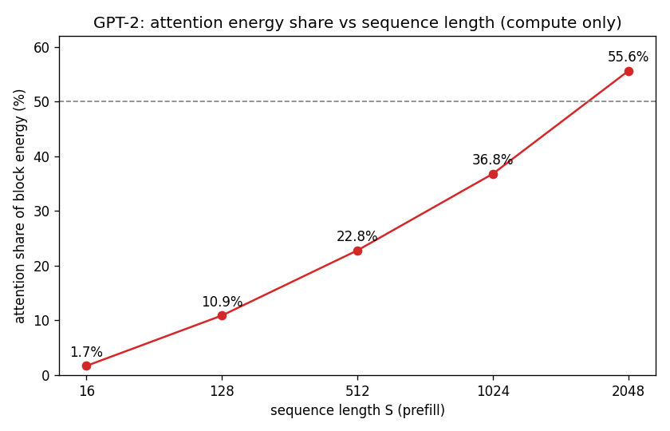
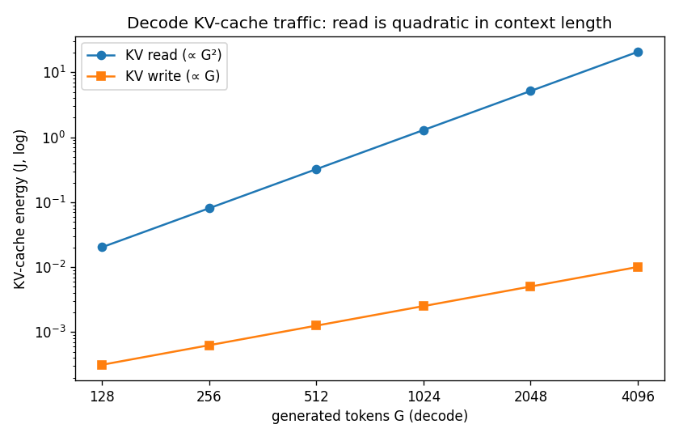
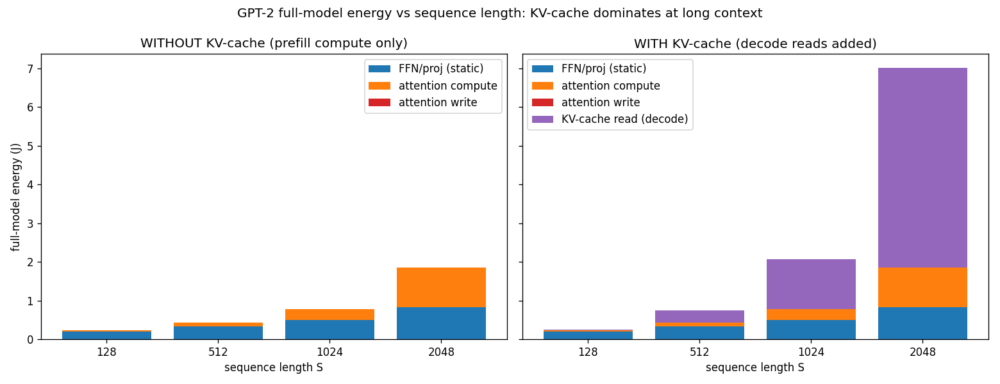
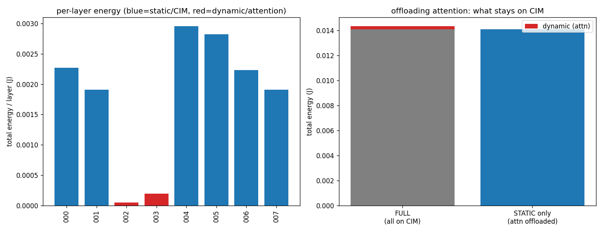
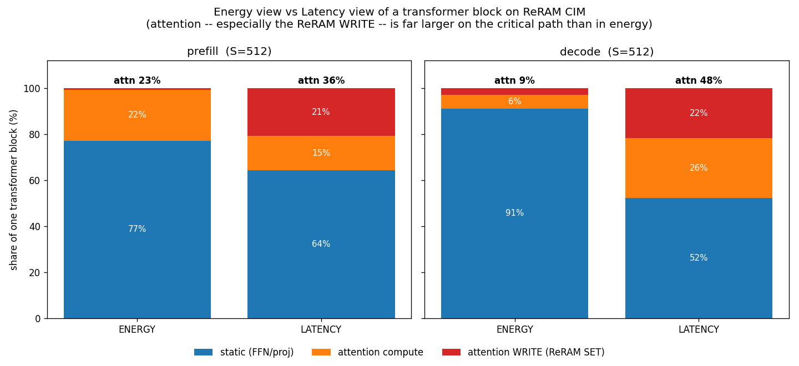
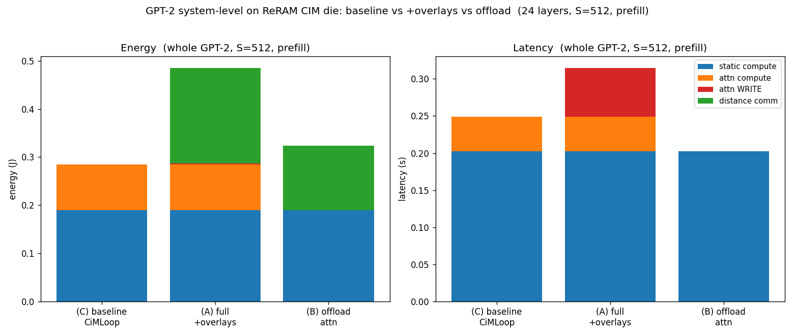
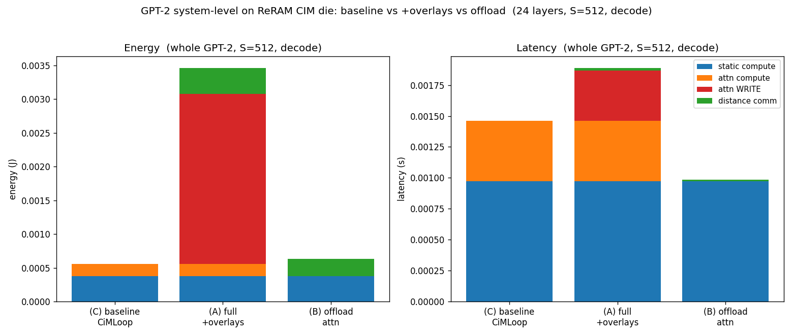

# 系统级 CIM 模拟器 — 功能总览

> 在 **CiMLoop**（Timeloop + Accelergy + CiM 扩展）之上,为公司 ReRAM CIM 芯片
> 叠加 CiMLoop 抽象掉的系统级因素:**多 die 常驻层级、布局/拓扑感知成本、
> crossbar 级分析、LLM 工作负载(序列缩放 + attention 写代价 + KV-cache)、
> 延迟建模、value-dependent 能量校正**。改动多为**解耦 overlay**,不动 Timeloop
> 内核;参数未校准处均为占位。
>
> **阅读顺序**:§0 动机 → §1-5 各功能模块 → §6-7 GPT-2 整模型结果 + 通信统计
> → §8 建模假设与局限 → §9-10 参考(参数表 / 脚本索引)。

---

## 0. 要解决的 gap

| 维度 | CiMLoop 默认做法 | 后果 / 我们的修正 |
|---|---|---|
| **物理位置** | 拓扑式,无坐标无距离 | 远近布局成本相同 → 加距离 overlay(§2) |
| **延迟 / 时间** | 只算 cycles,互连默认无限快 | 系统级延迟被低估 → 加延迟建模(§5) |
| **attention 写** | QK^T/AV 当普通矩阵乘 | 忽略每次推理写 K/V → 加写代价/写延迟(§4.2/§5) |
| **权重驻留** | 默认从 DRAM 流式取权重 | 对 ReRAM 是错的(非易失、常驻)→ 改常驻多 die(§1) |
| **数值相关能量** | 用该层 `histograms` | 合成负载曾误用别层分布 → 改按模型注入(§4.5) |

---

## 1. 硬件模型:package → die → macro → core → crossbar(权重常驻)

```
package (ws_chip2chip_link:die 间链路,权重常驻,无权重 DRAM 流式)
 └ die × N            N≈18(4-bit)/36(8-bit);GPT-2 常驻,256-die 封装绰绰有余
    └ macro × 8
       └ core × 4
          └ crossbar × 8          = 256 crossbar / die
crossbar = 复用的 256×256 4-bit ReRAM macro `wan_nature_2022`
```

- [`models/arch/3_chip/mlx_die.yaml`](../models/arch/3_chip/mlx_die.yaml) — die:8 MB SRAM(`glb`)+ 8 macro + inter-macro `router` + 4 core/macro
- [`models/arch/2_tile/mlx_core.yaml`](../models/arch/2_tile/mlx_core.yaml) — core:本地 I/O buffer + 8 crossbar
- [`scripts/mlx_system.py`](../scripts/mlx_system.py) — 硬件配置 + `LAYOUT`/`HOP_LATENCY_NS` + 运行器 + `n_dies_for_weights()`

**关键:ReRAM 权重常驻,不流式**。ReRAM 非易失、weight-stationary:权重**编程一次即常驻**,推理不重写(SET 8520ns + 寿命限制)。顶层用 `ws_chip2chip_link`(**无权重 DRAM,只有激活在 die 间流动**),而非 `fetch_weights_lpddr4`(每次推理流式取权重——SRAM 模式,对 ReRAM 错,曾使能量虚高 ~36%/prefill、~150×/decode)。**每次推理唯一要写的就是 attention K/V**。

**容量(为什么必须多 die)**:GPT-2 medium 权重 **302M**;一个 die = 8.4 MB = **16.8M 个 4-bit 权重** → 需 **18(4-bit)/36(8-bit)个 die 常驻**;单层(12.6M)放得下 1 个 die。

---

## 2. 布局 / 拓扑感知成本(能量)

CiMLoop 通信 = `volume × 固定每字能量`,**位置无关**。叠加距离:

- [`scripts/placement_aware.py`](../scripts/placement_aware.py) — `perceive → 布局先验 → 距离模型 → 重新聚合`。先验(`place_grid`/`place_linear`)与模式(`to_center`/`tree`/`all_to_all`/`neighbor`)可插拔。关键显式假设 `reference_hops`;**相对**比较稳健,绝对值依赖它。距离只作用于互连,不碰计算/存储。
- [`scripts/crossbar_comm.py`](../scripts/crossbar_comm.py) — 聚合流量拆成**逐对**(node↔node)流:嵌套 floorplan 给每 crossbar 坐标,沿多播/归约树生成 `(src→dst, volume, distance)`,得**随位置变化的逐 crossbar 成本** + 热力图。

**结论图** — 同样流量,成本随位置变化约 **3.58×**:



---

## 3. Crossbar 级统计

- [`scripts/crossbar_stats.py`](../scripts/crossbar_stats.py) — 单 crossbar 计算/权重/输入/输出(平均)、各级总线流量、从 mapping 解析的**通信结构**(多播/归约/bit-slice)。逐对流量以它为输入。

---

## 4. LLM 工作负载建模

[`scripts/llm_workload.py`](../scripts/llm_workload.py) 生成 GPT transformer block 的 6 个 op,形状随 **S** 和 **phase** 缩放;每个 op 仍是一次正常 die 层级运行,可与 crossbar_stats/crossbar_comm/placement_aware 联动。

### 4.1 序列长度缩放
attention(QK^T/AV)∝ S²,FFN/投影 ∝ S → attention 不再恒小。


### 4.2 attention 写代价(能量)
QK^T/AV 是 activation×activation → K/V 每次推理**编程进 ReRAM**,不摊销。叠加 `write_cells × E_WRITE_PER_CELL_J`。

### 4.3 KV-cache(decode)
每步读整个 KV-cache:读 ∝ G²(主导),写 ∝ G。



### 4.4 静态 vs 动态(offload)
ReRAM weight-stationary,宜静态权重(FFN/投影);动态 attention 宜 offload。


### 4.5 value-dependent 能量校正
CiMLoop 能量**数值相关**:每层 `histograms` 决定 ReRAM 模拟电流/ADC/导通 cell → 能量。合成负载曾误用 resnet 分布;现由 [`scripts/value_stats.py`](../scripts/value_stats.py) **按被仿真模型 + op 类型**注入。**通用**:换模型只改 `hist_source`。修正 ~3%(见 §8 关于分布粒度的局限)。

---

## 5. 延迟建模

延迟结构 ≠ 能量:能量**求和**,延迟是**临界路径**(并行取 max、串行相加)。三部分:

| 部分 | 来源 | 机制 |
|---|---|---|
| 计算 + 带宽 stall + IO | Timeloop 原生 cycles | 带宽不足 → 插 stall → cycles↑(`bandwidth_limiter` 即此旋钮) |
| 距离传播延迟 | overlay `position_aware_latency` | `hops × hop_latency_ns`,按相位串接、并行取 max |
| ReRAM 写延迟 | overlay `write_latency_s` | SET 8520ns 逐行串行,加在计算前;prefill 编程整个 C,decode 每步 1 行 |

**带宽实验**:router 设有限带宽 → 延迟随 `1/带宽` 线性暴涨(占位值下 75×–1200×)→ **延迟由瓶颈带宽主导,baseline 默认无限快 = 系统性低估**。

**能量 vs 延迟视角**(单 block):


| phase | attention 占比(能量) | attention 占比(延迟) | 写延迟占整块 |
|---|---|---|---|
| prefill S=512 | 22.8% | **35.6%** | 21% |
| decode S=512 | 8.9% | **47.8%** | 22% |

---

## 6. GPT-2 系统级搜索(整模型三方对比,常驻多 die)

整个 GPT-2(gpt2-medium,24 层)跑在常驻多 die 层级上,三场景:

- **(C) baseline** — 原始 CiMLoop,无 overlay;
- **(A) full + overlays** — + 位置感知通信 + 距离延迟 + ReRAM 写能量&延迟;
- **(B) offload** — 只留静态 op 在片上,动态 attention offload。

### 6.1 prefill(S=512,×24 层)


| 场景 | 能量 | 延迟 |
|---|---|---|
| (C) baseline CiMLoop | 0.284 J | 0.249 s |
| (A) full + overlays | **0.485 J**(1.71×) | **0.315 s**(1.26×) |
| (B) offload attention | 0.324 J | 0.203 s |

overlay 揭示(A vs C):能量 +71%、延迟 +26%;offload 收益(A vs B):省 **33% 能量、36% 延迟**。

### 6.2 decode(S=512,×24 层,单个生成步)


| 场景 | 能量 | 延迟 |
|---|---|---|
| (C) baseline CiMLoop | 5.60e-4 J | 1.46 ms |
| (A) full + overlays | **3.46e-3 J**(6.19×) | **1.89 ms**(1.29×) |
| (B) offload attention | 6.35e-4 J | 0.987 ms |

常驻后 decode 计算能量极小,**ReRAM 写(K/V)反成绝对主导**(A/C 能量 6.19×,图中红块);**offload 省 82% 能量、48% 延迟**。

### 6.3 结论
> - **residency 修复改写了 decode 图景**:旧"decode 是 DRAM-bound"是**流式假象**;常驻后 decode 计算塌到 ~0.56mJ,**attention K/V 写成主导**。
> - **能量视角低估 attention;延迟(尤其 decode)里写是主导**。判断 offload 看 **A vs B**(B vs C 是苹果比橘子)。
> - **decode 生成密集场景 offload attention 收益极大(能量 −82%、延迟 −48%)**。

### 6.4 mapping 搜索结果在哪看
每个 op 都走 Timeloop **mapper 搜索**(配置 `models/include/mapper.yaml`:目标 **EDP**、`random_pruned`、每 op 最多 **1 万个**合法 mapping、连续 100 无改进即停、单线程可复现)。**选中的最优 mapping 存在 `gpt2_system_mappings_{prefill,decode}.txt`**——每 op 的循环嵌套(P/C/M 怎么切、怎么铺到 package→die→macro→core→crossbar→列/行,`Spatial-X/Y`=空间并行)就是搜索的产物。

---

## 7. 逐对通信统计文件(每次运行自动保存)+ 分析

每次 `run_op` 后自动在 `analysis/comm/` 存 `<op>_<phase>_comm.{csv,json}`,把聚合总线量拆到**每条 `crossbar↔core↔macro↔glb` 链路**的流量 + 物理距离。

### 7.1 文件内容与实例
数据下发/汇聚是**三层树**:`glb → 8 macro → 32 core → 256 crossbar`,故每 op **296 条边** = 8+32+256。

**CSV**(每行一条链路,实例 `qk^t` prefill):
```
level,           src,   dst,     volume_words, distance_hops, volume_x_distance
glb<->macro,     glb,   macro2,  28835840,     12.0,          346030080   ← 远角 macro
glb<->macro,     glb,   macro4,  28835840,     1.5,           43253760    ← 近中心 macro
macro<->core,    macro0,core0.0, 7208960,      3.0,           21626880
core<->crossbar, core0.0,xb4,    901120,       0.25,          225280
```
**JSON**:层级形状 + 全部 flows + **逐 crossbar 成本**(id/坐标/cost)+ 位置离散度摘要
(`per_crossbar_cost: {min: 4.28e6, max: 1.53e7, max_over_min: 3.58}`;最便宜 `id=132@(7,7)` 近中心,最贵 `id=66@(14,0)` 远角)。

### 7.2 三个关键结论
1. **位置离散度 3.58×**:同样流量,边角 crossbar 比中心贵 3.58 倍(crossbar-aware 核心)。
2. **距离成本集中在顶层**:每级流量守恒(ffn1 每级 637M 字),但 `volume×distance` 在 `glb↔macro` 占 **~65%**、`macro↔core` ~25%、`core↔crossbar` ~10% → **降距离优化收益主要在顶层 glb↔macro**。
3. **prefill 片上 NoC 主导;decode 通信整体极小**(常驻后无权重流量);die 间激活远小于片上流量,**不是瓶颈**:

| 互连(模型总量) | prefill(全 op) | decode(全 op) |
|---|---|---|
| router(片上 NoC) | 13.1 G | 25.7 M |
| glb(片上 SRAM) | 8.25 G | 16.1 M |
| chip2chip(die 间,原生) | 5.03 G | 9.83 M |
| die 间激活(逻辑量,层间 hidden state) | 12.1 M | 23.5 K |

---

## 8. 建模假设与局限(校准前务必知道)

当前仿真是**逐 op 搜索 + 1 层/die 不打包 + 每 op 类型统一权重分布**——三个清晰的占位简化:

1. **逐 op 搜索,非跨层/跨 die 联合**:每个 op 各自在自己的空间里被 EDP 搜到最优再聚合;**层→die 放置是我们假设的,不是搜出来的**,Timeloop 不做层间融合/全局调度。

2. **1 层/die,用不完不打包**:每 op 只用 1 个 die 的 256 crossbar(`chip_in_system.meshX=1`);ffn1 权重只占 die 的 ~26%,**剩余容量闲置,不塞下一层**。→ die 数取 `n_layers=24`,**偏保守(高估)**;真实按容量打包(~4 层/die)只需 ~6-8 die。

3. **超大层未处理**:某层 > 1 die 时(更大模型/更高位宽)现在会不够;需把 `chip_in_system.meshX` 设 >1,让一个 op 空间性铺到多 die(arch 支持,尚未跑过)。GPT-2 medium 每层都装得下,暂未触发。

4. **value-dependent 分布三级简化**:
   - **层间**:静态/动态各一条平均分布(24 层静态 op 共用同一条);
   - **层内跨 crossbar**:统一 → 逐 crossbar 能量**对称、无差异**;
   - 理想:每层用自己的直方图、**每 crossbar 用自己那块权重的分布**(真正 crossbar-aware,需切真实权重张量)。层平均把极端抹平,所以 §4.5 修正只 ~3%。

5. **拓扑 / 位宽 / hop 代价等均为占位**(见 §9),等公司参数再校准。

**放松路线(按增值排序)**:① 逐 crossbar 分布(真正 crossbar-aware 能量)→ ② 容量打包(die 数变现实)→ ③ 超大层跨 die(`meshX>1`)。

---

## 9. 占位参数(待公司参数校准)

| 参数 | 占位值 | 出处 | 影响 |
|---|---|---|---|
| `E_WRITE_PER_CELL_J` | 1.0e-10 J | wan SET ~100pJ | attention 写能量 |
| `T_SET_NS` | 8520 ns | wan SET 脉宽 | attention 写延迟(瓶颈) |
| `E_DRAM_PER_WORD_J` | 5.0e-11 J | 典型 DRAM | KV-cache 能量 |
| `HOP_LATENCY_NS` | 1–5 ns/跳 | 占位 | 片上距离延迟 |
| `DIE_HOP_LATENCY_NS` | 20 ns/跳 | 占位 | die 间延迟 |
| 各级 `bandwidth` | 占位 | — | 计算/IO 延迟(极敏感) |
| `reference_hops` | 1.0 | 占位 | 距离能量绝对值 |
| 直方图来源 | `gpt2_medium` | 真实 workload | value-dependent 能量 |
| 权重位宽 / 层→die | 4-bit / 1 层每 die | 占位 | die 数、die 间量 |

---

## 10. 脚本索引

| 脚本 | 作用 |
|---|---|
| `mlx_system.py` | 硬件配置(常驻多 die)+ LAYOUT + 运行器 + `n_dies_for_weights` |
| `placement_aware.py` | 距离 overlay:能量(`position_aware_cost`)+ 延迟(`position_aware_latency`) |
| `crossbar_stats.py` | 逐 crossbar 统计 + 通信结构 + `hierarchy()` |
| `crossbar_comm.py` | 逐对流量 + 热力图 + 几何跳数 + `save_flows()`(自动落盘) |
| `llm_workload.py` | 序列缩放 + 写代价/写延迟 + KV-cache + die-to-die + 直方图注入 |
| `value_stats.py` | 通用 value 直方图加载器(按模型/层类型) |
| `analyze_gpt2_offload.py` | GPT-2 静态/动态 offload 分析 |
| `analyze_energy_vs_latency.py` | 能量 vs 延迟视角对比图 |
| `analyze_system_gpt2.py` | 整 GPT-2 系统级三方对比,传 `[S] [phase]` |

```python
from scripts import llm_workload as lw
res = lw.run_block(lw.GptConfig(), S=512, phase="prefill")   # 或 "decode"
lw.report_block(res, title="prefill S=512")                  # 能量表 + 延迟表
```
```bash
python3 scripts/analyze_system_gpt2.py 512 prefill    # 整模型系统级(或 512 decode)
```
